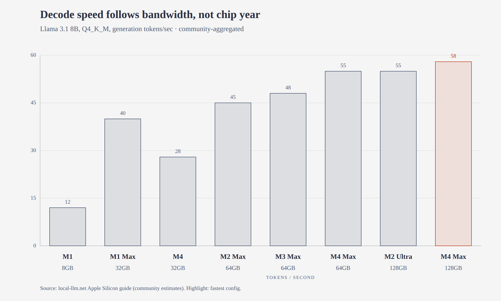
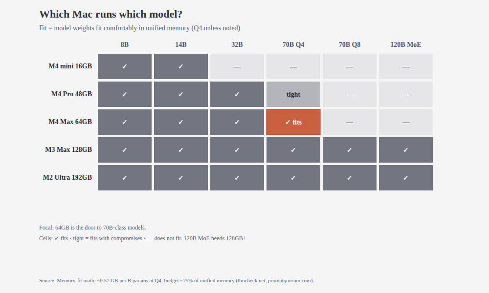
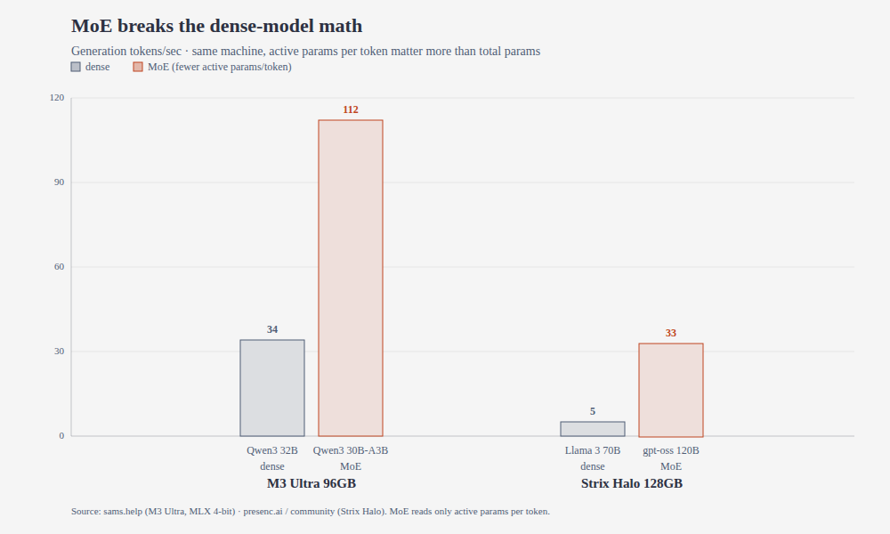

# 「小」電腦的大模型：strata 與 125B 參數的本地實驗

一個開源引擎、一顆統一記憶體，和一場關於「模型要多大才夠」的再思考

一名網友在社群平台貼出截圖：他的 Mac mini 風扇沒轉，終端機裡卻跑著 125B 參數的模型，每秒吐出 14 個 token，回答品質跟雲端版本分不出來。

我桌上這台電腦，到底能跑多大的 AI？

## 從一個三十天的 repo 說起

主角叫 strata，作者 niko1221 的個人開源專案，9 月 24 日才建立。截至 10 月 22 日的 GitHub 公開數據：30,027 顆星、3,197 次 fork、586 個未解決 issue——三十天三萬星，在開源圈是火箭速度。

它做的事一句話：把 125B 參數的 Qwen3.8-Flash-Next 跑在你家電腦上，還能偽裝成 OpenAI 或 Anthropic 的 API，讓 Claude Code、Codex 這些 coding agent 直接連上來用。NVIDIA、AMD、Intel、Apple Silicon 通吃，號稱一鍵安裝。

**三萬星。** **單一維護者。** **兩週十五版。**

這三句要並排讀。星星是社群用腳投票；但公開數據也顯示，2,630 次提交裡絕大多數出自作者一人——他病倒一天，專案就停擺一天。版本號從 v0.1.40 一路衝到 v0.2.2，兩週約十五版：進步神速，卻也代表你今天測的數字，換個版本未必對得上。

## 「125B」的代價：模型怎麼塞進 32GB

先把帳攤開。Qwen3.8-Flash-Next 是 Qwen 團隊 8 月 24 日釋出的實驗性預覽，模型卡稱它是「Qwen4 架構的前瞻實驗」（官方自述）。參數要這樣算：語言模型本體 125B，但每個 token 只啟動其中約 6B；外加 51B 的 n-gram 嵌入表和 4B 的推測解碼層，整個檔案約 180B。

換句話說，「125B」是名義體重，真正上場跑步的只有 6B。

這就是 MoE（混合專家）的玩法：48 層、每層 512 個小專家，每個 token 只請 10 個出來做事。strata 的引擎圍繞這個稀疏性蓋了三層記憶體，作者用圖書館打比方（以下出自作者技術文件，尚未見獨立驗證）：

**GPU 顯存是書桌。** 注意力計算、路由、KV 快取和最常用的專家放這裡；每多 1GB 顯存，大約多塞 700 個專家。

**系統記憶體是書架。** 全部 24,576 個專家釘在這裡，CPU 用 AVX 指令集在原地算那些沒進書桌的專家，跟 GPU 並行。

**SSD 是檔案庫。** 28.8GB 的 n-gram 對照表躺在這裡，每個 token 只讀幾行，走系統頁快取。

再疊兩層加速。模型自帶的 MTP 層做推測解碼：一次猜三個 token 再驗證，作者自述平均 1.6–1.8 倍加速、輸出與逐字生成完全一致。量化交給 ISTA-DASLab 的 GSQ-RCO：IQ3_XXS 據二手轉述，在多項評測拿到完整精度 99.4% 的分數，體積剩不到四分之一——這個數字出自第二手轉述，宜視為參考。

從 27.6GB 的 Gyro-S 到 136GB 的 Q8_0，官方文件列了一整條尺寸梯子。記住這句話，Mac 章節會回來：記憶體決定你能請多大的模型上桌。

## Mac 戰線：統一記憶體的甜蜜點

Mac 版只支援 M1 之後的 Apple Silicon，Intel Mac 被排除在外，系統要 macOS 15 以上（官方文件）。作者公布了三組自家實測（作者自述，尚未見獨立查證）：

M5 Max 配 128GB，模型整個放進記憶體：Q2_0 每秒 119.5 個 token；同機器的 llama.cpp 跑 56.6——將近兩倍。M4 Mac mini 配 32GB，專家從 SSD 串流：每秒 14.1 個 token。2021 年的 M1 Max 配 34GB：7.9。

圖 1 說的故事比數字本身有意思。它畫的是另一個模型（Llama 3.1 8B）在各 Mac 上的解碼速度，數據出自社群彙整：M1 Max 32GB 每秒 40 個 token，M4 32GB 只有 28——2021 年的晶片跑贏 2024 年的入門款。解碼速度吃的是記憶體頻寬，不是 CPU 年份：400GB/s 對上 120GB/s，帳就是這樣算的。

第二個故事是選購指南。社群實測歸納出一個反直覺的結論：記憶體買的是「能跑多大」，不是「跑多快」。同一顆晶片，16GB 和 32GB 跑同一個模型速度一樣；多出來的 GB 只決定你能不能把 70B 請上桌——70B 的 Q4 量化約 40GB 權重，64GB 是進門的門檻，128GB 才住得舒服（多家社群評測歸納）。

圖 2 是通用選購矩陣：16GB 到 14B，48GB 到 32B，64GB 解鎖 70B Q4，128GB 再開 70B Q8 與 120B MoE。買 Mac 跑本地大模型，先看記憶體，再看晶片。

第三個故事解釋 MoE 為什麼是統一記憶體機器的天作之合。同台 M3 Ultra，MoE 架構的 30B 模型每秒 112 個 token，dense 的 32B 只有 34——三倍多，因為每次只讀啟動的那幾個專家，頻寬花在刀口上（社群實測，sams.help）。AMD 的 Strix Halo 上更誇張：120B 的 MoE 跑 33，dense 的 70B 只剩 5。

## 快兩倍，然後呢？

strata 最響亮的口號是速度。作者自述：在 RTX 5070 配 64GB 記憶體的機器上，Q2_0 每秒 94 個 token，「比你閱讀速度還快」。第三方獨立測試目前只有一例：flowtivity.ai 十月在一台 RTX 4070 上測得 53.2，相較同機調校過的 llama.cpp 快約兩倍。

這個推論合理，但要放在比例尺上看：

- 快兩倍只成立於 Qwen3.8-Flash-Next 這個 MoE 家族。strata 是為它量身打造的專用引擎；llama.cpp 是通用引擎，模型廣度至今無人能及。你要跑的不是這個家族，strata 幫不上忙。
- 作者自述的數字多是開發者與用戶自述，方法學尚未統一——社群的標準測試流程還在草案階段，閱讀時宜留意。
- ollama、LM Studio 贏在簡單和模型多，但它們把整個模型載入記憶體；125B 這個量級，在「32GB 遊戲電腦」的信封裡根本裝不下。strata 的護城河不是 UI，是那個三層串流引擎。

## 動手之前：四個誠實提醒

**先看授權，風險最低。** 模型用的不是 MIT，是 Qwen Community 1.0：商用可以，但月活破億或月營收破 2,000 萬美元的產品要顯著標示模型名稱；拿它做「模型即服務」或 AI 助理生意，商用前要另行取得 Qwen 授權。strata 的程式碼是 MIT，模型不是開源軟體——這是兩本不同的帳（授權文件原文）。

**再看正確性。** 專案文件自述了一個已知問題：Coder 變體（為寫程式裁掉一半專家的版本）曾出現中文回答錯誤或鬼打牆，英文卻正常（issue #438）。寫程式之外的任務，它本來就比較弱。拿中文考它之前，先用英文驗一下水溫。

**然後是工程現實。** 586 個未解決 issue，多是各家顯卡核心的硬體特異問題；Windows 安裝程式沒有程式碼簽署，API 金鑰明文存在使用者目錄——專案文件自己都寫出來了。作者也聲稱更新走 Ed25519 簽章、引擎不含網路程式碼、預設只綁定本機（專案文件自述，尚未經獨立審計）。

**最後才是版本心態。** 兩週十五版，追新版的人要有「今天能跑、明天重測」的心理準備。當主力生產力工具，恐怕太早；當週末實驗，剛剛好。

## 你的電腦跑得動嗎

**先從記憶體看起，風險最低。** 對照官方文件的尺寸梯子：32GB 摸得到 Gyro-S（串流模式，約 9–14 tok/s）；64GB 是 Q2_0 的舒適區；要 IQ3_S 以上的品質，96GB 起跳。桌機顯卡看另一條線：12GB 顯存的 RTX 5070 配 64GB 記憶體，就是作者測出 94 tok/s 的那台——但注意，頭條速度和最低配備不會出現在同一台機器上。

**再選平台。** NVIDIA 最成熟，AMD 的 RX 9070 XT 也有作者實測（60 tok/s）；Mac 走 Metal 版，M1 以上、macOS 15 以上。Intel Mac，和不到 32GB 的統一記憶體，這次沒有位子。

**最後才是動手。** 官方一鍵安裝包按平台分好，裝完 `strata connect` 會直接吐出給 Claude Code、Codex、OpenCode 的設定。記得兩件事：Mac 版目前一次只能處理一個請求；筆電長時間跑，留意散熱。實際速度會因機型與散熱而異。

## 觀察：頻寬經濟學改寫了入場券

這個現象的核心，其實不在「免費的 GPT」，而在更老的問題：跑大模型的入場券，到底是算力，還是記憶體頻寬？

strata 的答案很具體：當模型學會「每次只啟動 6B」，頻寬就成了新的貨幣。統一記憶體的 Mac、AMD Strix Halo 這類「池子大、頻寬中等」的機器，突然從看客變成玩家——MoE 架構跟它們是天作之合，而這正是過去兩年本地 AI 圈沒人認真算過的帳。

接下來有三件事值得追蹤：Qwen4 正式版會不會延續這個 MoE 路線（strata 賭的是整個家族）；單一維護者撐不撐得住三萬星帶來的 issue 海嘯；以及 Apple 下一代晶片的記憶體頻寬開到多少——那直接決定你家下一台 Mac 能跑多大的模型。

至於「遊戲電腦跑 125B」會不會成為常態，還是只是這一季的社群熱話，目前無法下定論。

*說明：本文以 strata 專案的 README 與 docs 文件、Qwen3.8-Flash-Next 的模型卡與授權文件、GitHub 公開 API 數據（2026-10-22）為基礎，並補充 flowtivity.ai 的獨立測試與社群 bench 報告。三張圖表的底層數據分別出自：圖1 local-llm.net 社群彙整、圖2 記憶體配置估算（llmcheck.net、promptquorum.com 方法學）、圖3 sams.help 與 presenc.ai 社群實測。速度數字多為作者或社群自述，方法學尚未統一，宜視為參考；授權條款引自文件原文。實機測試未能執行（測試環境記憶體與顯卡未達最低需求），文中已註明。*
