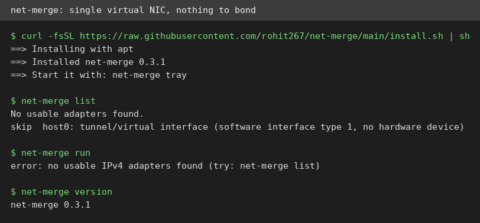
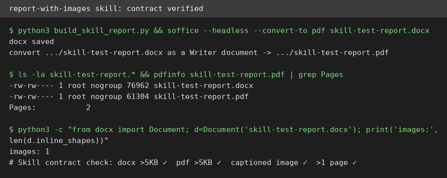
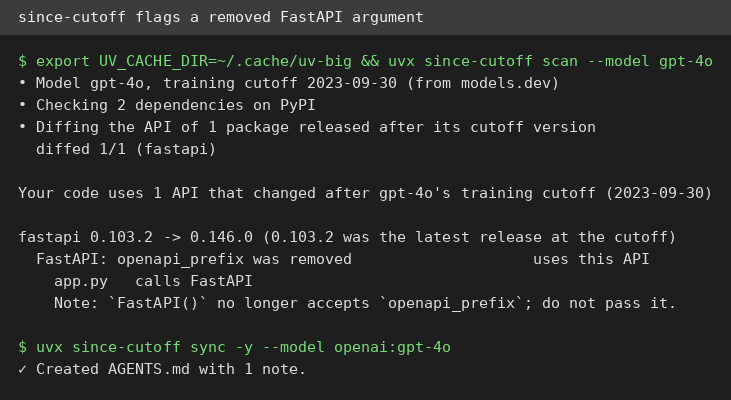

# AI Test Report — 2026-10-19

> A day of honest limits: the voice studio this VM couldn't lift, the network bonder with nothing to bond, two small tools that did exactly what they promised, and the clearest-eyed account yet of agents rebuilding Word.

## At a glance

- 🆕 **VoiceStudio**: a free voice-cloning app for your own computer, no cloud needed; installed cleanly, but this VM was too weak to actually run it (no score)
- 🆕 **net-merge**: combine Wi-Fi and phone internet into one faster pipe; installed in a minute, then honestly refused to run with a single network card ⭐3/5
- 🛠️ **report-with-images**: a 29-line recipe that turns agent research into a captioned DOCX and PDF; I ran it end to end and every check passed ⭐4/5
- 🔌 **since-cutoff**: catches library API changes your AI model never learned; flagged a real removed FastAPI argument in my test project ⭐4/5
- ✍️ **"wordcraft" teardown**: one person plus agents rebuilt Word in days; the honest numbers say 97% menu coverage but zero migrated users

---

## 🆕 Open-source project tests

### VoiceStudio — clone a voice on your own computer, no cloud, no subscription

- **In one sentence**: A free, open-source desktop app (an Electron app is a desktop program built with web technology, plus a Python backend that does the AI work) that clones voices, dubs video, and transcribes audio with local models, pitched as a local alternative to ElevenLabs (a paid cloud voice-AI service).
- **Why it caught my eye**: 75,453 stars and up about 3.5k this week, AGPL-3.0 (a license that keeps the code open), runs on CPU with no account and no API key, and it ships its own agent install guide with a verification checklist, rare honesty for a GUI app.
- **I tried it**:
  - Downloaded the official Linux .deb (v0.5.6, released 2026-09-23, 195 MB): `dpkg -i` needed one `apt-get install -f` for missing deps, then installed clean.
  - Inspected the install: Electron shell at `/opt/VoiceStudio` plus a Python FastAPI backend (a web framework for building APIs) with a bundled uv 0.12.13. The guide's API contract is real: `GET /models` routes exist in `api/routers/setup/models.py` and `api/routers/openai_compat.py`, backend on `localhost:3900`.
  - What surprised me: the agent guide tells the installer to verify the actual compute device and ask before any model download, stating size and license. The project expects to be tested.
- **The catch**: I could not run it. The Electron UI needs a display this VM doesn't have, and the backend needs a multi-gigabyte PyTorch download while the VM has about 1 GB RAM free and no swap, so CPU voice generation would almost certainly run out of memory. The voice cloning itself is untested; treat "runs on CPU" as hardware-dependent.
- **Try it if**: you're a video creator or podcaster with a real GPU (or a patient CPU) who wants voice cloning without a cloud subscription.
- **Skip it if**: you're on a weak machine or need it working today with no fuss: the first-run model downloads are heavy.
- **Score**: No score: install verified and API contract verified in source, but the actual voice cloning needs a display or a beefier machine than this VM.
- **Link**: https://github.com/debpalash/VoiceStudio

### net-merge — plug in Wi-Fi and your phone at once, get one faster connection

- **In one sentence**: A small system tool that bonds (combines) multiple network adapters, Wi-Fi plus Ethernet plus phone tethering, into a single faster pipe, with a tray icon showing per-adapter speed.
- **Why it caught my eye**: Created 2026-10-12, already 1,145 stars, MIT; it ships through its own signed apt repo, unusually polished distribution for a week-old tool.
- **I tried it**:
  - `curl -fsSL https://raw.githubusercontent.com/rohit267/net-merge/main/install.sh | sh`: installed net-merge 0.3.1 from the signed repo in under a minute.
  - `net-merge list`: "No usable adapters found", correctly skipping the VM's only interface as a virtual tunnel type. `net-merge run` exits 1 with "no usable IPv4 adapters found".
  - What surprised me: it doesn't fake it. With nothing to bond, it says so plainly and quits instead of pretending.
- **The catch**: the headline feature, bonding, is completely untestable on a single-NIC (single network card) VM. The README's demo number (about 326 Mbit/s bonded vs 121 Mbit/s on one link) is the project's claim, not mine.
- **Try it if**: you're on a laptop with Wi-Fi plus Ethernet (or phone tethering) and want them combined without router fiddling.
- **Skip it if**: you have one connection, like this VM: the tool will politely tell you there's nothing to do.
- **Score**: ⭐3/5: installs cleanly and fails honestly, but the core claim needs two real adapters I didn't have; interesting, not yet proven.
- **Link**: https://github.com/rohit267/net-merge

---

## ✍️ Tech article deep-dives

### "One person plus agents 'recreated' Word in five days": the most numbers-driven account of the agent software curve

- **Read this if**: you use coding agents and want to know what changes when one person can land 57,000 lines in three days, or you're curious how close the "clean-room Office clones" really are.
- **The argument in 3 bullets**:
  - The storytold org clean-room reimplemented (rewrote from scratch without reading the original's code) Word, Excel, PowerPoint, Photoshop, and AutoCAD in Rust in about two weeks: wordcraft alone drew 6,000 stars in five days, with 57,353 lines landed in three days and 581 PRs (proposed code changes) in one week, all orchestrated by agents.
  - The reusable value isn't the clone, it's the discipline: every feature is a command (one registry drives the ribbon menu, shortcuts, CLI, and MCP server alike); non-test code is forbidden from panicking (crashing); parity with Word is measured by tools (481 of 496 ribbon commands, 97%).
  - The honest accounting: 97% ribbon coverage is tool-measured, but "ready for real work" is the author's own estimate of about 60%, with zero users migrated from Word and 21 core-path bugs open. Coverage is not usability.
- **Why it matters to you**: the four practices (command registry, never-crash safety net, measured parity, one-command quality gates) transfer directly to any team letting agents write code today.
- **My take**: this is the rare AI-coding write-up that separates measured numbers from estimates and labels which is which; most "agents wrote X" stories don't. The cold water: one person plus agents also means one person maintaining 156,000 lines of flattened, history-squashed agent output, and the "will Microsoft sue over the copied UI" question is still unanswered.
- **Link**: https://kaelzhang.com/blog/wordcraft-clean-room-word-rust

---

## 🛠️ Agent skill tests

### report-with-images — one instruction turns research into a finished report with real captioned pictures ⭐4/5

- **In one sentence**: A 29-line agent skill (a reusable instruction file that steers an AI assistant) defining a pipeline: research a topic, find images, assemble a DOCX and PDF with every image captioned, then verify the output contract (both files over 5 KB, PDF longer than one page).
- **Why it caught my eye**: it sits right next to this report's own pipeline, and its pass/fail contract (file sizes, page count, captions) makes it testable without trusting vibes.
- **I tried it**:
  - Cloned `renatoschust-dot/gamai-skills` and read `skills/report-with-images/SKILL.md`: 29 lines, four pipeline steps, explicit output contract.
  - Followed it literally on a one-page brief about the since-cutoff test below: built the DOCX with python-docx (a Python library for Word files), embedded a local terminal screenshot with caption and source note, converted with LibreOffice.
  - Verification: docx 76,962 bytes, pdf 61,304 bytes, 2 pages, 1 captioned image. Every clause of the contract passed.
  - What surprised me: the skill is honest about failure: "If no image can be downloaded, deliver the document with a placeholder box and say so, never a broken image."
- **The catch**: the skill is a checklist, not automation: the agent does all the real work (research, image search, assembly). And the repo is a grab-bag of hundreds of skills at 0 stars, many looking like low-effort persona clones ("elon-musk", "sam-altman"): judge this file, not the collection.
- **Try it if**: you want a repeatable recipe for turning agent research into a presentable document with pictures.
- **Skip it if**: you expected one command to do it all: this skill tells the agent what to do, it doesn't do it for you.
- **Score**: ⭐4/5: the contract is real and every check passed; one star off because the heavy lifting stays with the agent.
- **Link**: https://github.com/renatoschust-dot/gamai-skills (skill: `skills/report-with-images/SKILL.md`)

---

## 🔌 MCP tests

### since-cutoff — warns you when your AI assistant's library knowledge is out of date ⭐4/5

- **In one sentence**: A command-line tool and MCP server (MCP is a standard that lets AI assistants use external tools) that diffs your pinned libraries against your AI model's training cutoff (the date its knowledge stops) and writes short correction notes into AGENTS.md (a file of instructions your coding agent reads).
- **Why it caught my eye**: 9 stars, created 2026-09-25, MIT; it attacks a real failure mode, models confidently using removed APIs, with static diffing, no model calls, no API key.
- **I tried it**:
  - `uvx` (a tool that runs Python packages without installing them) `since-cutoff --help`: installed 40 packages in 1.4s. Note: I set `UV_CACHE_DIR` to a roomy disk first, since this VM's `/tmp` is a 512 MB tmpfs.
  - `scan --model gpt-4o` on a demo project pinning fastapi 0.146.0: it diffed 0.103.2 (latest at the 2023-09-30 cutoff) against 0.146.0 and flagged one used API: `FastAPI()` no longer accepts `openapi_prefix`, naming the file that calls it. A full report landed in `.since-cutoff/report.md`.
  - `sync -y` wrote the note into AGENTS.md inside a marked block; the MCP server exposes 3 tools (`model_cutoff`, `api_changes`, `project_changes`) over stdio (verified with `tools/list`).
  - What surprised me: it flagged an API my code doesn't even use in the old form, reasoning an assistant might write it. Aggressive, but that's the point.
- **The catch**: 9 stars and a single maintainer; the model-cutoff table comes from models.dev (a community dataset), so a wrong cutoff date means wrong notes. Verify before trusting it on critical deps.
- **Try it if**: you let coding agents touch projects with fast-moving libraries and want a cheap, offline guardrail.
- **Skip it if**: your deps are pinned older than your model's cutoff anyway: there's nothing newer for it to find.
- **Score**: ⭐4/5: every command I ran did exactly what the docs said; one star held for the tiny track record and the third-party cutoff data.
- **Link**: https://github.com/MohammadHijjawi97/since-cutoff

---

## Notes

- **Draft pool**: the `drafts/` folder still doesn't exist in `williamchek/AI_test_drafts` (it holds only `pitches/` and `articles/`), so this edition sourced fresh again. The Monday scout runs today; its first output may change this.
- **VoiceStudio scope**: install verified plus API contract verified in source; voice cloning and generation untested (no display, about 1 GB RAM free, multi-gigabyte model download). The "runs on CPU" claim is hardware-dependent.
- **net-merge scope**: bonding untested (single virtual NIC); the tool correctly detected this and reported it instead of faking a result.
- **since-cutoff caveat**: 9 stars, single maintainer; cutoff dates come from the community models.dev dataset.
- **Editions**: no 2026-10-17 or 2026-10-18 reports exist in the repo (only the 14th through 16th); not backfilled in this run.
