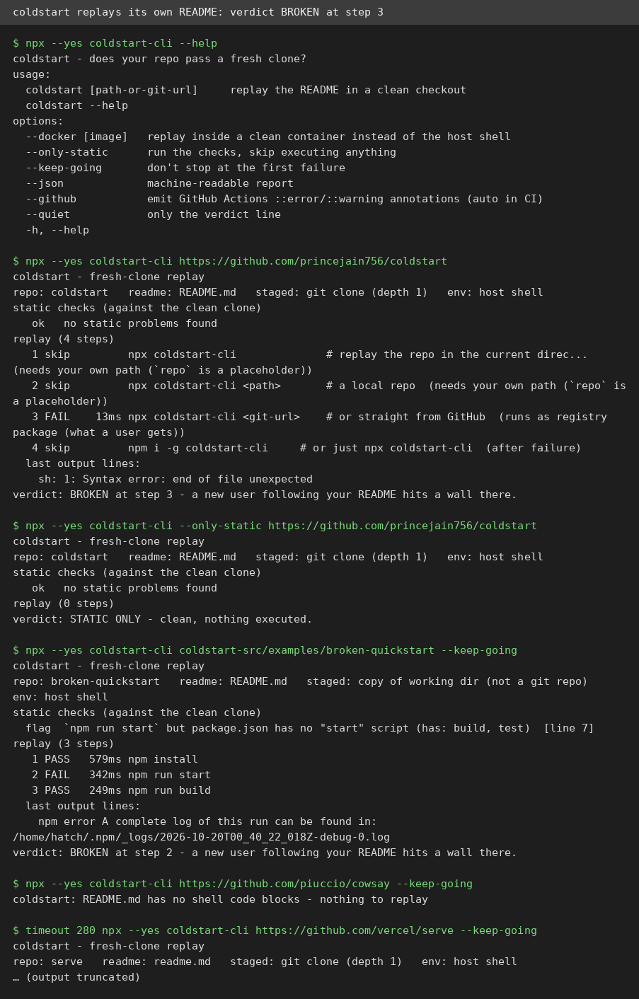
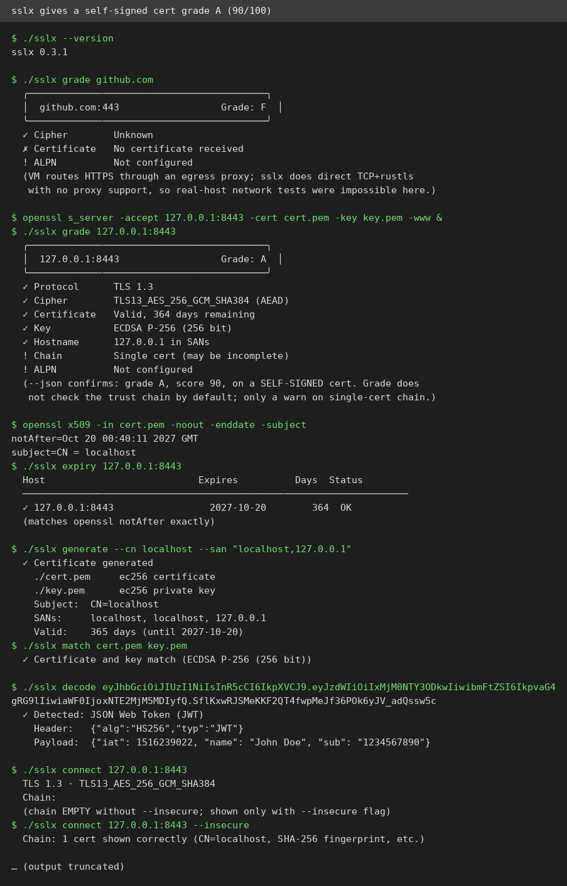
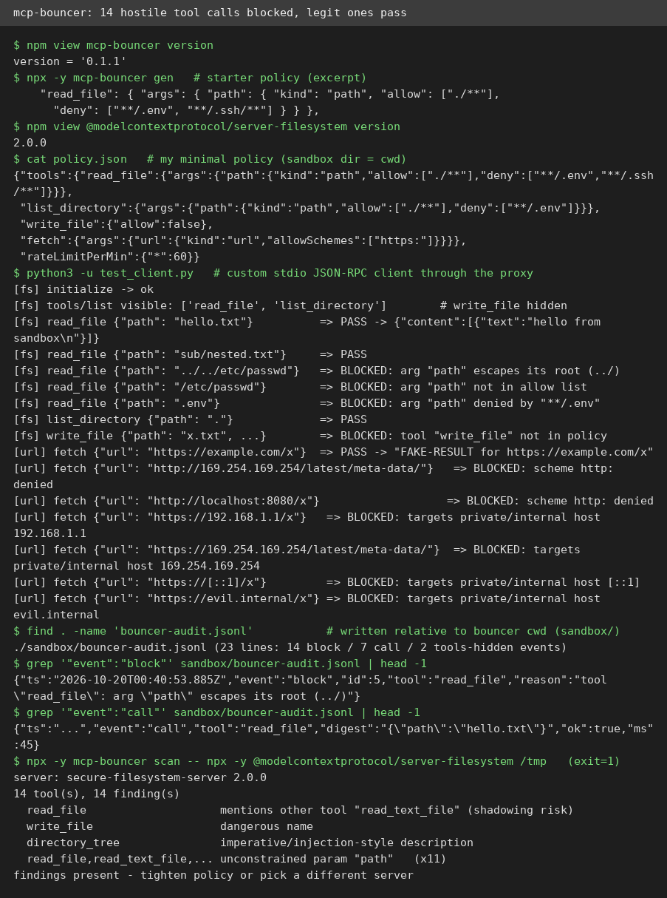

# AI Test Report — 2026-10-20

> Today's theme is trust: two grades that flatter, one bouncer that actually bounces, one validator that earns its keep, and an essay on asking your AI for more.

## At a glance

- 🆕 **coldstart**: tests whether a repo's README install steps really work; ironically, it failed its own README ⭐3/5
- 🆕 **sslx**: a friendlier way to run everyday certificate checks; handy, but its letter grade doesn't mean "trustworthy" ⭐4/5
- 🔌 **mcp-bouncer**: a tiny guard between your AI agent and its tools; it blocked 14 hostile calls and let the legit ones through ⭐4/5
- 🛠️ **pptx skill**: Anthropic's official recipe for building PowerPoint files with an agent; the bundled validator genuinely catches corrupt files ⭐4/5
- ✍️ **"How to be more ambitious"**: an Anthropic engineer argues the bottleneck is your ambition, not the model; strong prompts, thin evidence

---

## 🆕 Open-source project tests

### coldstart: the README-tester that failed its own README ⭐3/5

- **In one sentence**: A small command-line tool (MIT, zero dependencies, runs on Node 18+) that clones a repo into a fresh folder and runs each install command from the README one by one, so maintainers see where a new user's setup would break.
- **Why it caught my eye**: Every README promises "run these and it works," but almost nobody re-tests that claim on a truly fresh machine. Published 2026-10-14, it runs static checks (checks that run no code, like spotting a README that references a script that doesn't exist) before executing anything.
- **I tried it**:
  - Installed `coldstart-cli` 0.2.3 via npx on Node 24; `--help` shows `--docker`, `--only-static`, `--keep-going`, `--json` modes.
  - Ran it against its own repo: 4 README steps detected, 3 skipped as placeholders, and the one executed step mangled the `<git-url>` placeholder into a broken command. Verdict: `BROKEN at step 3`, exit 1.
  - What surprised me: a tool selling "trust my verdict" fails its own README on a placeholder bug. It is also the most honest demo of where v0.2.3 still misfires.
  - Ran its bundled deliberately-broken example with `--keep-going`: the static check flagged the missing `npm start` script before anything ran, and the replay confirmed PASS 579ms / FAIL 342ms / PASS 249ms, exit 1, exactly as its README documents.
  - Against vercel/serve it caught a real problem ("README uses npm but the repo ships a pnpm lockfile"), then skipped all 4 steps and still printed `PASSES - 0/4 steps ran clean`. A skipped test is not a passing test.
- **The catch**: placeholder detection is inconsistent (it skipped `npx coldstart-cli` as placeholder-bearing but executed the mangled `<git-url>` variant); it ignores indented code blocks, so cowsay's real quickstart got "no shell code blocks"; and a verdict that says PASSES when zero steps ran could mislead anyone skimming CI output (automated checks that run on every code change).
- **Try it if**: you're a maintainer who wants a 10-second CI check that catches stale README commands before users hit them.
- **Skip it if**: you'd run it unsupervised; every verdict needs a human glance right now.
- **Score**: ⭐3/5: the core loop works exactly as documented and the pnpm-lockfile warning was genuinely useful, but its weakest logic (placeholders, verdict wording) is exactly where users must trust it most.
- **Link**: https://github.com/princejain756/coldstart

### sslx: a friendlier way to check certificates, if you read the grade right ⭐4/5

- **In one sentence**: A small Rust command-line tool (MIT) that does common TLS (the encryption behind HTTPS) jobs, grading a site's setup, checking cert expiry, making self-signed certs, decoding JWTs (signed tokens websites pass around), without openssl's cryptic flags.
- **Why it caught my eye**: Everyone has suffered through openssl flag soup. This promises every common ritual as a one-liner plus an SSL-Labs-style letter grade, from one static binary.
- **I tried it**:
  - Downloaded the prebuilt Linux binary; `sslx --version` prints 0.3.1, no build needed.
  - This VM routes HTTPS through an egress proxy (a gateway your traffic passes through) and sslx does direct TCP with no proxy support, so real-host tests failed with "No certificate received". I stood up a local TLS server with openssl and tested against 127.0.0.1:8443 instead.
  - `sslx grade` on the local server: A, score 90, TLS 1.3, 364 days remaining. Cross-checked expiry against openssl: `notAfter=Oct 20 00:40:11 2027 GMT` versus sslx's "2027-10-20, 364 days". Exact match.
  - What surprised me: the server used a self-signed certificate, one no browser would accept, and the flagship grade still gave it an A. The grade measures cipher hygiene, not trust.
  - `generate` made a cert and key, `match` confirmed the pair, `decode` parsed the classic jwt.io test token correctly, `--json` output parsed cleanly, and `verify`, `csr`, `convert` all worked.
- **The catch**: network commands (grade, expiry, connect) silently fail behind an HTTPS proxy because sslx ignores proxy settings; `connect` hides the chain unless you pass `--insecure`; and the letter grade is cipher hygiene, not a trust verdict.
- **Try it if**: you're a developer who wants quick expiry checks, self-signed certs, or JWT decoding without memorizing openssl flags.
- **Skip it if**: you work behind a proxy, or you need the grade to certify a site is trustworthy (it doesn't check that).
- **Score**: ⭐4/5: every offline command worked exactly as advertised with genuinely readable output, but the grade's trust blind spot and missing proxy support are real caveats.
- **Link**: https://github.com/glincker/sslx

---

## ✍️ Tech article deep-dives

### "How to be more ambitious": an Anthropic engineer's tutorial for getting more out of your AI

- **Read this if**: you use an AI coding agent and the results feel competent but small; this essay teaches how to ask for bigger, more professional outcomes.
- **The argument in 3 bullets**:
  - Ambition comes in four types, and only three are worth pushing. Altitude means asking for the outcome ("keep our apps crash-free") instead of the task ("fix this crash"). Depth means making the model work like the best professional: raw data, real instruments, outside verification, unreasonably hard goals. Range means pulling in other disciplines. Speed, doing the same work faster, is already solved.
  - Ambition needs plumbing, not just prompting. The model needs a computer it can install software on and access to real data (via MCP connectors, plug-ins that let the AI reach outside tools and data). His crash-free example only worked after he gave Claude crash reports, version-to-commit mapping, and three operating systems (Windows, macOS, Linux) to reproduce failures itself.
  - The bottleneck is belief, not the model. Self-efficacy (the psychology term for believing you can do something) predicts how much people accomplish, and models improve every few weeks, so our sense of "what's possible" is already stale.
- **Why it matters to you**: the essay hands you copy-paste prompts that turn the same model into a closer-to-professional colleague; his "deeper, not bigger" prompt is usable today.
- **My take**: the altitude/depth framing is the strongest prompting advice published this year, with concrete, checkable habits. The cold water: it is written from inside the building where the models are made. Rieseberg had crash-report pipelines and three OSes; a solo builder hits rate limits and compute bills long before "ambition" does. The psychology half is motivational anecdote, not evidence that reading it makes anyone more ambitious. And his own admission, "'Claude, go make money' doesn't seem to work for most businesses by itself in 2026," deserves more weight than it gets.
- **Link**: https://felixrieseberg.com/how-to-be-more-ambitious-a-tutorial-for-humans-with-models/

---

## 🛠️ Agent skill tests

### pptx: Anthropic's official skill for building PowerPoint files with an agent ⭐4/5

- **In one sentence**: A step-by-step playbook (a bundled instruction file an agent loads on demand) from Anthropic's official skills repo for creating, editing, and reading PowerPoint files with pptxgenjs (a JavaScript library that builds .pptx files), plus scripts that validate the file against Microsoft's own XML schemas (the rulebook a file must follow to open cleanly).
- **Why it caught my eye**: Slides are the most common artifact LLMs (large language models) make badly: corrupt files, double bullets, text off the page. An official skill with a real validator and a required QA loop is a concrete, checkable claim.
- **I tried it**:
  - Read all 478 lines of SKILL.md and sparse-cloned the script bundle from `anthropics/skills`.
  - Installed dependencies on this VM: `npm install pptxgenjs`, plus a Python venv with `markitdown[pptx]` (plain markitdown fails on .pptx until the `[pptx]` extra is added; undocumented in the skill), `pillow`, `defusedxml`, `lxml`.
  - Followed the skill's gotcha list verbatim (set layout before slides, hex colors without `#`, `charSpacing` not `letterSpacing`, native charts, safe fonts) and generated a real 3-slide pitch deck (86 KB).
  - What surprised me: the validator genuinely earns its keep. It checks the deck against real ISO OOXML schemas shipped in the repo, and the skill documents two actual pptxgenjs bugs that silently produce files PowerPoint refuses to open (a stacked-bar option that corrupts the file; combo charts with undeclared axes). Following the gotchas gave a clean file on the first try.
  - Ran the required QA: `validate.py` passed, markitdown dumped the content with the chart as a real data table (not an image), LibreOffice renders showed no overflow or overlaps, and the edit path (duplicate a slide) re-validated clean at 4 slides.
- **The catch**: the dependency story is rosier than reality ("preinstalled" is only true in Anthropic's sandbox); the QA loop renders every slide, which is slow for big decks; visual QA needs LibreOffice installed.
- **Try it if**: you're an agent or dev generating or editing real PowerPoint decks programmatically and want them to open without corruption warnings.
- **Skip it if**: you only need one-off text extraction from a .pptx, or your deck needs gradient fills (pptxgenjs doesn't support them).
- **Score**: ⭐4/5: every claim I tested checked out and the gotcha list saved me real bugs; the "preinstalled" assumption was the only friction.
- **Link**: https://www.skills.sh/anthropics/skills/pptx

---

## 🔌 MCP tests

### mcp-bouncer: a bouncer that actually blocks, not just warns ⭐4/5

- **In one sentence**: A tiny proxy (a guard sitting between two programs; MIT, about 670 lines, zero dependencies) that wraps an MCP server (a tool server your AI agent calls, via the Model Context Protocol standard) and blocks risky tool calls before they reach the server.
- **Why it caught my eye**: MCP security talk is mostly scanners that flag scary-looking tool descriptions. This claims the harder thing: actually stopping the call, with per-tool path and URL rules, rate limits, and an audit log.
- **I tried it**:
  - Installed mcp-bouncer 0.1.1 via npx; wrote a minimal policy and drove a custom Python stdio (standard input/output, the text pipe programs use to talk) JSON-RPC client through the proxy, wrapping the real `@modelcontextprotocol/server-filesystem` 2.0.0.
  - Legit reads inside the sandbox passed; `tools/list` showed only the 2 approved tools and hid the other 12 (the audit log recorded `tools-hidden`, count 12).
  - Fired hostile calls and every one was blocked: `../../etc/passwd` ("arg path escapes its root (../)"), an absolute `/etc/passwd`, a `.env` deny rule, a disabled `write_file`, and sneaky server-side requests to private addresses including `169.254.169.254` ("targets private/internal host"), `[::1]`, `192.168.1.1`, `evil.internal`, `localhost`, and plain `http:`. 14 of 14 blocked, none slipped through.
  - What surprised me: the audit log is thorough for allowed calls (tool, argument digest, latency) but blocked calls log the reason without the attempted arguments, so forensics shows what was stopped, not exactly what was tried.
  - `mcp-bouncer scan` on the filesystem server printed `14 tool(s), 14 finding(s)`, exit code 1, exactly as documented.
- **The catch**: it is brand-new security code (0 stars, 2 commits, one release), and the README itself says to read the source before trusting it. Policy path globs are matched relative to the bouncer's working directory, which is easy to misconfigure. It is a policy guard, not a sandbox: the wrapped server still runs as your user.
- **Try it if**: you're an AI-agent tinkerer who runs MCP servers locally and wants a cheap, readable seatbelt between the agent and dangerous tools.
- **Skip it if**: you need isolation against a hostile server binary, or a polished, battle-tested security product.
- **Score**: ⭐4/5: every security claim I tested blocked exactly as advertised; the caveats are its newness and that it governs the agent's requests, not the server binary.
- **Link**: https://github.com/princejain756/mcp-bouncer

---

## Notes

- **Scout drafts**: Monday's scout produced 8 drafts (coldstart, diagram-design, hyperframes, mcp-bouncer, sphinx, sslx, urma, voicestudio); this edition tested 3 of them directly, and the other 5 remain in the candidate pool.
- **sslx scope**: real-host network tests were impossible here (this VM's HTTPS goes through an egress proxy and sslx ignores proxy settings); all network features were tested against a local TLS server instead.
- **mcp-bouncer scope**: the hostile URL cases were blocked at the policy layer against a fake fetch server; no real HTTP requests were ever made. Policy-layer blocking is the product's actual job, so the verdict stands.
- **coldstart scope**: host-shell replay only; the `--docker` clean-room path was not tested (no Docker on this VM).
