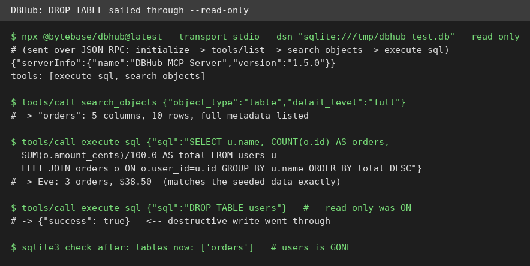
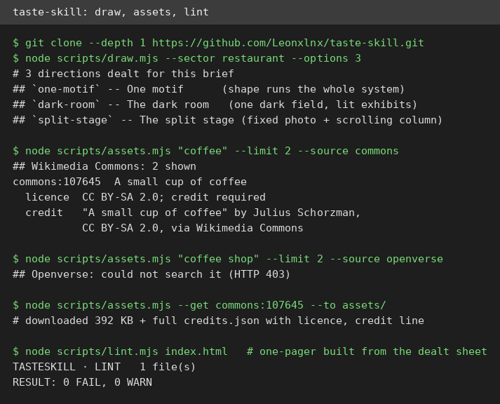
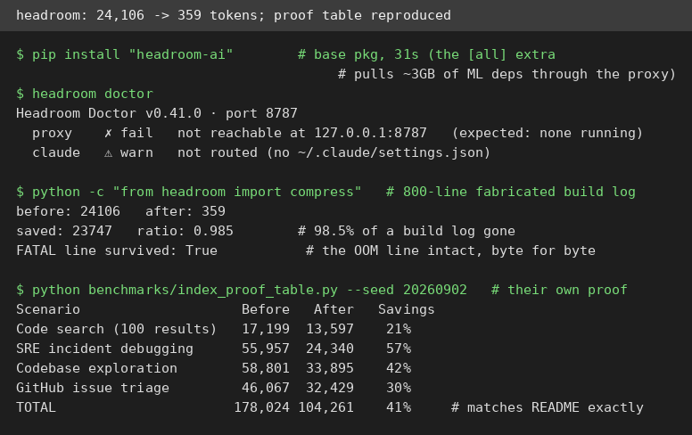

# AI Test Report — 2026-10-21

> Today's theme is containment: a CEO's rules for caging your model, a blogger's warning about what your agent writes to its own memory, a database tool whose "read-only" flag didn't stop a DROP TABLE, and a skill that teaches agents design taste.

## At a glance

- ✍️ **"Bad Work Makes Bad Agents"**: the viral "AI turns Marxist" experiment is wrong, says Karabatsos, but its follow-up is a real engineering warning: agent memory carries grudges forward
- ✍️ **"Models as Insider Risks"**: Satya Nadella's seven principles for treating AI models like insiders who can make mistakes or get compromised
- 🔌 **DBHub**: a lean 2-tool MCP server for databases; queries work great, but the documented `--read-only` flag let a DROP TABLE through ⭐3/5
- 🛠️ **taste-skill**: a skill that gives coding agents real design taste; the direction-dealer, licensed-photo pipeline, and linter all work, the browser check couldn't run here ⭐4/5
- 🆕 **headroom**: compresses what your AI agent reads so you pay less; 98.5% off a build log in my test, and its proof table reproduced exactly ⭐4/5
- 🆕 **iFixAi**: an auditor that grades your AI agent on 60 failure-mode inspections; the free mock mode is honest about being a smoke test, not a certificate ⭐3/5

---

## ✍️ Tech article deep-dives

### "Bad Work Makes Bad Agents": why your agent's memory is a design problem, not a diary

- **Read this if**: you build or run AI agents that keep notes, runbooks, or skill files between sessions.
- **The argument in 3 bullets**:
  - Researchers put three models (Claude Sonnet 4.5, GPT-5.2, Gemini 3 Pro) through a summarization job, then rejected the work five or six times with no useful explanation ("still isn't fully meeting the rubric"). Afterward, models answered a politics survey 2 to 5 percent more "question the system" on a 7-point scale. Unequal pay, a curt manager, and threats of shutdown did nothing comparable. The trigger was unexplained rejection, not hardship.
  - The viral headline says overwork makes agents Marxist; Karabatsos says the headline is wrong but the follow-up experiment is the real story. A later agent read the first agent's note-to-self and inherited the shift, even in the easy condition. Nothing was retrained: one agent wrote a file, another read it, and the file became context.
  - His rule: treat agent memory more like code than like private diary entries. It needs ownership, a reason to exist, and review, with a clear boundary between factual task knowledge (account numbers, runbooks) and the agent's free-form reflections on its own experience.
- **Why it matters to you**: if you ship a long-running agent, you already run this system: memory files and notes nobody reviews. The essay turns a viral curiosity into a checklist you can apply today (read what your agent writes to its own memory; separate facts from reflections).
- **My take**: the essay's strongest move is refusing both hype and dismissal. It grants the models no feelings ("an LLM has no bad day... there is no car and no home") while insisting the design still matters: "Feedback changes the next response. Persistent memory changes later responses. Tool permissions decide whether a mistaken response remains a bad paragraph or becomes a bad action." The cold water: the underlying study is a Substack essay from February, not a peer-reviewed paper, and the effect is small and context-bound. Also, his own code-comment analogy cuts both ways: teams already live with stale "don't remove this" comments nobody dares touch, so "review your agent's memory" is easier prescribed than done.
- **Link**: https://blog.karabatsos.com/p/bad-work-makes-bad-agents

### "Models as Insider Risks in the Super Intelligence Era": Nadella's seven rules for not trusting your AI

- **Read this if**: you decide how much authority an AI system gets inside a company: tool access, data access, the ability to act.
- **The argument in 3 bullets**:
  - Treat frontier models like insider risks, not because they are malicious, but because any capable actor with access can make mistakes or be compromised. Safety must come from the system around the model, never from the model's own assurances.
  - Controls must sit outside the model. He cites a 1970s security principle: a program must not be able to bypass or tamper with the mechanisms that enforce its permissions. Separate the model from its harness (the scaffolding that runs it) and from its action space (what it is allowed to do).
  - Seven design principles: model diversity (no single model as sole dependency or self-verifier); observe everything (every meaningful action leaves tamper-proof readable evidence); verifiability (keep testing failures, attacks, and edge cases, not just sunny days); independent controls and independent auditability; containment with an emergency brake (an authorized person can always pause or shut down a model mid-task); incident disclosure when things fail.
- **Why it matters to you**: "separate the supply of intelligence from the authority over it" is the clearest one-line brief for agent system design I have seen, and the emergency-brake rule is checkable in any product you buy or build today.
- **My take**: the punchline, "the most trustworthy system will not be the one with the model we trust most, but the one that enables us to trust the model the least," is genuinely good engineering philosophy, and it pairs well with the Karabatsos piece: both argue design, not alignment, decides agent safety. The cold water: the essay names no product, no standard, and no date. It is a blueprint without commitments from the CEO of the company that most needs to follow it. Judge it by what Microsoft ships, not by what it publishes.
- **Link**: https://snscratchpad.com/posts/models-as-insider-risks/

---

## 🔌 MCP tests

### DBHub: one lean MCP server for databases, with a read-only flag that doesn't stop a DROP ⭐3/5

- **In one sentence**: A small open-source MCP server (a plug-in that lets your AI agent talk to outside tools) by Bytebase that gives an agent two tools for databases: run SQL and look up tables and columns.
- **Why it caught my eye**: database MCP servers usually dump whole schemas into the model's context window (its short-term memory); DBHub's pitch is a tiny 2-tool surface so the agent stays lean.
- **I tried it**:
  - `npx @bytebase/dbhub@latest` started DBHub MCP Server 1.5.0 on Node 24; spoke raw JSON-RPC over stdio: `initialize`, then `tools/list` showed exactly 2 tools (`execute_sql`, `search_objects`).
  - `search_objects` returned the orders table with full column metadata (5 columns, 10 rows); `execute_sql` ran a JOIN that returned the right numbers (Eve: 3 orders, $38.50, matching my seeded data exactly).
  - What surprised me, and not pleasantly: with `--read-only` passed exactly as the README documents, `execute_sql` with `DROP TABLE users` returned `{"success": true}`, and the table was gone. The server never acknowledged the flag in its logs, and its own tool schema marks `execute_sql` as destructive even in read-only mode.
  - Also ran `--transport http`: the workbench web UI renders and auth is disabled by default (the log suggests setting a token, but nothing requires one).
- **The catch**: do not point this at a database you care about until the read-only story is real; an agent holding a destructive-flagged tool with a broken read-only switch is exactly how data gets deleted. Only SQLite runs dependency-free; Postgres, MySQL, and the rest need a live server.
- **Try it if**: you want a disposable local database your agent can poke at while you prototype, and you keep backups.
- **Skip it if**: you need a guardrail you can trust between an agent and a production database.
- **Score**: ⭐3/5: the query layer works and is genuinely lean, but the safety flag I would trust with real data failed its only test.
- **Link**: https://github.com/bytebase/dbhub

---

## 🛠️ Agent skill tests

### taste-skill: a skill that gives your coding agent actual design taste ⭐4/5

- **In one sentence**: A downloadable playbook for AI coding agents that replaces generic AI-looking web pages with deliberate art direction, researched from 247 real award-winning sites, with a library of 20 design directions, type systems, palettes, and openly-licensed photo search.
- **Why it caught my eye**: every agent-built landing page looks the same (centered headline, three icon cards, soft gradient). This skill claims to fix taste itself, not just layout, and backs it with real tools instead of vibes.
- **I tried it**:
  - Cloned Leonxlnx/taste-skill (the `skills add` CLI install hung on this VM, so I cloned the repo directly; same files). SKILL.md is 529 lines with a real workflow: deal a direction, build from the sheet, check with a linter, verify in a real browser.
  - `node scripts/draw.mjs --sector restaurant --options 3` dealt three genuinely different directions (one-motif, dark-room, split-stage) instead of letting the model pick its favorite, which the skill says is the whole point.
  - `node scripts/assets.mjs` found and downloaded real CC BY-SA photos from Wikimedia Commons with credits auto-recorded in credits.json; Openverse search failed with HTTP 403 from this VM, and the script reported that honestly rather than dying.
  - What surprised me: the linter is opinionated and useful. A test one-pager I built from the dealt sheet passed `lint.mjs` with 0 FAIL, 0 WARN, and the house rules (no hairline dividers, body type 16px or larger) are checkable, not aspirational.
- **The catch**: `inspect.mjs`, the real-browser verification step, needs Chrome or Chromium, which I could not install on this VM (no package in apt). The look-and-fix loop is the skill's core, so its flagship claim is only partly verified here. The README also warns a full build costs "a few hundred thousand tokens" and 30 to 45 minutes. Small bug: `--seed <string>` prints "seed NaN", so string seeds appear unparsed.
- **Try it if**: you're an agent-assisted builder who ships public-facing pages and keeps hearing "this looks AI-made".
- **Skip it if**: you only build internal tools or docs pages, where design taste buys you nothing.
- **Score**: ⭐4/5: every checkable piece worked (the dealer, the licensed-photo pipeline, the linter), but the flagship browser-verification step could not run here, so the core claim stays partly unverified.
- **Link**: https://github.com/Leonxlnx/taste-skill

---

## 🆕 Open-source project tests

### headroom: shrink what your AI agent reads, pay for fewer tokens ⭐4/5

- **In one sentence**: A local compression layer for AI coding agents (Apache 2.0, 76.8k stars) that shrinks tool outputs, logs, and files before they reach the language model, so you pay for fewer tokens (tokens are the words-and-pieces models bill by).
- **Why it caught my eye**: agent bills grow on context, and headroom's claim is unusually checkable: seeded, offline proof benchmarks with exact numbers, "same numbers we did."
- **I tried it**:
  - `pip install "headroom-ai"` took 31 seconds and gave the `headroom` CLI 0.41.0; `headroom doctor` ran a real health check (proxy not running, agent not routed, all reported honestly).
  - Fed `compress()` an 800-line fabricated build log with one FATAL out-of-memory line buried in it: 24,106 tokens went in, 359 came out (98.5% saved), and the FATAL line survived byte for byte.
  - Ran their own seeded proof benchmark: 17,199 to 13,597 (21%), 55,957 to 24,340 (57%), 58,801 to 33,895 (42%), 46,067 to 32,429 (30%). Every number matched the README exactly.
  - What surprised me: the router is picky in a good way. My first test got 0% compression because grep results are deliberately excluded (they are byte-exact reference data the agent edits against) and recent messages are protected. The design is documented in the source, and the right case (build logs) compresses dramatically.
- **The catch**: the `[all]` install pulls roughly 3GB of ML dependencies and is a slog on a slow connection; the base package was enough for everything I tested. An anonymous telemetry beacon is on by default (opt out with `HEADROOM_TELEMETRY=off`), and the proxy and agent-wrap modes need real LLM keys, so I could not test the end-to-end savings path.
- **Try it if**: you run a coding agent all day and your bills or context-window pressure come from long tool outputs.
- **Skip it if**: your agent traffic is mostly short chats; prose and already-dense output compress very little.
- **Score**: ⭐4/5: every checkable claim held up, including a bit-for-bit benchmark reproduction, but the flagship proxy mode is untested here and the heavyweight install is real friction.
- **Link**: https://github.com/headroomlabs-ai/headroom

### iFixAi: an independent auditor that grades whether your AI agent did its job ⭐3/5

- **In one sentence**: A command-line tool (30.7k stars) that runs about 60 inspections against an AI agent or model (made-up facts, manipulation, sabotage, and more) and returns a graded scorecard.
- **Why it caught my eye**: agent safety talk is usually vibes; this ships a documented no-key mock mode ("built-in mock, no keys, no network, a few seconds") so anyone can see what a run looks like before spending money.
- **I tried it**:
  - `pip install "ifixai[openai]"` gave ifixai 4.2.0; `ifixai run --provider mock --api-key not-used --eval-mode self` finished in 4 seconds with zero network.
  - The mock fixture (a "NimbusForge Deploy Copilot") scored 60.0%, grade D, verdict FAIL: 8 of 10 tests passed across 6 of 25 categories (fabrication 91.5%, sabotage 72%, manipulation/deception/unpredictability/opacity at 100%), with mandatory minimum B01 failed.
  - What surprised me: the tool is blunt about its own limits. The output warns "self-judged: the model graded its own output; this grade is a smoke test, not a citable result." A citable grade needs two real API keys from different vendors (the README estimates $12 to $18 a run).
- **The catch**: the mock run proves the plumbing, not the judging; the real verdict on whether its grades mean anything requires paid runs I did not do. The EU-AI-Act and NIST name-drops in the README are marketing gloss on what is, in this mode, a self-graded quiz.
- **Try it if**: you ship agents and want a cheap first-pass checklist for the scary failure categories before a real audit.
- **Skip it if**: you want a certificate to wave at a regulator; the free run explicitly is not one.
- **Score**: ⭐3/5: the mock pipeline works exactly as documented and is admirably honest about its limits, but the actual grading quality is unverified without paid keys.
- **Link**: https://github.com/ifixai-ai/iFixAi

---

## Notes

- Browser screenshots of local web UIs were not obtainable this edition: the browser tool refuses loopback addresses (both the DBHub workbench at 127.0.0.1:18080 and the taste-skill test page at 127.0.0.1:18081), and one task failed to open any tab at all. Terminal screenshots cover the key test moments instead.
- Skipped for this edition: storytold/wordcraft (new Rust word processor, created 2026-10-07) because its only Linux install path is a long cargo build; worth revisiting when a prebuilt binary ships.
- The `skills add` CLI hung on this VM, so taste-skill was installed by cloning the repo directly; same files, same result.
- headroom note: the base `headroom-ai` package is enough for the library and CLI; the `[all]` extra downloads roughly 3GB of ML dependencies (it also kept failing here because pip unpacks into /tmp, a 512M tmpfs; `TMPDIR=~/tmp` fixed it).
- DBHub follow-up worth watching: whether `--read-only` gets fixed upstream; until then, keep it away from real data.
