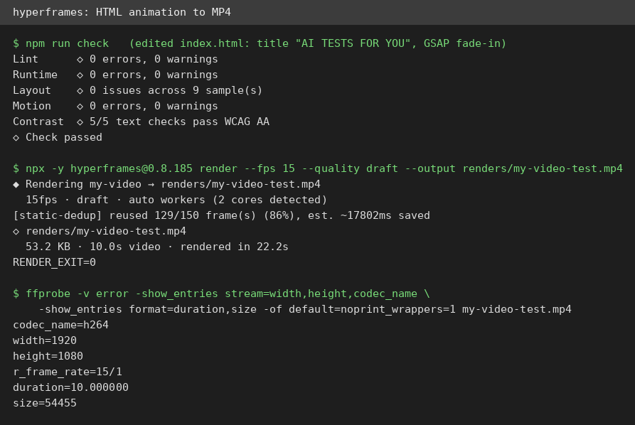
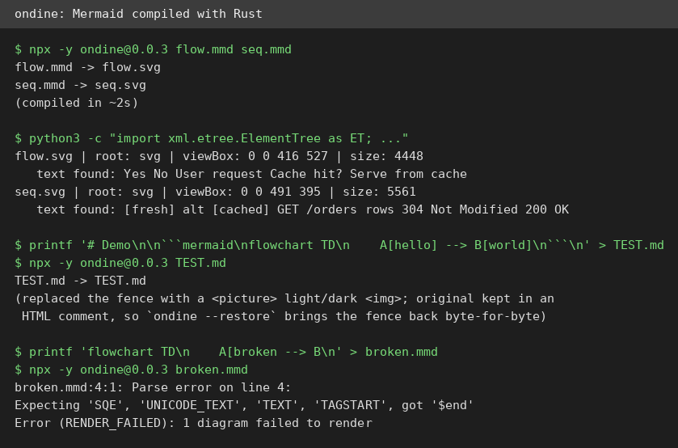
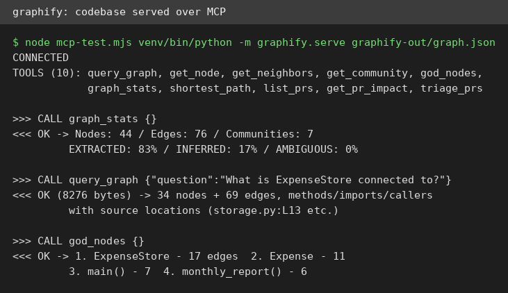

# AI Test Report — 2026-10-22
> A video engine that actually renders, diagrams compiled in Rust, a codebase turned into a map an agent can query, and two essays arguing opposite answers to the same question: should a human still write code?

## At a glance
- 🆕 **hyperframes**: write an animated web page, get a real video file back; the render pipeline works, the setup has sharp edges.
- 🆕 **ondine**: Mermaid diagrams compiled to SVG by a Rust binary; fast, scriptable, with reversible markdown transforms.
- ✍️ **"It's still OK to enjoy programming"**: a permission slip for hand-written code, argued on the ground of meaning rather than economics.
- ✍️ **"Why I'm no longer updating this repository"**: a Ruby maintainer archives his gems, saying open source became training input for the system that replaces him.
- 🛠️ **graphify**: turn a codebase into a knowledge graph an agent can query; the extraction is honest, the headline number is not verified.
- 🔌 **breakinggood**: an MCP server that clones a repo and sets it up for you; interesting, but its own scanner flagged itself.

## 🆕 Open-source project tests

### hyperframes — write an animated web page, get a real video file back ⭐4/5

- **In one sentence**: Hyperframes is a free tool (Apache-2.0) from HeyGen that turns an animated web page into a standard MP4 video file, so a script or an AI agent can produce videos the way it writes web pages.
- **Why it caught my eye**: the bold claim is agent-directed video production, for example auto-generating a changelog video from a pull request; it also came from this week's scout drafts.
- **I tried it**:
  - `npx hyperframes@latest init my-video --non-interactive` scaffolded the project with version 0.8.185 (the plain `init` hung on an interactive prompt with no TTY).
  - Edited the sample page with a fade-in title ("AI TESTS FOR YOU"); `npm run check` passed with 0 errors after I vendored the animation library locally, because the bundled headless Chrome could not fetch it from the CDN through this VM's proxy.
  - `hyperframes render --fps 15 --quality draft` produced a 10.0-second, 1920×1080 h264 (a standard video format) MP4 in 22.2 seconds; `ffprobe` confirmed the file and a frame extracted at t=2s showed the animated title pixels, so the animation genuinely rendered.
  - What surprised me: static-dedup reused 129 of 150 frames (86%), skipping re-renders of unchanged frames.
- **The catch**: the first render failed because this VM's /tmp is a 512MB tmpfs (a temporary in-memory filesystem) and the renderer writes large temp files; rerunning with TMPDIR relocated fixed it. The 21 agent skills and the PR-to-video workflow were not exercised in this round.
- **Try it if**: you're a developer who wants programmatic video (changelogs, explainers, demos) without opening a video editor.
- **Skip it if**: you just need one quick video; a screen recorder is faster.
- **Score**: ⭐4/5 — the render pipeline works end to end on a bare VM; docked one star for the setup friction (TTY prompt, CDN fetch, /tmp space).
- **Link**: https://github.com/heygen-com/hyperframes

### ondine — Mermaid diagrams compiled to pictures by a Rust binary ⭐4/5

- **In one sentence**: ondine is a small MIT command-line tool that reads Mermaid diagram text (Mermaid is a plain-text language for drawing diagrams) and compiles it to SVG pictures using Rust, fast.
- **Why it caught my eye**: released 2026-10-18 and at 354 stars within days; the Rust-compiled angle promises speed over the usual JavaScript Mermaid renderer.
- **I tried it**:
  - `npx -y ondine@0.0.3 flow.mmd seq.mmd` compiled a flowchart with a decision node and a sequence diagram with alt/else blocks in about 2 seconds; parsing the SVGs confirmed well-formed XML with every label present.
  - Stdin mode prints the SVG straight to stdout, so it composes with pipes.
  - On a markdown file, it replaced a mermaid fence (a fenced code block) with a `<picture>` tag serving light and dark images while keeping the original source in an HTML comment; `ondine --restore` brought the fence back byte-for-byte.
  - What surprised me: broken input gets a precise parse error with line and column numbers plus a non-zero exit code, which makes it scriptable in CI (continuous integration, the automated checks that run on every code change).
- **The catch**: markdown mode rewrites fences to ondine.sh-hosted image URLs, so you depend on their hosting unless you self-host (I did not verify those URLs resolve). I only exercised the flowchart and sequence diagram types.
- **Try it if**: you're a docs writer who keeps diagrams in markdown and wants fast, deterministic rendering.
- **Skip it if**: you need exotic Mermaid diagram types; check its coverage first.
- **Score**: ⭐4/5 — everything I ran worked exactly as advertised; the hosted-image dependency keeps it from a 5.
- **Link**: https://github.com/wevm/ondine

## ✍️ Tech article deep-dives

### "It's still OK to enjoy programming" — a permission slip for hand-written code
- **Read this if**: you're a working programmer who feels guilty writing code by hand in the age of coding agents.
- **The argument in 3 bullets**:
  - The economics of hand-written code at work have changed, he concedes up front; but work is not life, and weekend code needs no economic justification.
  - His examples are deliberately pointless: a buggy hand-written Breakout clone, pushing Java's type safety with ideas from dependently typed languages (Agda's `Fin`, a type that counts exactly), hours on recursion schemes (a way to describe recursive patterns) with no payoff.
  - Hard, unproductive study pays off on a delay: ideas "bake in" for years, and the changed understanding in your own head is the one artifact no model can hand you.
- **Why it matters to you**: it reframes "should I still write code by hand" from a productivity question to a craft question, and quietly makes a career argument: the people who keep building deep understanding will be the best at directing agents.
- **My take**: the strongest move is conceding the economics and fighting on the smaller ground of meaning. Cold water: he admits in a footnote that he also vibe-codes (has an AI write whole apps) entire apps and finds that fun too, which splits "enjoying programming" into two different activities he never reconciles; and "just enjoy it on weekends" comforts mid-career developers far more than juniors whose day jobs are the ones being eaten. Published 2026-10-17, 270 HN points, 260 comments.
- **Link**: https://chriskiehl.com/article/it-is-still-ok-to-enjoy-programming

### "Why I'm no longer updating this repository" — a maintainer quits over the AI pipeline
- **Read this if**: you maintain open source, or you depend on single-maintainer libraries.
- **The argument in 3 bullets**:
  - Paul Battley is archiving all his Ruby gems: Ruby's steward now pitches it as a "Programming Language for AI age" meant to be emitted by agents, with the stated requirement that LLMs consume more good human-written Ruby.
  - The sharpest line: open-source labor has become "training input for the system that will perform your labour"; the commons is being strip-mined by corporations to feed machines whose output pollutes it.
  - A second grievance: Rails is controlled by DHH, whose views he finds abhorrent, and he reads the Rails World keynote as proof its own steward no longer cares about Ruby.
- **Why it matters to you**: this is the first widely-discussed walkaway aimed specifically at the agent-training pipeline, and the mechanism applies to every open corpus, not just Ruby; if you depend on single-maintainer gems, audit your dependency risk now.
- **My take**: the "strip-mined commons" sentence is the one genuinely new idea here, and it's worth sitting with. Permissive licenses (licenses that let anyone reuse the code, even commercially) always meant donating labor to corporations, but LLMs changed the terms by making the output compete directly with the author. Cold water: the two grievances (governance boycott and AI-training objection) don't belong together, and licensing-wise the strip-mining is what the license always allowed; the plainer story is that unpaid maintenance was already unsustainable and AI removed the last non-monetary reason to continue. Published 2026-10-18, 277 HN points, 240 comments.
- **Link**: https://po-ru.com/2026/10/18/why-im-no-longer-updating-this-repository

## 🛠️ Agent skill tests

### graphify — turn a codebase into a map an agent can actually query ⭐4/5

- **In one sentence**: graphify is a free agent skill (a packaged set of instructions that teaches an AI agent a workflow) plus a Python library that reads a codebase and builds a knowledge graph (a map of how functions, classes, and files connect) an agent can query instead of re-reading every file.
- **Why it caught my eye**: repo updated 2026-10-20, PyPI 0.9.93; the bold claim is a 71.5x token reduction for agents working on large codebases.
- **I tried it**:
  - Read the full 1,204-line skill definition first; installed `graphifyy` 0.9.93 from PyPI (note the double-y: the README warns other graphify* packages are unaffiliated).
  - Built a real 6-file Python expense-tracker corpus; detection classified 6 code files plus 1 doc file, and AST extraction (AST is the parsed structure of the code) found 31 nodes and 80 edges with file-and-line tags.
  - Build plus cluster produced 44 nodes, 76 edges, 7 communities; the "god nodes" (the most connected parts), ExpenseStore, Expense, and main(), matched the real architecture.
  - Served the graph over MCP and queried it live: `graph_stats` returned 44 nodes / 76 edges / 83% directly-extracted edges; `query_graph` on "What is ExpenseStore connected to?" returned 34 nodes with source locations.
  - What surprised me: the skill is honest about its own limits; the report flags that all 7 "surprising connections" involving ExpenseStore are inferred, and suggests asking whether they are actually correct.
- **The catch**: the output graph is undirected, so queries print some edges backwards ("ExpenseStore --calls--> main()" is really the reverse). The 71.5x token-reduction claim could not be verified: the skill's own rule only runs the benchmark on corpora over 5,000 words, and mine was 508.
- **Try it if**: you're wiring an agent to work on a large unfamiliar codebase and want it to stop re-reading every file.
- **Skip it if**: your codebase fits in one context window; the skill itself says you may not need a graph then.
- **Score**: ⭐4/5 — extraction, clustering, and MCP querying all worked; docked one for the backwards edges and the unverifiable headline number.
- **Link**: https://github.com/deco31416/graphify

## 🔌 MCP tests

### breakinggood — clone any repo and let it set itself up, via MCP ⭐3/5
- **In one sentence**: breakinggood is a brand-new MCP server (MCP is the protocol that lets AI agents use external tools) that clones a repo or captures a website and reverse-engineers it: detect the stack, scan for risks, install, and run.
- **Why it caught my eye**: published 2026-10-17, five days old; the pitch is "one command to clone, reverse-engineer and run any software from a URL."
- **I tried it** (via a Node MCP client over stdio, a direct pipe between two programs, calling all 3 advertised tools):
  - `scan_repo` on its own GitHub repo detected Node/npm, listed install/run commands, and reported 3 files with "obfuscated blobs or network->shell patterns". I verified by grep that this is a false positive: the scanner matched its own detection regex and a description string in its own source.
  - `capture_site` on a local test page ran the full pipeline: design tokens, 2 screenshots, capture.json. The same call on example.com failed with a proxy error because this VM's egress needs authentication and the bundled Chromium launches without proxy config; an environment limitation, not a product bug.
  - `clone_and_prepare` on a scratch repo cloned it, ran `npm install` (exit 0), and detected the stack; I verified the files landed.
  - What surprised me: the README's headline install command `npx breakinggood --help` is broken out of the box. The package declares a second binary named `bg`, which npx resolves through the shell where `bg` is the job-control builtin; `npx -y --package breakinggood breakinggood --help` works.
- **The catch**: the site REBUILD step (regenerating a captured site with an AI provider) needs an API key this VM does not have, so the flashiest half is untested; and the tool runs other people's code on your machine, which its own README warns about.
- **Try it if**: you're an agent developer who wants a "clone this and make it run" tool call.
- **Skip it if**: you need the rebuild feature (unverified here) or you run untrusted repos without a sandbox.
- **Score**: ⭐3/5 — interesting but rough: a broken headline command, a self-flagging scanner, and the biggest feature untested.
- **Link**: https://github.com/eklavya2201/breakinggood

## Notes
- Hyperframes' agent-skill workflow (21 skills) and its PR-to-video path were not exercised; the CLI render path was the tested surface.
- ondine.sh-hosted image URLs produced by markdown mode were not verified to resolve.
- graphify's 71.5x token-reduction benchmark needs a corpus over 5,000 words; worth re-testing on a real repo.
- breakinggood's site REBUILD step needs an AI provider key (Anthropic/OpenAI/Groq/OpenRouter/Gemini/Ollama); none was configured on this VM.
- Full test transcripts live in the run's working notes; screenshots above show the key moments.
