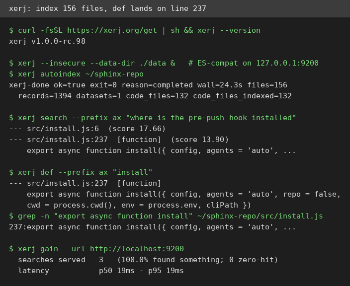
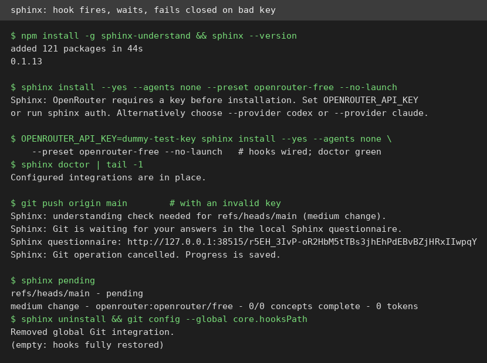
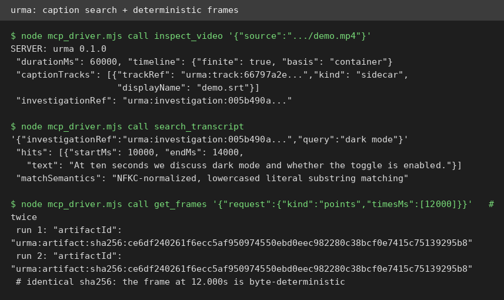

# AI Test Report — 2026-10-23
> A search engine that audits its own homework, a git hook that quizzes you before you push, a video investigator with byte-exact memory, two tiny skills that screen for the week's nastiest PHP bug, and one engineer's honest account of surviving the AI throughput shock.

## At a glance
- 🆕 **xerj**: a local-first search engine for coding agents; indexing and go-to-definition verified against real code, though the CLI search is lexical-only.
- 🆕 **sphinx**: a git hook that quizzes you on agent-written code before it ships; the machinery works and fails closed, but the live quiz needs a model account I didn't have.
- 🛠️ **php2shell-checker**: OpenAI's two skills that screen a site's PHP version against this week's critical CVEs; all six verdicts tested, caveats printed on every result.
- 🔌 **urma**: an MCP server that lets an agent search video captions and pull exact frames; deterministic and honest about its limits, but remote fetching died in this sandbox.
- ✍️ **"Enjoying Software Engineering in the Age of AI"**: a staff engineer's field notes on what doubled code output did to her team, and the unsexy fixes that worked.

## 🆕 Open-source project tests

### xerj — point your agent at a folder, stop paying it to re-read your repo ⭐4/5

- **In one sentence**: Xerj is a free search engine (Apache-2.0, one Rust binary, no JVM) that indexes any folder on your machine so a coding agent can pull the exact passage it needs instead of reading whole files into its context window (the working memory an AI model reads while answering).
- **Why it caught my eye**: 13,140 stars and updated today; the README claims a coding agent used 2.7x fewer output tokens at the same 16/16 solve rate in a controlled study, and it publishes where its own numbers break down.
- **I tried it**:
  - `curl -fsSL https://xerj.org/get | sh` installed v1.0.0-rc.98 to `~/.local/bin` (not added to PATH; noted, not fatal).
  - `xerj --insecure --data-dir ./data &` started clean: Elasticsearch-compatible API (an API that speaks the same protocol as the popular Elasticsearch search server) on 127.0.0.1:9200, plus REST on 8080 and gRPC on 8081.
  - `xerj autoindex` on a real JS repo: 156 files, 1,394 records, 132 code files indexed in 24.3s.
  - `xerj def "install"` returned `src/install.js:237`; `grep` on the repo confirmed line 237 is exactly `export async function install(...)`.
  - What surprised me: `xerj gain` reports counted usage from its own audit log (3 searches, p50 19ms, 100% hit rate) and explicitly excludes its own maintenance queries from your stats.
- **The catch**: the CLI `search` is lexical only; it prints "does not consult the embedding" itself, so vector and hybrid search live behind the API/MCP, not the one-liner. `--insecure` disables TLS and auth, and the README is blunt that this means a single-user dev machine only. The installer nudges you to file a field-report PR (opt out with `XERJ_DISABLE_FEEDBACK=true`). I did not independently verify the 2.7x token claim; that needs a coding agent and a budget.
- **Try it if**: you're a developer whose agent burns tokens re-reading your own repo every session.
- **Skip it if**: you search one small project; plain grep is still faster to reach for.
- **Score**: ⭐4/5 — everything I ran worked and the headline results verified against ground truth; docked one star for the lexical-only CLI and a trust boundary (`--insecure`) you must understand before using.
- **Link**: https://github.com/xerj-org/xerj

### sphinx — a git hook that quizzes you on your agent's code before it ships (no score)

- **In one sentence**: Sphinx is a free git hook (MIT) that pauses your push to a protected branch and asks you questions about what the changed code does when things go wrong, so you can't ship agent-written code you don't understand.
- **Why it caught my eye**: from this week's scout drafts; it attacks a real habit, rubber-stamping code your agent wrote, with a mechanism instead of a lecture.
- **I tried it**:
  - `npm install -g sphinx-understand` was clean: 121 packages in 44s, version 0.1.13.
  - `sphinx install` refuses to wire anything without a reviewer model account first: "OpenRouter requires a key before installation." No silent half-install.
  - With a dummy key: hooks wired, `sphinx doctor` green, `sphinx init` created `.sphinxconfig`, `.sphinxignore`, `.sphinxcontext.md`.
  - `git push origin main` fired the checkpoint: "understanding check needed for refs/heads/main (medium change)", Git waited on a local questionnaire URL. With the invalid key the session recorded 2 failed model calls, 0 questions, 0 tokens, and the check stayed pending; `sphinx check --json` gave a clear "OpenRouter requires an API key" error. It fails closed, never waves you through.
  - What surprised me: `sphinx yolo --reason "report test"` logged the skip with a timestamp, and `sphinx uninstall` removed the global hooks completely; a push afterwards went through normally.
- **The catch**: I could not run a live quiz. There is no reviewer model account on this VM (it needs a Codex or Claude plan, an OpenRouter key, or an OpenAI-compatible endpoint). Their own eval (2026-10-15, five small synthetic repos) is admirably blunt: 7 questions generated, 12 of 14 generated-question verdict probes matched, and the authors write "the result is not an all-green semantic evaluation"; one audit missed a real defect, and the run cost about $0.12 for 86 requests.
- **Try it if**: you run a coding agent and have a cheap model route to spend on quizzing yourself.
- **Skip it if**: you won't configure a reviewer model; without one this is a paperweight.
- **Score**: no score, couldn't test the live quiz (no model account on this VM); the machinery around it, install, hooks, checkpoint, skip logging, uninstall, all works as documented.
- **Link**: https://github.com/parthh01/sphinx

## ✍️ Tech article deep-dives

### "Enjoying Software Engineering in the Age of AI" — one company's numbers on the AI throughput shock
- **Read this if**: you lead a team where AI doubled output and halved everyone's patience.
- **The argument in 3 bullets**:
  - AI made experimenting cheap but engineering is still slow: at her company, merged PRs (pull requests, proposed code changes) rose about 70% year over year and merged code volume more than doubled, with only about 25% more engineers; review, testing, CI (continuous integration, the automated checks on every change), deployment and human attention all choked on twice the traffic.
  - The accountability gap: agents produce changes that get merged without the merger understanding them, so whoever debugs production inherits work they never agreed to; she calls untangling that history "pretty radicalizing."
  - The fixes are old and unsexy: modular code, clear ownership, explicit experiment-vs-production boundaries, plus a cultural rule borrowed from Tom Bedor, "if you are asking for human attention, demonstrate human effort"; she now refuses to review unclear requests and asks authors to self-review first.
- **Why it matters to you**: it puts numbers on a feeling many teams have, and the CI results (mandatory merge check 25 to 10 minutes, trunk red hours 145 to 55, flaky-test builds 25% to 12%) show the throughput pain is fixable with real investment, not just vibes.
- **My take**: the most honest piece I've read on this topic, because she admits her observability push started as a cynical attempt to prove AI slop caused incidents, and instead found that humans produce plenty of slop too. The cold water: it's one company's story, a fully remote scaleup on a monorepo (one giant shared code repository), and the "refuse unclear reviews" policy needs the psychological safety she says she was fortunate to have; your mileage will vary with your org's trust level.
- **Link**: https://kirahowe.com/2026/oct/20/enjoying-software-engineering-in-the-age-of-ai

## 🛠️ Agent skill tests

### php2shell-checker — two tiny skills that screen for the week's nastiest PHP bug ⭐5/5
- **In one sentence**: Two free official OpenAI skills (Apache-2.0) that read a site's advertised PHP version, from its URL or from the server itself, and warn if it predates the fix for the php2shell remote-code-execution flaws (CVE-2026-109618 and CVE-2026-109619, disclosed this week).
- **Why it caught my eye**: released October 21 to 22 by OpenAI; it does version checks only, never exploit probes, and the docs lead with the limits of what a header check can prove.
- **I tried it**:
  - Read both SKILL.md files in full. The URL skill wraps one Node script; the server skill is a playbook for checking distro package versions against Debian and Ubuntu advisories (tables verified 2026-10-22).
  - Ran the URL checker against five fake local servers with controlled headers: `PHP/8.1.34` gave exit 1 `potentially_vulnerable`; `PHP/8.3.36` gave exit 0 `ok`; no header gave exit 3 `unknown`; `PHP/8.2.20` hiding in the `Server` header gave exit 1; `PHP/8.1.99` gave exit 1, confirming end-of-life branches always warn even with high patch numbers. A garbage argument exited 2, matching the docs. All six behaviors exactly as documented.
  - The repo's own test suite: 49 passed, 0 failed. The repo-root `phpcheck.js` is a two-line shim over the skill's bundled copy, so the skill runs standalone with no Codex needed.
  - What surprised me: the care in the wording. Every result carries its own caveat: "HTTP headers cannot tell whether this version contains a backported fix" and "advertised version meets an upstream fixed release. Installed build not verified." The skill instructs agents to say "potentially vulnerable, never confirmed vulnerable."
- **The catch**: header sniffing only. A server that hides `X-Powered-By` returns UNKNOWN, which can't distinguish safe from stealthy, and backported distro patches are invisible to headers. The stronger server-side check needs real server access; no PHP is installed on this VM, so that path went untested. Installing the skills into Codex needs the Codex app.
- **Try it if**: you run or audit PHP sites and want a two-second triage this week.
- **Skip it if**: you need proof of patching; this is a screen, not an audit.
- **Score**: ⭐5/5 — every claim I tested checked out, and the honesty of the caveats is the feature; I'd send this to a friend running WordPress tonight.
- **Link**: https://github.com/openai/php2shell-checker

## 🔌 MCP tests

### urma — let your agent watch a video and cite the timestamp ⭐4/5

- **In one sentence**: Urma is a free local MCP server (Apache-2.0, version 0.1.0) that gives an AI agent five tools to search a video's captions and pull exact frames, so it can answer what's said and shown with timestamps instead of guessing.
- **Why it caught my eye**: from this week's scout drafts; it fills the gap where the key information sits inside a long talk and the docs say "coming soon."
- **I tried it**:
  - `npx -y urma-mcp@latest setup` worked on Node 24, fetching its own ffmpeg, ffprobe and yt-dlp; the server speaks MCP over stdio with five tools (inspect_video, search_transcript, read_transcript, get_overview, get_frames).
  - Built a 60-second test video with ffmpeg plus a hand-written subtitle file as ground truth. Local files require a `URMA_LOCAL_ROOTS` allowlist; without it you get a clear `LOCAL_SOURCE_DISABLED` error, which is the right default.
  - `search_transcript` for "dark mode" hit 10000 to 14000ms exactly, and documents its match semantics as "NFKC-normalized, lowercased literal substring matching." `read_transcript` on 8000 to 16000ms correctly narrowed to the one overlapping cue.
  - `get_frames` at 12.000s returned a frame showing the burned-in timecode `00:00:12.000`; requesting it twice produced byte-identical artifacts (same sha256). `get_overview` returned 12 evenly spaced cells, honestly labeled "sample-points-only."
  - What surprised me: the determinism, and how much of the honesty is in the schema itself ("hits are not visual proof", "cadence is discrete, not continuous").
- **The catch**: the headline remote-URL flow failed in this sandbox. The bundled yt-dlp (a PyInstaller binary with its own certificates) doesn't trust this VM's egress proxy CA, and urma's integrity checks block swapping the binary or passing `--no-check-certificate`, so YouTube acquisition never started. Version 0.1 does no speech-to-text: a video without captions has no transcript, full stop. Sidecar captions must be named exactly `demo.srt`, not `demo.en.srt`. Server startup takes about 30 seconds per spawn.
- **Try it if**: you're building a research agent that needs to cite video content with timestamps and frame evidence.
- **Skip it if**: your videos have no captions; there is no transcription fallback.
- **Score**: ⭐4/5 — the local pipeline is exact, deterministic, and admirably honest; docked one star because the remote-URL flow, the reason most people would install this, couldn't be verified here.
- **Link**: https://www.npmjs.com/package/urma-mcp

## Notes
- Failures and partials: urma's remote acquisition (sandbox TLS, not necessarily urma's bug); sphinx's live quiz (no reviewer model account); xerj's 2.7x token-saving claim (needs a coding agent and budget to verify independently).
- Worth following up: DeepSeek's DeepInfer inference engine (deepseek-ai/DeepInfer, released October 20) was this week's backup candidate; skipped because it needs data-center GPUs this VM doesn't have. A doc-read edition could cover it.
- The sphinx test left no residue: `sphinx uninstall` removed the global git hooks and pushes work normally again.
- Seen-list keys added this run: `github:xerj-org/xerj`, `github:parthh01/sphinx`, `skill:https://github.com/openai/php2shell-checker`, `mcp:urma-mcp`, `article:kirahowe-enjoying-software-engineering-2026-10-20`.
