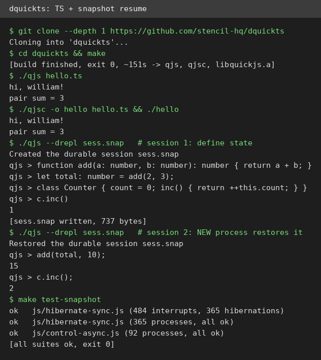
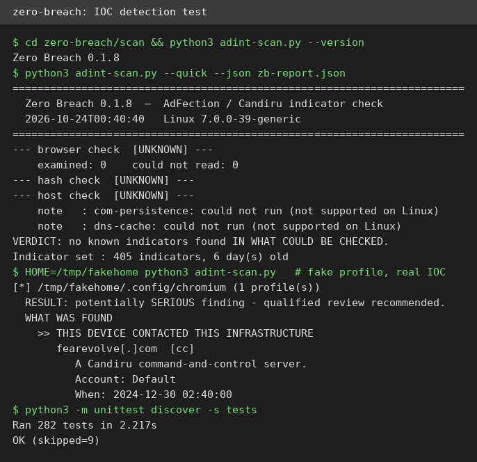
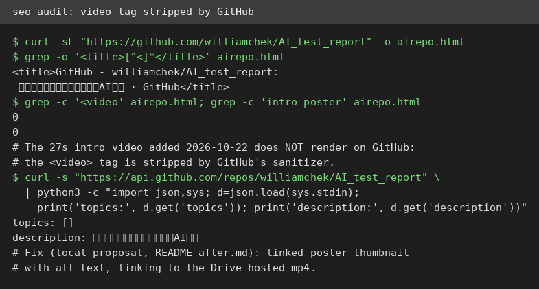
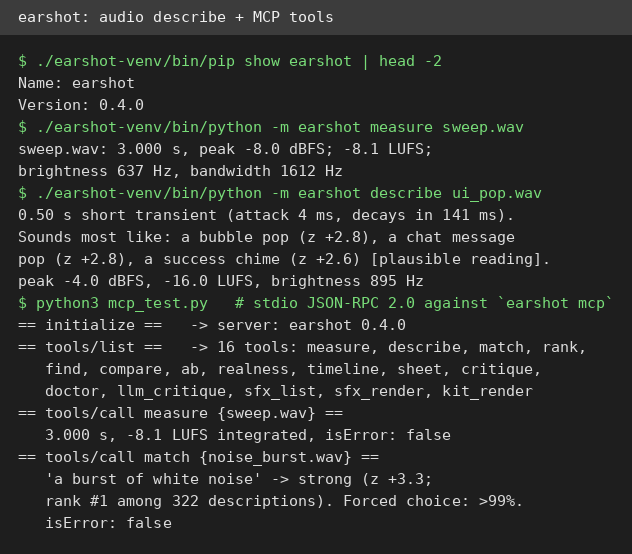

# AI Test Report — 2026-10-24
> A JavaScript engine that can pause mid-loop and wake up somewhere else, a spyware self-check with an honesty policy, and an audit that caught our own repo's invisible video.

## At a glance
- **dquickts** — a tiny JS engine that runs TypeScript directly and freezes live programs into resumable snapshots.
- **zero-breach** — a no-install scanner that checks your computer for traces of the AdFection spyware campaign.
- **"AI Agents Wrote 30% More Code. Finished Software Didn't Move."** — a Harvard study on where AI coding gains actually go.
- **seo-audit skill** — a 497-line audit playbook, tested against this very repo; it found a real bug in our README.
- **earshot MCP server** — gives an AI agent ears: it describes sounds, matches them against text, over a real MCP stdio connection.

## 🆕 Open-source project tests

### dquickts — freeze a running program, wake it up in a new process ⭐4/5

- **In one sentence**: a small JavaScript engine (the part of a browser that runs JS code) that executes TypeScript (JavaScript with type labels) with no compile step, and can save a running program's whole memory to a file and resume it in a different process.
- **Why it caught my eye**: pause-and-resume is exactly the primitive people want for checkpointing long AI agent tasks; it gained ~350 stars in its first five days after its 2026-10-19 debut.
- **I tried it**: cloned and ran `make` (about 151 seconds, exit 0). Ran a typed `hello.ts` directly with `./qjs hello.ts`: printed `hi, william!` and `pair sum = 3`, no transpile step. Compiled it to a self-contained 6.7MB binary with `qjsc`: same output. The durable REPL (an interactive prompt that runs code line by line): session 1 defined functions and a `Counter` class, wrote a 737-byte `sess.snap`; a brand-new process restored it and computed correctly (`add(total, 10)` gave `15`). What surprised me: the checkpoint survived a full process kill, not just a restart. `make test-snapshot` passed every suite, including 365 hibernations resumed across 365 separate processes.
- **The catch**: `qjs --drepl` hangs when stdin (piped input) closes, my piped test had to be SIGTERM'd. A snapshot only loads in the `qjs` build that wrote it. File and timer modules are unavailable inside the durable REPL, since host state can't be snapshotted. Rust bindings were not tested (no Rust toolchain on this VM).
- **Try it if**: you're building long-running agent or scripting systems and want real checkpoint/resume, not just a log.
- **Skip it if**: you just need a JS engine for web work, or you need a stable production runtime (this is days old).
- **Score**: ⭐4/5 — every core claim verified on the VM; the REPL stdin quirk and same-build-only snapshots are real annoyances.
- **Link**: https://github.com/stencil-hq/dquickts

### zero-breach — a spyware self-check that admits what it can't see ⭐4/5

- **In one sentence**: a read-only scanner you run on your own computer that looks for traces of the AdFection/Candiru spyware campaign (leftover browser records, known bad file fingerprints, auto-start tricks), and tells you honestly what it found and what it couldn't check.
- **Why it caught my eye**: it rides The Citizen Lab's 2026-10-15 "Exposing AdFection" report (an ad-tech firm allegedly used real-time ad bidding to deliver zero-click spyware, code that needs no tap or click, to 45+ Al Jazeera devices); everyone's first question is "am I affected?", and this is the community's self-check answer, trending to ~540 stars since 2026-10-18.
- **I tried it**: pure Python standard library, no install; `--version` printed `Zero Breach 0.1.8`. On this bare VM the quick scan ran in 0.2s but every check reported UNKNOWN (0 browser profiles found, hash check skipped, all host checks "not supported on Linux") with the verdict "no known indicators found IN WHAT COULD BE CHECKED", i.e., it checked nothing and says so loudly. What surprised me: that honesty is the feature. Then a synthetic test: I built a fake browser profile containing one real bundled indicator (`fearevolve.com`), and the scan flipped to a SERIOUS finding, naming it "A Candiru command-and-control server" with the URL defanged as `fearevolve[.]com` plus account, timestamp, and "do NOT open" guidance. The project's own suite: 282 tests, OK (9 skipped) in 2.2s.
- **The catch**: on a Linux server VM it can check essentially nothing; its real audience is personal Windows/macOS desktops. A clean result is not a clean bill of health: the author's own disclaimer says spyware of this grade is built to defeat exactly this kind of check. The optional file-pattern scan needs a separately installed pinned YARA-X engine.
- **Try it if**: you run Windows or macOS and want a fast, honest first check after reading the Citizen Lab report.
- **Skip it if**: you expect a forensic verdict; this is triage, and it tells you that up front.
- **Score**: ⭐4/5 — an unusually honest self-check whose detection path works; it is triage, not a real spyware detector, and says so itself.
- **Link**: https://github.com/interplains/zero-breach

## ✍️ Tech article deep-dives

### "AI Agents Wrote 30% More Code. Finished Software Didn't Move."
- **Read this if**: you lead a team using AI coding tools and your dashboard shows productivity climbing while shipping feels flat.
- **The argument in 3 bullets**: (1) More code, same software: after adopting AI agents, teams wrote 30% more lines of code, 20% more commits, 23% more pull requests, but finished output (completed work items after production deploy) didn't rise in any meaningful way, per a Harvard working paper covering 718 firms and ~725,000 workers from 2021 to March 2026. (2) The bottleneck moved to review: average PR review time rose 49%, bounced-back PRs nearly doubled, review comments per PR rose 35%. AI code-review tools didn't remove the human at the center; judging whether a change is right doesn't scale like typing. (3) Code was never most of the job: engineers spend only 30–40% of their time writing code, the rest is planning, review, testing, coordination. Speeding one third of the process can't move the whole.
- **Why it matters to you**: companies are measuring AI ROI with the wrong scoreboard (lines of code, commits, PRs measure activity, not results). The prescription: treat review as planned engineering work, keep AI-generated changes small enough to understand in one sitting, invest in automated tests before humans, and measure shipped features instead of code volume.
- **My take**: the "measure output, not activity" lesson is genuinely useful and free to adopt tomorrow; it will make your AI rollout look worse before it looks better, which is exactly why most dashboards avoid it. Cold water: this is a non-peer-reviewed working paper, data ends March 2026, it's observational rather than experimental, and the BizTechLab outlet shows no byline, so I cross-checked every figure against the paper-linked summaries before repeating it; the numbers matched.
- **Link**: https://biztechlab.in/opinion/ai-agents-wrote-30-more-code-finished-software-didnt-move

## 🛠️ Agent skill tests

### seo-audit — a 497-line playbook that audited our own repo and caught our missing video ⭐4/5

- **In one sentence**: a step-by-step instruction file (a skill is a playbook an AI agent follows) that turns an agent into an SEO auditor (SEO = making a page findable on search engines), checking titles, descriptions, headings, images, and links in priority order, outputting each finding as Issue / Impact / Evidence / Fix / Priority.
- **Why it caught my eye**: this repo is our public storefront, so an honest audit of it was the perfect real test; the skill is v2.2.2, MIT-licensed, no install needed. I rejected a trending alternative (`just-scrape`) because it hard-requires a paid API key with no free test path.
- **I tried it**: read all 497 lines of SKILL.md, then ran its framework against https://github.com/williamchek/AI_test_report fetched with `curl` (247,680 bytes). The heading hierarchy was clean (one H1, good H1-to-H2 structure). What surprised me: the biggest win was a rendering bug, not SEO theory. Counting `<video`, `intro_poster`, and `AI_test_report_intro.mp4` occurrences in the rendered HTML returned 0, 0, 0: GitHub strips `<video>` tags from READMEs, so the 27-second intro video we added on 2026-10-22 is invisible on the repo page. The skill's image/link checks caught what a pure SEO reading would have missed. I drafted a local fix (linked poster thumbnail with alt text pointing at the Drive-hosted mp4), not committed.
- **The catch**: the skill assumes a normal website; parts don't apply to GitHub (page title and description come from the repo About box; you don't control sitemaps). The two highest-impact fixes, an English repo description and topic tags, are settings William would make in the repo's About section, not file changes. I touched nothing public; the fix is a local proposal.
- **Try it if**: you maintain a site or repo page and want a systematic, evidence-linked audit rather than a vibes-based one.
- **Skip it if**: your whole presence is a GitHub repo; half the playbook won't apply, though the image/link checks alone were worth it.
- **Score**: ⭐4/5 — a thorough playbook that caught our own invisible video; parts assume a normal website, not a GitHub repo.
- **Link**: https://github.com/coreyhaines31/marketingskills/tree/main/skills/seo-audit

## 🔌 MCP tests

### earshot — give your coding agent ears, over a working MCP server ⭐4/5

- **In one sentence**: a tool that lets an AI agent "hear" audio files: describe what a sound is, check how well it matches a text description, or find the best moment in a long recording; it runs locally on CPU and ships as a CLI, a Python API, and an MCP server (MCP is a standard way for AI apps to call external tools).
- **Why it caught my eye**: the MCP angle is the test that matters: does the stdio server actually work and return real tool results? Concrete and testable with zero API keys; v0.4.0 with a 252-sound bank.
- **I tried it**: installed from the GitHub clone (PyPI has a *different* package also named `earshot`, a voice-activity-detection tool by Carson M: `pip install earshot` gets the wrong one; pip also needed TMPDIR pointed at the workspace since /tmp is a 512MB tmpfs). Model-free commands worked immediately: `measure` gave real LUFS loudness numbers on a synthesized sweep. I synthesized three test WAVs in pure Python (UI pop, noise burst, 200Hz-to-2kHz sweep). Model download: the stock downloader stalled at 0% for 6+ minutes, so I fetched the two models directly (741MB CLAP, 331MB AST) via documented env vars. `describe` read my synthesized UI pop correctly: "0.50 s short transient... sounds most like: a bubble pop (z +2.8)". Then the core test: spawned `python -m earshot mcp` and spoke raw JSON-RPC 2.0; `initialize` reported server `earshot 0.4.0`, `tools/list` returned 16 tools, and `tools/call` on `measure`, `sfx_list`, `describe`, and `match` all returned real correct results with `isError: false`. What surprised me: the verdicts are calibrated, not vibes; `match` quoted a held-out evidence base and rated the pop reading "plausible" (z +2.8) instead of overclaiming, and `match` on the noise burst scored "strong" (z +3.3, >99% in a forced choice).
- **The catch**: heavy: 1.1GB of models, ~68s model load per process on this 2-CPU VM (the MCP server keeps them loaded, which is the point). The first-run download path is fragile here. `llm` critique needs your own Gemini key (not tested). The docs' own caveat: the `forge` synthesis search optimizes against its own models, so it can game its own grader; they disclose this.
- **Try it if**: your agent pipeline handles audio (game SFX, media QA, video tooling) and you want machine-listenable judgments over MCP.
- **Skip it if**: you just need loudness numbers: ffmpeg (a command-line media tool) does that without a gigabyte of models.
- **Score**: ⭐4/5 — model verdicts came back calibrated and correct over stdio; the install is heavy and the first download was fragile.
- **Link**: https://github.com/Leonxlnx/earshot

## Notes
- GitHub strips `<video>` tags from READMEs: our 27s intro video is invisible on the repo page (found during the seo-audit test). Proposed fix (linked poster thumbnail to the Drive mp4) is staged as a local diff, not committed; the About-box edits (English description, topic tags) need William's click.
- PyPI name collision: there are two unrelated "earshot" packages; the agent-audio one is GitHub-only.
- Draft pool in the private drafts repo is exhausted (all 8 Oct-19 briefs already covered); today's items were all freshly sourced.
