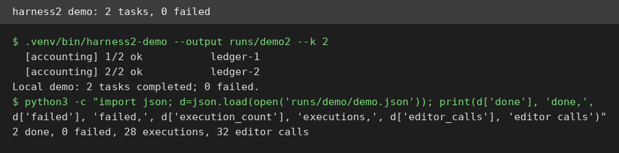
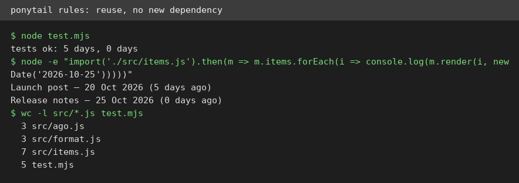
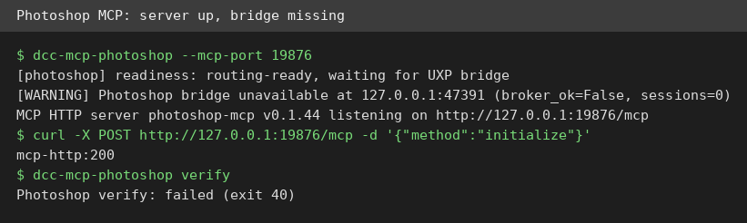

# AI Test Report — 2026-10-25
> Today every item is about making AI helpers better at their jobs: a setup that improves itself, an office suite for agents, and a lazy senior developer as a skill.
## At a glance
- Harness²: Google's tool that teaches an AI setup to improve itself, and its free demo runs with no account.
- GenOffice: a free office suite your agent can drive from typed commands, and I built its command tool from source.
- Ponytail: a lazy senior developer living inside your AI helper, tested on a small real task.
- Skills, commands, subagents, hooks: a short guide that picks the right reuse trick with two questions.
- Photoshop MCP: a server that lets an AI drive Photoshop, tested as far as a machine without Photoshop allows.
## 🆕 Open-source project tests
### Harness² — Google's tool that teaches an AI setup to improve itself ⭐4/5

- **In one sentence**: Harness² is a framework that refines the setup around an AI model, called a harness (the setup around a model that lets it act), in rounds, called recursion (rounds where a system improves its own setup).
- **Why it caught my eye**: It is a Google Research project from 2026-10-06 with about 19,000 stars, and its demo promises a real run with no model account needed.
- **I tried it**: installed it with `python3 -m venv .venv` and `.venv/bin/pip install -e '.[render]'`, then ran `.venv/bin/harness2-demo --output runs/demo2 --k 2`.
- **I tried it**: the demo finished 2 accounting tasks with 0 failed, 28 executions, and 32 editor calls, all printed in the log above.
- **I tried it**: what surprised me is the shared lesson library: it started empty and held 1 entry by the second task, which is the self-improvement loop working in miniature.
- **The catch**: the demo uses fixed, scripted editors, not a real model, so it proves the plumbing, not the paper's score gains. Real benchmark runs need paid cloud accounts and are untested here.
- **Try it if**: you're a researcher or builder who wants to study agent setup design with real code.
- **Skip it if**: you want a tool that makes your daily agent better today, with no research setup.
- **Score**: ⭐4/5 — the no-account demo runs exactly as documented, but the headline gains remain the paper's claims, not mine.
- **Link**: https://github.com/google-research/harness2

### GenOffice — a free office suite your agent can drive from typed commands ⭐4/5
- **In one sentence**: GenOffice is a free alternative to Microsoft Office that opens and saves real Word, Excel, and PowerPoint files, plus a command tool for agents.
- **Why it caught my eye**: It has about 10,700 stars, and its agent skill (a reusable instruction file for an agent) promises document work with no window open and no copy paste.
- **I tried it**: the command tool is not on npm, so I cloned the repo and built it from source with `node build.mjs` in `packages/cli`, which produced a working `genoffice` 0.10.0 tool.
- **I tried it**: `genoffice create --type docx --from in.md --out out.docx --json` returned status ok, and `genoffice docs read out.docx` showed my heading, paragraph, and both list items intact.
- **I tried it**: a spreadsheet from CSV also worked, reporting 1 sheet and 8 cells, but `genoffice sheet read` failed because its spreadsheet helper, called a sidecar (a helper program running alongside), ships only with the packaged app.
- **I tried it**: what surprised me is how good the error messages are: every failure came back as one JSON object with a stable error code and a next step.
- **The catch**: the first `npm install` failed here with a file permission error, and only a retry with `--ignore-scripts --no-bin-links` finished, adding 1,068 packages. Most users should just download the app instead of building from source.
- **Try it if**: you're a builder who wants an agent to create and check real office files from scripts.
- **Skip it if**: you only need to edit one document by hand, since the desktop app is the simpler path.
- **Score**: ⭐4/5 — the document tool works from source and its errors are excellent, but the build is rough and one read path needs the packaged app.
- **Link**: https://github.com/genspark-ai/genoffice

## ✍️ Tech article deep-dives
### Skills, Commands, Subagents or Hooks: Which to Use — four ways to reuse AI instructions, and when to use each
- **Read this if**: you use an AI coding helper and keep pasting the same instructions into it.
- **The argument in 3 bullets**: Ask whether a rule must hold every time: if yes, use a hook, a command that runs outside the model on every matching event. Ask how much the job must read: a long review belongs in a subagent, a separate helper with its own context window, so it does not crowd your main chat. Otherwise, pick a skill when the agent should start the job itself, or a slash command when you want to type it yourself.
- **Why it matters to you**: most people pile up prompts with no system, and this chart turns that pile into four clear choices in under a minute.
- **My take**: the flowchart is the whole article, and it is genuinely useful, but the piece is short, assumes one vendor's tool, and ends with a product pitch, so readers on other tools must translate the file paths themselves.
- **Link**: https://bridgedev.io/blog/claude-code-skills-commands-subagents-hooks-which-to-use

## 🛠️ Agent skill tests
### Ponytail — a lazy senior developer living inside your AI helper ⭐4/5

- **In one sentence**: Ponytail is a skill that tells your AI helper to solve each task with the smallest change that fully works, reusing what already exists first.
- **Why it caught my eye**: It has about 175,000 stars and claims its agents write about half the code of unassisted ones, a bold claim worth checking in miniature.
- **I tried it**: I read `skills/ponytail/SKILL.md` and followed it literally on a scratch notes app: check existing code first, reuse it, add no new dependency, and add a small test for new logic.
- **I tried it**: the task was adding a "days ago" label, and the result was a 3 line helper, a small edit to the display code, and a 5 line test, with no new package.
- **I tried it**: what surprised me is how practical the rule list is: it names the exact order to try, from existing code, to standard library, to installed packages, and it forbids cutting validation or security to save lines.
- **The catch**: I tested the skill text as a playbook, not the plugin install, since this machine has no Claude Code or Codex tool. The project's own docs say copying the skill file works for other agents, which is what I did.
- **Try it if**: you're a coder whose AI helper keeps building elaborate solutions for simple tasks.
- **Skip it if**: you want the agent to explore freely, since this skill deliberately narrows it down.
- **Score**: ⭐4/5 — the rules are concrete and my small test came out clean, but the big code-saving numbers are the project's own benchmark, not an independent check.
- **Link**: https://github.com/DietrichGebert/ponytail

## 🔌 MCP tests
### dcc-mcp-photoshop — let your AI drive Photoshop, if you own Photoshop ⭐3/5

- **In one sentence**: This is a server using MCP (a standard plug that connects AI tools) that lets an AI assistant control Adobe Photoshop through typed instructions.
- **Why it caught my eye**: Photoshop control from plain language is a long standing wish, and this project, version 0.1.44, installs from pip with a full status and verify flow.
- **I tried it**: `pip install dcc-mcp-photoshop` in a virtual environment worked, and `dcc-mcp-photoshop --version` printed 0.1.44.
- **I tried it**: starting the server on port 19876 worked: it reported readiness as "routing-ready, waiting for UXP bridge" and answered an initialize request with HTTP 200.
- **I tried it**: what surprised me is the honest warning in the log: "Photoshop bridge unavailable", with 0 sessions, plus 15 built-in skills discovered at startup.
- **The catch**: no Photoshop runs on this machine, so no real edit was ever driven. Its own signals disagree: `status` printed ok while `verify` failed with exit code 40. Its docs also mention an embedded mode flag that the installed tool rejects as unknown.
- **Try it if**: you're a designer with Photoshop on Windows or Mac who wants to automate repetitive edits by instruction.
- **Skip it if**: you do not own Photoshop, since without it this server answers but drives nothing.
- **Score**: ⭐3/5 — the server half runs and reports clearly, but the Photoshop half is untested here and its own checks contradict each other.
- **Link**: https://github.com/dcc-mcp/dcc-mcp-photoshop

## Notes
- GenOffice install detail: the first `npm install` failed with a permission error on a file ownership change, and the retry with `--ignore-scripts --no-bin-links` succeeded. This looks like a machine restriction, not a project bug.
- Ponytail's benchmark detail: the file `benchmarks/results/2026-10-07-agentic.md` documents 39 tasks, 5 runs each, on one model, with the median of 5 runs reported. Those numbers come from the project itself.
- Photoshop MCP detail: the first server start on port 9765 failed to bind, while the second on port 19876 listened fine. I report both as observed, with no cause confirmed.
- Follow-up worth watching: whether GenOffice publishes its command tool as a standalone install, which would remove the whole source build step.
