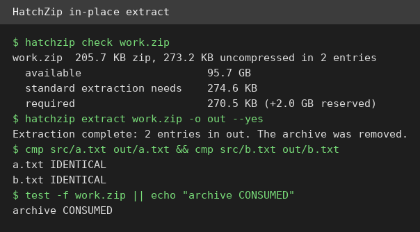
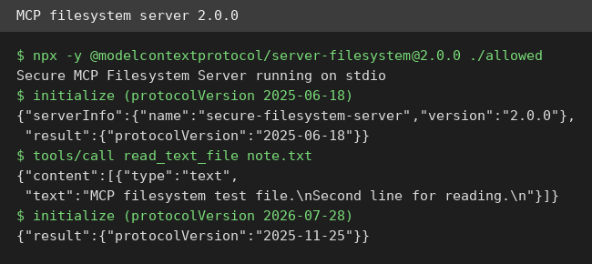

# AI Test Report — 2026-10-26
> Today is about space and standards: a tool that unpacks archives without needing room for both copies, a guard for agents that stops at its first check, and the rules that let agent skills travel between tools.
## At a glance
- HatchZip: unpack big downloads on a nearly full disk, because it eats the archive as it goes.
- OpenShell: NVIDIA's guard for AI agents, but on this machine it stopped at the first check.
- Agent Skills joins a neutral home: what actually changed on 22 October, and what still does not travel.
- PDF skill: a plain instruction file that extracts, merges, and splits PDFs, tested end to end.
- MCP filesystem server 2.0.0: the official file server works, but its newest protocol answer was a surprise.
## 🆕 Open-source project tests
### HatchZip — unpack huge downloads on a nearly full disk ⭐4/5

- **In one sentence**: HatchZip unpacks archives (compressed bundles of files) by eating the archive as it goes, so you need room for the unpacked files only.
- **Why it caught my eye**: It was created 2026-10-21, already has 1,937 stars, and version 0.1.5 came out 2026-10-25. It claims a 180 GB download needs only a little over 200 GB to unpack.
- **I tried it**: I downloaded the Linux package (11.8 MB), unpacked the binary without installing it, and `hatchzip --version` printed 0.1.5.
- **I tried it**: `hatchzip check work.zip` showed a 205.7 KB archive, 273.2 KB unpacked, and 270.5 KB required, before touching anything.
- **I tried it**: the first extract refused without `--yes`, a safety guard I liked. With `--yes` it finished, both files matched exactly (checked with `cmp`, a byte comparison tool), and the archive was gone.
- **I tried it**: what surprised me is that guard: most unpackers never ask before deleting your archive.
- **The catch**: this machine has no Rust toolchain (the language it is written in), so I tested the release binary, not a source build. My test was 273 KB, not a nearly full disk, so the headline tight-disk claim is the project's own test, not mine. The Windows build is unsigned, so Windows warns before running it.
- **Try it if**: you're a gamer or downloader with a nearly full disk and big archives to unpack.
- **Skip it if**: you have plenty of free space, since normal unpackers already work fine.
- **Score**: ⭐4/5 — everything I ran worked exactly as documented, but the tight-disk headline is untested at real scale.
- **Link**: https://github.com/xevrion/hatchzip

### OpenShell — NVIDIA's guard for fleets of AI agents ⭐3/5
- **In one sentence**: OpenShell is NVIDIA's runtime (a guard layer that runs agents inside limits) that controls what files, network, and credentials each AI agent can touch.
- **Why it caught my eye**: It has 19,864 stars, version 0.1.5 is current, and it promises kernel-level enforcement (rules checked by the operating system core).
- **I tried it**: I downloaded the Linux tarball (a compressed bundle), and `./openshell --version` printed 0.1.5. Its help listed sandbox, policy, and gateway commands.
- **I tried it**: `openshell status` said "No gateway configured", where a gateway is the control program that manages sandboxes (isolated workspaces for agents). `sandbox create --name demo` then failed with "No active gateway".
- **I tried it**: `openshell doctor check` failed at its first check: "failed to execute docker info", because this machine has no Docker (a tool for isolated app containers).
- **I tried it**: what surprised me is how good the errors are: each one names the exact next command to run.
- **The catch**: no Docker here means no sandbox, no gateway, and no agent run was possible. Its headline safety claims are untested here, not disproven.
- **Try it if**: you're a team running fleets of agents on machines with Docker, and you want policy limits on them.
- **Skip it if**: you run one agent on your own laptop, since this is fleet infrastructure, not a personal tool.
- **Score**: ⭐3/5 — the CLI runs and reports honestly, but the product itself could not run on this machine.
- **Link**: https://github.com/NVIDIA/OpenShell

## ✍️ Tech article deep-dives
### Agent Skills joins the Agentic AI Foundation — what the open standard changes, and what a skill still leaves behind
- **Read this if**: you write instructions for AI agents and wonder whether they survive switching tools.
- **The argument in 3 bullets**: On 22 October 2026 Anthropic gave the Agent Skills format to the Agentic AI Foundation (a neutral group under the Linux Foundation), along with three other projects, taking the foundation to 10 projects. Nothing in your existing skills changes: same six fields, same folder layout, no version number yet, and the spec repository had not changed since 9 August. Portability is partial: the folder and body travel, but agent-specific extras (hooks that run on events, MCP wiring, variable substitution) stay behind.
- **Why it matters to you**: if your team mixes two agent tools, one canonical skill folder plus symlinks (shortcuts pointing at the same folder) beats maintaining two copies.
- **My take**: the most useful part is the nine-agent comparison table, which shows `.agents/skills/` as the shared folder except in Claude Code. Cold water: the 280 million installs figure comes from a registry that admits it does not count unique people, and security guidance for installing strangers' skills is still only a proposal. Read it before you copy a skill folder into a second tool.
- **Link**: https://stackness.dev/blog/agent-skills-open-standard-agentic-ai-foundation-what-changes

## 🛠️ Agent skill tests
### pdf — a plain instruction file that handles PDFs end to end ⭐4/5
- **In one sentence**: The pdf skill is a plain instruction file (a SKILL.md that tells an agent how to do one job) for reading, merging, splitting, and editing PDF files (a fixed-layout document format).
- **Why it caught my eye**: It ships in anthropics/skills, and the article above uses PDF work as its example skill, so I tested the real thing.
- **I tried it**: I read `skills/pdf/SKILL.md` and installed pypdf 6.21.2 in a virtual environment (an isolated Python setup), as the skill instructs.
- **I tried it**: I made two one-page PDFs with LibreOffice, extracted text from both, and both sentences came back exactly.
- **I tried it**: I merged them into one 2-page PDF, then split it back into two files, and the second split file still held its exact sentence.
- **I tried it**: what surprised me is how little magic is involved: the skill is short and tool-based, so the whole test needed no AI model at all.
- **The catch**: I tested extract, merge, and split only. Form filling, watermarks, and OCR (reading text from scanned images) are in the skill but untested here.
- **Try it if**: you're a builder whose agent must handle PDFs with scripts, not by opening a viewer.
- **Skip it if**: you only need to read one PDF once, since a viewer is faster.
- **Score**: ⭐4/5 — every operation I tested worked exactly as written, but three skill areas remain untested.
- **Link**: https://github.com/anthropics/skills

## 🔌 MCP tests
### Official MCP filesystem server 2.0.0 — the file server works, the newest protocol answer surprises ⭐4/5

- **In one sentence**: This is the official file server using MCP (a standard plug that connects AI tools), version 2.0.0, that lets an agent read files in folders you allow.
- **Why it caught my eye**: It came out 2026-10-19, eight days after 1.0, promising support for both the newest protocol revision and older clients.
- **I tried it**: `npx -y @modelcontextprotocol/server-filesystem@2.0.0 ./allowed` started, naming itself secure-filesystem-server 2.0.0.
- **I tried it**: initialize with 2025-06-18 answered 2025-06-18, tools/list worked, and read_text_file returned my two test lines exactly.
- **I tried it**: initialize asking for 2026-07-28 answered 2025-11-25 instead, so the newest protocol did not come back through the handshake I used.
- **I tried it**: what surprised me is the honest versioning: it lists a deprecated read_file tool right next to its replacement.
- **The catch**: I tested the file tools only, not the memory, git, or other reference servers. The newest protocol path may need the server/discover route, which I did not test.
- **Try it if**: you're a builder wiring an agent to local files and you want the current official server.
- **Skip it if**: you need the newest protocol today, since my handshake test did not confirm it.
- **Score**: ⭐4/5 — the older protocol path works perfectly, but the newest protocol claim is unconfirmed by my test.
- **Link**: https://www.npmjs.com/package/@modelcontextprotocol/server-filesystem

## Notes
- OpenShell needs Docker: retest the sandbox and gateway when Docker is available on this machine.
- HatchZip tight-disk claim: the project's own test used a 220 MiB disk, while mine used 273 KB of files. A small-disk retest would close that gap.
- MCP modern-era path: test the server/discover route to see whether 2026-07-28 support exists outside the initialize handshake.
- PDF skill areas left untested: form filling, watermarks, and OCR on scanned PDFs.
