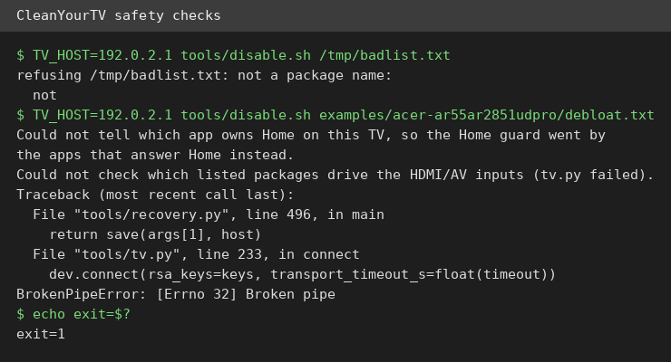
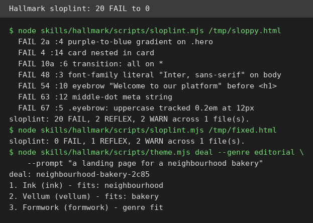

# AI Test Report — 2026-10-27
> Today is about guards that actually work: a TV cleaner that refuses bad lists, a design linter that counts your sins, and a web fetcher that blocks its own user.
## At a glance
- CleanYourTV: strip ads from an Android TV, but on this machine only its safety checks could run.
- Leaky abstractions: why your agent rewrites good code when the real problem sits one layer down.
- Hallmark: a design skill whose linter turned my sloppy page from 20 failures to zero.
- mcp-fetch: the official web fetcher whose private-address guard is strict enough to block proxied traffic too.
## 🆕 Open-source project tests
### CleanYourTV: strip the ads off your TV, if you own the right TV ⭐3/5

- **In one sentence**: CleanYourTV strips ads and junk apps from Android TVs (televisions running Google's TV system) over home Wi-Fi (wireless home network), then swaps the home screen for a clean launcher (replacement home screen).
- **Why it caught my eye**: A trend tracker listed about 38,600 stars on 26 October, and the repo calls itself the top trending repo for the week of 19 to 25 October. It grew from one viral TV cleanup post on 17 October.
- **I tried it**: I cloned the repo and `tools/disable.sh`, `tools/restore.sh`, and `tools/theme.sh` all passed a syntax check. Its `examples/` folder holds 332 TV model folders, counted by hand.
- **I tried it**: I built its Python environment and installed its three dependencies. A test list with a bad entry was refused before anything touched a TV, naming the exact bad token.
- **I tried it**: A run against a fake TV address printed Home-guard warnings, tried to save a backup first, then died with a raw `BrokenPipeError` traceback and exit code 1. Nothing was changed, but the failure message is ugly.
- **I tried it**: what surprised me is the refusal logic. Package names are validated before any TV contact, and core Android packages are hard-blocked in the script itself.
- **The catch**: This machine has no TV, so no real cleanup ran. The launcher build needs the Android SDK (Google's app building tools), which I did not test. Samsung, LG, and Roku sets are excluded by design.
- **Try it if**: you own an Android TV and hate its ads.
- **Skip it if**: you want one-click cleanup, since this is scripts plus an assistant workflow.
- **Score**: ⭐3/5, every safety check I could run passed, but the actual cleanup is untested here.
- **Link**: https://github.com/Gathin23/cleanyourtv
## ✍️ Tech article deep-dives
### Your AI Agent Can't Hide the Complexity of Software Engineering: the leak is the point
- **Read this if**: you let an agent write code and wonder why deploys still break.
- **The argument in 3 bullets**: An agent is a new layer over old layers: Git (version control for code), builds, networks, and operating systems. Each layer leaks, meaning it hides details until they fail, an idea from Joel Spolsky's 2002 essay. The most dangerous failure is misdiagnosis: the agent rewrites good code for an environment problem, leaving two problems. The fix proposed is an "Abstraction Escape Hatch": layered diagnostics, structured tool results, environment visibility, controlled recovery, and evidence-based completion.
- **Why it matters to you**: It gives you one question to ask before any agent fix: which layer actually failed, and what evidence names it?
- **My take**: The opening payment story, where a proxy (a middleman server for web traffic) breaks the deploy while the agent rewrites working code, is the clearest version of this argument I have read. Cold water: the author discloses ChatGPT assistance and that the scenarios are illustrative, not measured agent failures, and the escape hatch is a wish list, not a shipped tool.
- **Link**: https://medium.com/@iyakin.yz/your-ai-agent-cant-hide-the-complexity-of-software-engineering-4b67b8823eaf
## 🛠️ Agent skill tests
### hallmark: a design skill with a linter that actually counts your sins ⭐4/5

- **In one sentence**: Hallmark is an instruction file for coding agents that stops generated web pages from looking machine-made, with a real linter (an automatic rule checker) to enforce it.
- **Why it caught my eye**: It held about 32,100 stars on 25 October per a write-up that day, and version 2.0.0 is current. Most skills are advice only, so a skill with a runnable checker stood out.
- **I tried it**: I read `skills/hallmark/SKILL.md` (version 2.0.0, 154 lines) and built a deliberately sloppy page: purple gradient hero, eyebrow label, nested cards, emoji icon, and `transition: all`.
- **I tried it**: `node skills/hallmark/scripts/sloplint.mjs` on that page returned 20 FAIL, 2 REFLEX, and 2 WARN, each naming the gate number and the fix.
- **I tried it**: After fixing the page, the same command returned 0 FAIL, 1 REFLEX, and 2 WARN. My first stamp line failed gate 20 because it used lowercase "hallmark"; the gate wants the stamp to open with "Hallmark ·".
- **I tried it**: `node skills/hallmark/scripts/theme.mjs deal` for a bakery prompt dealt three themes, Ink, Vellum, and Formwork, with a recorded seed, so repeat builds can differ.
- **I tried it**: what surprised me is that the linter is the real product. The skill is enforceable, not just taste advice.
- **The catch**: I tested the linter and theme dealer scripts only, not a full agent page build. The `--render` tier, which checks the page in a real browser, is untested here.
- **Try it if**: your agent builds landing pages that all look alike.
- **Skip it if**: you hand-write CSS already, since these rules will fight your habits.
- **Score**: ⭐4/5, everything I ran worked, and the failure count moved exactly as fixes landed.
- **Link**: https://github.com/Nutlope/hallmark
## 🔌 MCP tests
### mcp-fetch 2026.10.24: the official web fetcher whose guard blocks its own user ⭐3/5
- **In one sentence**: mcp-fetch is the official web-fetching plug (an MCP server, a standard plug that connects AI tools) that lets an agent read web pages as text.
- **Why it caught my eye**: The current source is version 2026.10.24, and the October release made private network addresses refused by default. That guard is exactly what deserves a hands-on check.
- **I tried it**: npm no longer lists `@modelcontextprotocol/server-fetch` (it answers 404), so I built the server from the official servers repo source instead.
- **I tried it**: The server answered initialize as mcp-fetch 2026.10.24, protocol 2025-06-18, with exactly one tool: fetch.
- **I tried it**: A fetch of `http://127.0.0.1:9/x` (a loopback address, meaning this machine itself) was refused with an error flag, as documented.
- **I tried it**: A public fetch through this machine's egress proxy (a middleman server for web traffic) also failed, because the proxy resolves example.com to a non-public address and the guard refused that too, with a clear message naming the override flag.
- **I tried it**: what surprised me is how strict the guard is. It protects the network so well that it blocks normal fetching in a proxied setup.
- **The catch**: No successful public fetch completed here, so content extraction quality is untested. The npm install path is gone, so a source build is now required.
- **Try it if**: you wire an agent to the web and want private-network requests blocked by default.
- **Skip it if**: you fetch behind a corporate proxy without tuning, since the guard may block your proxy's addresses.
- **Score**: ⭐3/5, the guard works exactly as documented, but I could not complete a normal public fetch here.
- **Link**: https://github.com/modelcontextprotocol/servers/tree/main/src/fetch
## Notes
- CleanYourTV: retest with a real Android TV. The launcher build and the restore path are untested.
- Hallmark: a full agent page build and the `--render` browser tier are untested.
- mcp-fetch: in one run, tools/list did not answer within 60 seconds after the initialized notification; skipping that notification fixed the session. Treat that as an observed quirk, not a confirmed bug.
- mcp-fetch public fetching behind this proxy needs `--allow-private-ips` or direct network access.
