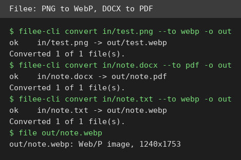
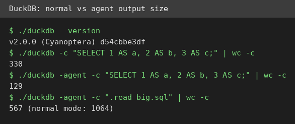
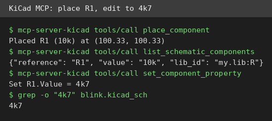

# AI Test Report — 2026-10-28
> Today is about tools that quietly do the boring work: a file converter that never uploads, a database that answers agents in fewer words, and an audit skill that refuses to call a guess a finding.
## At a glance
- Filee: convert files on your own machine, no uploads, no account.
- DuckDB 2.0.0: a pocket database with a shorter agent mode and one missing trigger type.
- The AI coding bottleneck: firms write 30% more code and finish no more work.
- security-audit: an audit skill whose validator rejects sloppy findings.
- mcp-server-kicad: an AI plug that edits circuit-board files, even without KiCad installed.
## 🆕 Open-source project tests
### Filee: turn one file type into another, without uploading anything ⭐4/5

- **In one sentence**: Filee converts files between formats on your own computer, so your files never leave your machine.
- **Why it caught my eye**: Version 2.1.0 landed on 24 October, and the repo held 14,754 stars on 28 October.
- **I tried it**: `filee-cli convert in/test.png --to webp -o out` turned a 2,862-byte PNG (a common image format) into a 1,972-byte WebP (a smaller web image format).
- **I tried it**: `filee-cli convert in/note.docx --to pdf -o out` turned a Word document into a 1-page PDF (a fixed-layout document) with one command.
- **I tried it**: One batch command converted 5 PNG files, 5 of 5 ok, and the formats list spans 17 groups, from images to fonts to subtitles.
- **I tried it**: What surprised me is that a plain text file converted to WebP produced a 1240x1753 image of the text, like a printed page.
- **The catch**: The Linux download is about 129MB. I tested only the command line tool, not the visual app. Some formats need extra engines installed inside Filee.
- **Try it if**: you convert files often and dislike uploading them to random websites.
- **Skip it if**: you convert one file a month, since your system tools already cover that.
- **Score**: ⭐4/5, every conversion I ran worked, including the odd text-to-image one.
- **Link**: https://github.com/KnifeLemon/Filee
### DuckDB 2.0.0: a pocket database that answers agents in fewer words ⭐4/5

- **In one sentence**: DuckDB is a database that reads CSV (comma-separated data files) and Parquet (a column-based data format) files directly, with no server to set up.
- **Why it caught my eye**: Version 2.0.0 arrived on 21 October, and its agent mode claims to cut output for coding agents by 59%.
- **I tried it**: `./duckdb --version` printed v2.0.0 (Cyanoptera).
- **I tried it**: A VARIANT column (a flexible column for mixed-shape data) stored two different JSON (a text data format) shapes, and `->>` read values from both.
- **I tried it**: A statement-level trigger (an automatic rule on data change) fired and wrote one audit row, but a row-level trigger failed with "not yet supported".
- **I tried it**: Agent mode shrank a small query from 330 bytes to 129, and a 20-row table from 1,064 to 567, which is 61% and 47% smaller.
- **I tried it**: What surprised me is the honesty of the trigger error. It names the missing feature instead of silently doing nothing.
- **The catch**: Row-level triggers are missing, so per-row audit logging is unavailable yet. My 47% to 61% range brackets the claimed 59%, but it does not prove it.
- **Try it if**: you analyze data files and want a database without server setup.
- **Skip it if**: you need row-level triggers today.
- **Score**: ⭐4/5, the headline features work, with one named gap.
- **Link**: https://duckdb.org/2026/10/21/announcing-duckdb-200.html
## ✍️ Tech article deep-dives
### The AI Coding Boom Has a Bottleneck Nobody Talks About: more code, same finished work
- **Read this if**: your team ships AI-written code and reviews feel slower, not faster.
- **The argument in 3 bullets**: A Harvard paper tracked 725,938 workers at 718 firms, using about 300 million work events from January 2021 to March 2026.
- **The argument in 3 bullets**: Code written rose about 30%, but finished work, counted as deployed Jira issues (tracked tasks), barely moved and the gain was statistically zero.
- **The argument in 3 bullets**: Review absorbed the extra code. Pull-request-to-merge time rose 49%, from 7.03 days to about 10.5, and change requests nearly doubled.
- **Why it matters to you**: It tells you which number to watch: time from pull request (a proposed code change) to merge, not lines written. Otherwise you celebrate output while the queue grows.
- **My take**: The two-channel split is the useful part. If the problem is volume, add reviewers. If the problem is quality, only better tools help, and the paper says the data shows both. Cold water: this is a working paper, not peer-reviewed work, the data ends in March 2026, and the sample is self-selected Jellyfish clients.
- **Link**: https://medium.com/predict/the-ai-coding-boom-has-a-bottleneck-nobody-talks-about-874f10b5beba
## 🛠️ Agent skill tests
### security-audit: an audit skill that makes your agent prove each finding ⭐4/5
- **In one sentence**: security-audit is an instruction file that turns a coding agent into a security reviewer that must show evidence for every claim.
- **Why it caught my eye**: It held 50,183 stars on 28 October, up from 12,696 in the 26 October scout draft, and it comes from Cloudflare.
- **I tried it**: I read SKILL.md (192 lines) plus its 14 companion guides, and ran it in guidance mode, not the full six-phase workflow.
- **I tried it**: I planted three flaws: string-built SQL (a query built from text), an unchecked file path, and a hardcoded token (a secret in code).
- **I tried it**: The SQL flaw returned 2 rows for a crafted name versus 1 for a normal name. The path flaw read a file outside the data folder.
- **I tried it**: I wrote the three results as structured findings and ran `validate-findings.cjs`. It rejected my first drafts for wrong field shapes and unsorted order, then printed "PASS: 3 findings valid".
- **I tried it**: What surprised me is the verdict discipline. The token became needs-validation, with no severity, because proving it live would mean probing a real service, which the skill forbids.
- **The catch**: I tested guidance mode only. The full workflow needs many agent runs (hunters, verifiers, critics) inside a strict sandbox, which I did not run end to end.
- **Try it if**: your agent's security reviews read like guesses and you want checkable findings.
- **Skip it if**: you want a one-click scanner, since this is a workflow, not a tool.
- **Score**: ⭐4/5, the validator and the verdict rules work as written, but the full workflow is untested here.
- **Link**: https://github.com/cloudflare/security-audit-skill
## 🔌 MCP tests
### mcp-server-kicad: let an AI place parts on a circuit board by name ⭐4/5

- **In one sentence**: mcp-server-kicad is a plug (an MCP server, a standard plug that connects AI tools) that lets an agent read and edit KiCad design files.
- **Why it caught my eye**: Version 0.21.1 reached PyPI (the Python package index) on 20 October, and its file-editing tools claim no KiCad install is needed.
- **I tried it**: `pip install mcp-server-kicad==0.21.1` worked, and the server answered initialize with 109 tools.
- **I tried it**: `create_project` made a KiCad 9 project, and `get_schematic_summary` reported an empty A4 page with 0 components.
- **I tried it**: Stock part placement failed first, since KiCad is not installed here and its part libraries were missing.
- **I tried it**: The workaround worked. I defined my own resistor symbol with `add_symbol`, loaded it, placed R1 at 10k, then edited it to 4k7. The file itself shows 4k7 twice.
- **I tried it**: What surprised me is how clear the failure messages are. Each one names the fix, such as passing a symbol library path.
- **The catch**: BOM export (a parts list), ERC (electrical rules check), and DRC (design rules check) all need kicad-cli, which is missing here. Those tools are untested.
- **Try it if**: you design boards in KiCad and want an agent to do the repetitive placement.
- **Skip it if**: you have no KiCad install and need stock parts, since you must define symbols yourself.
- **Score**: ⭐4/5, file editing works without KiCad, but the checks that need KiCad do not run here.
- **Link**: https://pypi.org/project/mcp-server-kicad/
## Notes
- Filee: the visual app and engine installs are untested. The command line tool is the part I verified.
- DuckDB: retest row-level triggers in a later release. Statement-level triggers work now.
- security-audit: the full six-phase workflow, with hunter and verifier agents, is untested. Guidance mode plus the validator is what ran.
- mcp-server-kicad: install KiCad to test BOM export, ERC, and DRC. The 109-tool count includes those kicad-cli tools.
