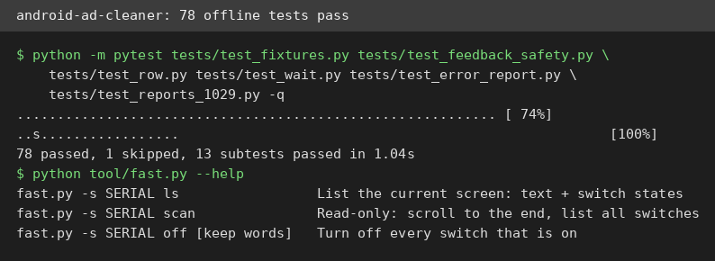
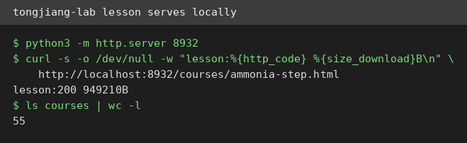
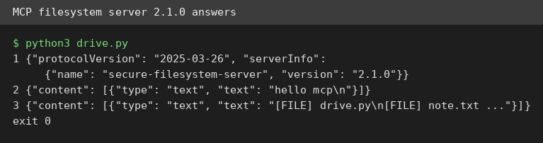

# AI Test Report — 2026-10-30
> Today is about work that moved, not work that vanished: phone ads you can switch off, lessons you can run offline, and code review that now matters more than code writing.
## At a glance
- android-ad-cleaner: switch off built-in phone ads without rooting the phone, tested as far as a phoneless VM allows.
- tongjiang-lab: free interactive 3D science lessons that run from plain files on your own machine.
- The compiler was supposed to end programming too: why cheaper code makes reading code the real job.
- tstack file-pr: a short skill that turns a diff into a pull request people actually want to read.
- MCP filesystem server 2.1.0: the official file-access plug, verified over a live protocol session.
## 🆕 Open-source project tests
### android-ad-cleaner: switch off built-in phone ads, no risky phone surgery needed ⭐3/5

- **In one sentence**: android-ad-cleaner turns off ads, hot searches, and marketing pop-ups built into Chinese-brand Android phones (phones running Google's mobile system), using the phone maker's own switches.
- **Why it caught my eye**: Created 24 October 2026, it held 4,725 stars on 30 October, and version 0.2.7 shipped 29 October with fixes from 101 user error reports.
- **I tried it**: `python3 tool/fast.py --help` printed the full command list after I installed its dependency (a Python package for driving Android screens) in a clean virtual environment (an isolated Python setup).
- **I tried it**: `python -m pytest` on six offline test files passed: 78 passed, 1 skipped, 13 subtests passed, covering screen fixtures (saved sample phone screens) and feedback safety.
- **I tried it**: What surprised me is the recipe detail. The Xiaomi REDMI K90 Pro Max script is 243 lines and records exactly where HyperOS 4 (Xiaomi's phone system) hides each switch, based on a real-device run on 27 October.
- **I tried it**: The device-dependent tests could not run here. This VM has no `adb` (the Android debug bridge, a tool that talks to phones) binary and no phone, so the suite exits with "adb not found" for those tests.
- **The catch**: I could not verify the core job, actually switching off ads on a phone. The project also targets Chinese-brand phones only, and it needs a USB cable plus developer mode (a hidden phone setting) switched on.
- **Try it if**: you own a Xiaomi, OPPO, vivo, Honor, or OnePlus phone and hate its built-in ads.
- **Skip it if**: you do not own one of those brands, or you will not plug your phone into a computer.
- **Score**: ⭐3/5, the offline code checks out, but the phone-side claim is untested here.
- **Link**: https://github.com/rddmwmddr/android-ad-cleaner
### tongjiang-lab: free 3D science lessons that run from plain files ⭐3/5

- **In one sentence**: tongjiang-lab is a set of free interactive 3D science lessons for high school students, each lesson a single web page you can open or host yourself.
- **Why it caught my eye**: Created 28 October 2026, it held 935 stars on 30 October, and every lesson is a self-contained file, not a locked platform.
- **I tried it**: `python3 -m http.server 8932` served the repo, and `curl` fetched the ammonia lesson with status 200 and 949,210 bytes.
- **I tried it**: The lesson file contains Three.js (a 3D graphics library for the browser) code, and the `courses/` folder holds 55 lesson files across chemistry, physics, and biology.
- **I tried it**: What surprised me is how portable this is. No build step, no account, no server app: static files (plain files served as-is) plus a browser.
- **The catch**: I verified serving and file contents, not the 3D interaction in a browser. The lessons are written for the Chinese high school curriculum, so the text is in Chinese.
- **Try it if**: you teach or learn high school science and want interactive demos without a subscription.
- **Skip it if**: you need English lessons, since these are in Chinese.
- **Score**: ⭐3/5, it serves cleanly and looks complete, but classroom interaction is unverified here.
- **Link**: https://github.com/smithjohn78390/tongjiang-lab
## ✍️ Tech article deep-dives
### The compiler was supposed to end programming too: cheaper code makes reading the real job
- **Read this if**: you write or review code with AI tools and wonder what your job becomes.
- **The argument in 3 bullets**: Every past automation, from FORTRAN (an early programming language) in 1957 to Copilot (an AI coding assistant) in 2021, removed one tedious layer and grew the field instead of ending it.
- **The argument in 3 bullets**: Adoption is high but trust is low. In 2025, 84% of developers used AI tools or planned to, yet only 33% trusted AI output accuracy, and 66% named "almost right, but not quite" as the top frustration.
- **The argument in 3 bullets**: When code gets cheap, review becomes the bottleneck (the slowest step). One 2026 dataset shows median review time up five times, 31% more pull requests (proposed code changes) merging with no review, and incidents per pull request more than tripled.
- **Why it matters to you**: If you lead a team, the essay argues the spec (a written description of what to build) and the tests become the thing you own, while generated code becomes output you inspect.
- **My take**: The history lesson is strong and the numbers are honestly caveated, but the compiler analogy has a hole the essay underplays. A compiler maps one formal input to one defined output, while a prompt (a natural-language request) has no such contract, so "stop reading the output" is riskier here than it was for assembly (low-level machine code). The METR study behind the "19% longer" headline also had just 16 developers on early-2025 tools.
- **Link**: https://hrih.si/articles/the-compiler-was-supposed-to-end-programming/
## 🛠️ Agent skill tests
### tstack file-pr: turn a diff into a pull request people want to read ⭐4/5
- **In one sentence**: file-pr is one skill from tstack, a collection of nine agent skills for driving code changes to a merged pull request (a proposed code change) with nobody watching.
- **Why it caught my eye**: Created 24 October 2026, tstack held 2,393 stars on 30 October, and file-pr promises the opposite of most agent output: short, problem-first descriptions.
- **I tried it**: I read the skill file, then made a real local diff: a five-line hand loop replaced by one `sum()` call in a scratch repo.
- **I tried it**: Following the skill, I wrote a title that states the benefit ("Fix slow total() by using the built-in sum()"), opened with the problem, and closed with the model-and-harness credit line the skill requires.
- **I tried it**: What surprised me is how much of the skill is about what not to write. It bans leading with an inventory of changes, and gives a bad example next to a good one for each rule.
- **The catch**: I tested one skill, not the pack. The flashier ones, council (three-model review) and sol-loop, need access to other providers' models, which this VM setup does not have. I also filed no real pull request, only a draft body.
- **Try it if**: your agent writes pull requests that read like changelogs nobody opens.
- **Skip it if**: you never file pull requests, since the whole pack assumes a GitHub workflow.
- **Score**: ⭐4/5, the one skill I ran did exactly what it promises, with clear bad-versus-good guidance.
- **Link**: https://github.com/t3dotgg/tstack
## 🔌 MCP tests
### MCP filesystem server 2.1.0: the official file-access plug, verified live ⭐4/5

- **In one sentence**: This is the official Model Context Protocol (a standard plug for AI tools) server that lets an AI assistant read and write files inside one folder you choose.
- **Why it caught my eye**: The package version 2.1.0 was published 28 October 2026 as part of the official servers release, and it is the reference file-access server most assistants copy.
- **I tried it**: `npx -y @modelcontextprotocol/server-filesystem@2.1.0` started the server, and it identified itself as `secure-filesystem-server` version 2.1.0.
- **I tried it**: `tools/list` returned 14 tools, from `read_text_file` to `list_allowed_directories`, and a live call to `read_text_file` returned the exact contents of my test file ("hello mcp").
- **I tried it**: What surprised me is a transport quirk (a behavior of the connection method). Piping requests through stdin (standard input) and closing it dropped replies, but a persistent client that keeps the connection open got every answer.
- **The catch**: Write and edit tools are powerful by design, so only point it at a folder you can afford to change. The stdin quirk also means quick shell-pipe tests can look broken when the server is fine.
- **Try it if**: you want to give a local AI assistant safe, scoped access to one project folder.
- **Skip it if**: you need remote access or fine-grained per-file permissions, since this server trusts the whole allowed folder.
- **Score**: ⭐4/5, every tool call I ran worked, with one connection quirk worth knowing.
- **Link**: https://github.com/modelcontextprotocol/servers
## Notes
- No Android phone or `adb` binary exists on this VM, so android-ad-cleaner's device flow stays untested. Its offline suite and recipe detail are the verified parts.
- The 2026-10-29 daily edition is missing from the repo: the latest pushed edition before this one is 2026-10-28. This run covers 2026-10-30 only and does not backfill 2026-10-29.
- The 2026-10-26 scout drafts were all already covered in earlier editions, so this edition sourced fresh items from GitHub search instead.
- MCP note: drive the filesystem server with a persistent client, not a one-shot pipe, or replies can vanish when stdin (standard input) closes.
