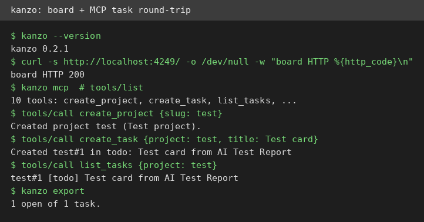
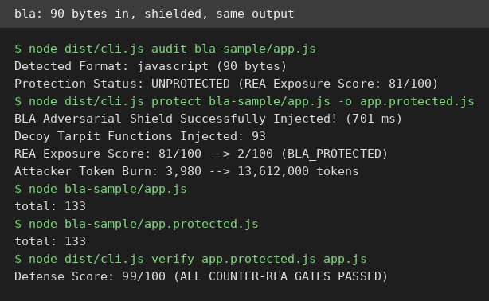
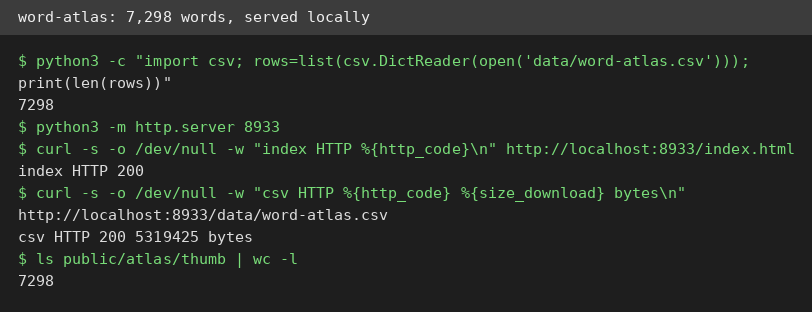

# AI Test Report — 2026-10-31
> Today: a board agents can move, a shield against code copying, and a word list you can count.
## At a glance
- kanzo: a tiny task board that humans and AI agents share.
- bla: a shield that fattens your code so AI copycats pay more.
- word-atlas: 7,298 illustrated English words, free as data.
- I tried to build a programming language for AI agents: why better tests beat a new language.
- ub-mode: Uncle Bob's coding discipline, packed into one skill file.
- canvas-mcp: a read-only plug that lets AI assistants read your courses.
## 🆕 Open-source project tests
### kanzo: a task board humans and AI agents share ⭐4/5

- **In one sentence**: kanzo is a kanban (a board of task cards in columns) board and MCP (a standard plug for AI tools) server in one small program.
- **Why it caught my eye**: Created 25 October 2026, it held 197 stars on 31 October, and its pitch is blunt: no account, no server, one folder for the whole board.
- **I tried it**: `kanzo --version` printed `kanzo 0.2.1`, and the release binary measured 4.5 MB on disk.
- **I tried it**: `kanzo --home ./kanzo-home --port 4249 --no-open` served the board, and `curl` fetched the front page with HTTP 200 and 29,824 bytes.
- **I tried it**: Over MCP stdio (typed input to a program), `tools/list` returned 10 tools. Then `create_project`, `create_task`, and `list_tasks` made and listed card `test#1`, and `kanzo export` printed it back as Markdown (a plain text format).
- **I tried it**: What surprised me is how little ceremony there is. No setup wizard, no database to install, just a binary and a folder.
- **The catch**: The board has no login, so only run it on a network you trust. Sync across machines needs a private git (a version control system) repo, which I did not test. Task creation also needs a project first, and none is created by default.
- **Try it if**: you run coding agents and want to watch their tasks move on a board.
- **Skip it if**: you need shared logins, permissions, or a hosted service.
- **Score**: ⭐4/5, the board and the agent plug both worked end to end, with trust and sync caveats.
- **Link**: https://github.com/emanuele-em/kanzo
### bla: a shield that makes copying your code expensive ⭐4/5

- **In one sentence**: bla is a defense tool that fattens shipped software, so AI copy tools burn far more time and money.
- **Why it caught my eye**: Created 25 October 2026, it held 1,400 stars on 31 October, and its named target is REA, an AI agent that analyzes release files.
- **I tried it**: `npm install` added 67 packages in 10 seconds, and `npm run build` passed for version 1.5.2.
- **I tried it**: `node dist/cli.js audit bla-sample/app.js` on a 90-byte sample called it UNPROTECTED, with an exposure score of 81 out of 100.
- **I tried it**: `node dist/cli.js protect` ran in 701 ms, injected 93 decoy functions, and cut the exposure score from 81 to 2. The file grew from 90 bytes to 127,934 bytes.
- **I tried it**: What surprised me is that the runtime stayed identical. The original and the protected file both printed `total: 133`, and `verify` scored the protected file 99 out of 100.
- **The catch**: The token and dollar figures are BLA's own estimates. I did not run a real REA agent against the protected file, so the attacker cost is claimed, not measured. The protected output is also huge, so shipping it costs bandwidth and load time. Use it only on software you own.
- **Try it if**: you ship JavaScript, binaries, or models and worry about AI tools cloning them.
- **Skip it if**: you ship tiny files where a 1,400-fold size jump hurts, or you need proof against a real attacker.
- **Score**: ⭐4/5, audit, protect, verify, and runtime all worked, but the attacker-cost claims are self-reported.
- **Link**: https://github.com/qybaihe/bla
### word-atlas: 7,298 illustrated English words, free as data ⭐3/5

- **In one sentence**: word-atlas is a free set of 7,298 English words for IELTS (an English test for study abroad) learners, with pictures, pronunciation, and examples.
- **Why it caught my eye**: Created 25 October 2026, it held 3,359 stars on 31 October, and the dataset is openly licensed for reuse with credit.
- **I tried it**: The CSV (a plain table file) holds exactly 7,298 rows across 17 columns and 19 topics. CEFR (a six-level language scale) counts run from 785 at A1 to 274 at C2.
- **I tried it**: `python3 -m http.server 8933` served the repo, and `curl` fetched the front page with HTTP 200 and the CSV with HTTP 200 and 5,319,425 bytes.
- **I tried it**: What surprised me is that the count checks out three ways. The README claim, the CSV rows, and the thumbnail folder all say 7,298.
- **The catch**: I did not run the full app, which needs an npm (a JavaScript package tool) dev setup, so the study flow, FSRS (a spaced-repetition scheduling method) scheduling, and audio playback are unverified here. Word meanings are in Chinese, while definitions are in English. The clone is 1.4 GB, mostly images and audio.
- **Try it if**: you learn IELTS words, or you build learning tools and want free, checkable data.
- **Skip it if**: you need English-only explanations, or you want a small download.
- **Score**: ⭐3/5, the dataset is exact and openly licensed, but the app itself is unverified here.
- **Link**: https://github.com/designfuchen/word-atlas
## ✍️ Tech article deep-dives
### I tried to build a programming language for AI agents: better tests beat a new language
- **Read this if**: you build tools for coding agents, or you wonder where agent money actually goes.
- **The argument in 3 bullets**: Agents mostly re-read old context, not write code. In 94 of the author's sessions, re-reading took 72.5% of cost, writing code took 4.2%, so a syntax 30% shorter would save about 1%.
- **The argument in 3 bullets**: A brand-new language did not help. Two models passed all 16 runs, but their code was 101% and 132% the size of their Python (a popular programming language). A stricter codebase also failed to cut reading, while types alone cut it 8 to 15%.
- **The argument in 3 bullets**: Thinking harder beat tooling. On 24 real fixes in sqlglot (an open-source SQL parser), low effort passed 31 of 48 runs, high effort passed 46, and a code-map tool lifted low effort only to 34, against a 32 baseline in that run.
- **Why it matters to you**: If you buy or build agent tools, this says spend on tests first, since tests are what let you trust the extra code agents write.
- **My take**: The pre-written kill lines and the honest small-sample notes make this essay unusually trustworthy, but the hard test rests on one codebase and 24 fixes, so treat "tools lose to thinking harder" as a strong hint, not a law.
- **Link**: https://medium.com/@ishantkohar/i-tried-to-build-a-programming-language-for-ai-agents-b7a7df6a77af
## 🛠️ Agent skill tests
### ub-mode: Uncle Bob's coding discipline in one skill file ⭐4/5
- **In one sentence**: ub-mode is a one-file skill for disciplined agent coding: test first, smallest change, then cleanup.
- **Why it caught my eye**: Created 25 October 2026, it held 5,377 stars on 31 October, and it comes from Uncle Bob, author of Clean Code (a famous book on readable code).
- **I tried it**: The skill is 152 lines, and installing it means copying `SKILL.md` into your agent's skills folder.
- **I tried it**: Following it on a toy `total()` function, I wrote behavior checks first, then replaced a hand loop with `sum()`, and the checks still passed.
- **I tried it**: I also ran its companion gate tool, crapper (a complexity and coverage score tool). It installed into a venv (an isolated Python setup) and reported complexity 1 for `total()`, well under the skill's gate of 10.
- **I tried it**: What surprised me is how short the skill is. It reads in minutes, yet it names real gates instead of vague advice.
- **The catch**: The other two gates, dryer and mutator, were not run here. The skill alone is a checklist, and its teeth live in companion tools you must fetch separately.
- **Try it if**: your agent writes code that works but keeps getting messier.
- **Skip it if**: you never write code with an agent, or you dislike strict process.
- **Score**: ⭐4/5, the one gate I ran passed cleanly and the rules are concrete, but two gates remain untested.
- **Link**: https://github.com/unclebob/ub-mode
## 🔌 MCP tests
### canvas-mcp: a read-only plug for your Canvas courses ⭐3/5
- **In one sentence**: canvas-mcp is a read-only MCP server that lets AI assistants answer questions about your Canvas (a learning platform used by schools) courses.
- **Why it caught my eye**: Created 25 October 2026, it held 119 stars on 31 October, and all 26 of its tools only read data. None can submit, post, or mark anything read.
- **I tried it**: `npm install` added 95 packages in 6 seconds, and with a dummy config the server started as version 1.2.0.
- **I tried it**: Over MCP Streamable HTTP (a web-based plug connection), `initialize` returned the server name `Canvas (read-only)`, and `tools/list` returned all 26 tools, from `list_courses` to `get_recent_activity`.
- **I tried it**: `list_courses` against a dead Canvas address returned an error reading `fetch failed`, which shows the call reaches the upstream step. A wrong secret returned 404, so the secret gate works.
- **I tried it**: What surprised me is the strict secret rule. The server refused a short secret at startup, instead of failing later.
- **The catch**: No live course data came back here, because I have no Canvas account or token. You must deploy it and add your own token before any real question works.
- **Try it if**: you use Canvas and want an assistant to check deadlines and grades.
- **Skip it if**: your school does not use Canvas, or you cannot deploy a small server.
- **Score**: ⭐3/5, the server, the tools, and the secret gate check out, but live course data is untested without an account.
- **Link**: https://github.com/boyuchengz/canvas-mcp
## Notes
- The 2026-10-29 daily edition is still missing from the repo: the latest pushed edition before this one is 2026-10-30. This run covers 2026-10-31 only and does not backfill 2026-10-29.
- The 2026-10-26 scout drafts were all already covered in earlier editions, so this edition sourced fresh items from GitHub search instead.
- BLA's token and dollar figures are the tool's own estimates. No real REA agent was run against the protected sample in this edition.
- canvas-mcp needs a real Canvas account and token for live data. The dummy config used here can only prove the server, the tool list, and the error path.
- word-atlas was cloned in full (1.4 GB) for the dataset check. Only the scratch copy was kept, and it is not part of the report commit.
