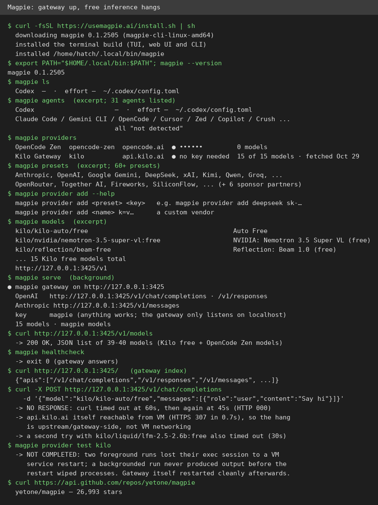
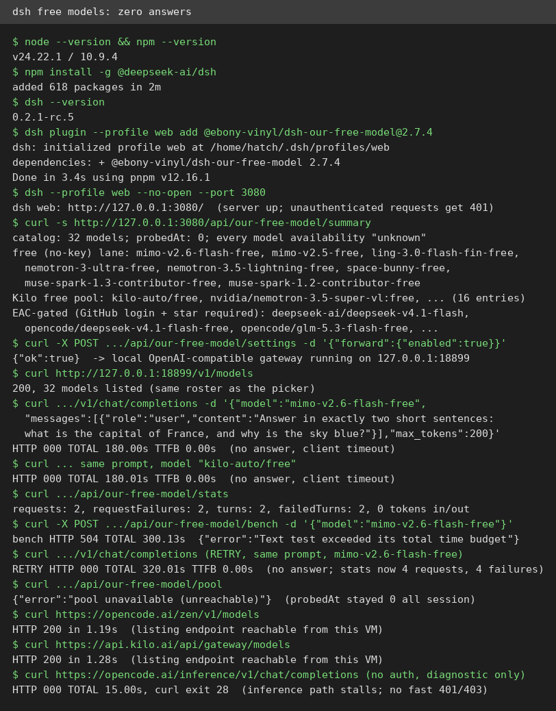
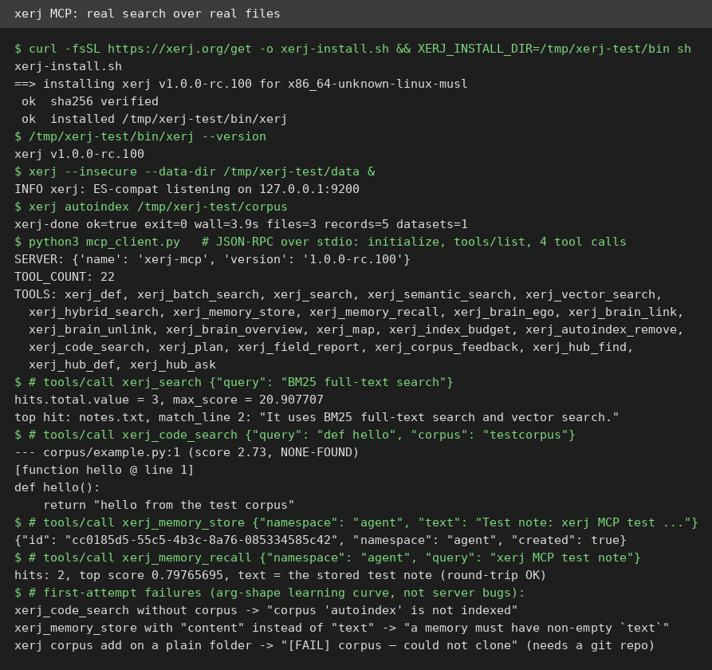

# AI Test Report — 2026-11-01
> Today's free AI lanes went quiet when asked to answer, but a local search engine and an essay about ambition spoke up clearly.

## At a glance
- Magpie: a switchboard for AI coding tools that serves its catalog but stalls on free answers.
- dsh-our-free-model: a no-login free model plug where no model answered at all.
- Dan Luu essay: build the tool you assumed was too big, and test it hard.
- triage skill: a sharp issue-sorting workflow that needs setup before it can act.
- xerj: a local search engine your AI assistant can actually query.

## 🆕 Open-source project tests

### Magpie: one switchboard for every AI coding tool you run ⭐3/5

- **In one sentence**: Magpie is a free program on your computer that lets each coding assistant use a different AI model, switched from one place.
- **Why it caught my eye**: It holds about 27,000 stars, and its headline trick is running one assistant on another company's model.
- **I tried it**:
  - The install command put version 0.1.2505 on disk, but left the binary out of PATH (the list of folders your shell searches for programs). `magpie` failed until I added `~/.local/bin` by hand.
  - `magpie agents` found only Codex on this machine; the other 30 agents it knows were correctly reported as not installed.
  - `magpie serve` started the local gateway (a middleman program that translates requests between tools) on port 3425. `curl /v1/models` returned 200 with 39 to 40 models.
  - What surprised me: the no-key free tier was already there, Kilo Gateway with 15 free models. Yet every chat request through it hung until curl timed out, twice, at 60 and 45 seconds.
- **The catch**: The part that matters most, actually getting an answer, never worked here without a key. Kilo's own website answered in 0.7 seconds, so the stall sits between the gateway and the model, and it fails silently with no error message.
- **Try it if**: you're a developer juggling several coding assistants and you already pay for at least one model subscription.
- **Skip it if**: you want free models with no key, or you only use one assistant.
- **Score**: ⭐3/5, the gateway installs and serves cleanly, but its free answers never arrived.
- **Link**: https://github.com/yetone/magpie

### dsh-our-free-model: free AI models with no login, no key, and no answers ⭐1/5

- **In one sentence**: This is a plug-in for dsh (a terminal program for chatting with AI models) that promises top models free, with no account and no key.
- **Why it caught my eye**: It gained about 19,000 stars in 7 days, and "no login, no key" is exactly the kind of claim worth checking.
- **I tried it**:
  - `npm install -g @deepseek-ai/dsh` installed dsh 0.2.1-rc.5, and the plug-in version 2.7.4 installed in 3.4 seconds.
  - With no key and no login anywhere, the picker listed 32 models: 8 in a no-key lane, 16 in a free Kilo pool.
  - What surprised me: DeepSeek V4.1 Flash, the name in the pitch, sits behind an EAC gate (needs a GitHub login and a repo star). It is not in the no-key lane at all.
  - The same two-sentence question went to two free models, twice, plus the plug-in's own speed test: 4 requests, 4 failures, 0 tokens produced.
- **The catch**: Model listings loaded in about 1.2 seconds, but every answer path hung: 180 seconds, 180 seconds, a 504 error after 300 seconds, then 320 seconds. No rate-limit message, no refusal, just silence. The plug-in's own health probe never finished, and its pool endpoint answered "pool unavailable (unreachable)".
- **Try it if**: you want to watch whether its free lanes come back to life, and you enjoy debugging other people's gateways.
- **Skip it if**: you need a model that answers today.
- **Score**: ⭐1/5, installs and lists fine, but not one free model produced a single token.
- **Link**: https://github.com/Ebony-Vinyl/dsh-our-free-model

## ✍️ Tech article deep-dives

### We should be more ambitious with the software we build: the tool you think is too big is now a weekend project
- **Read this if**: you use coding agents and keep a list of tools you assume are too large to build.
- **The argument in 3 bullets**:
  - The old cost model is out of date: year-long expert projects now take hours with agents implementing.
  - His proof is three personal tools built in a few hours each. They are a regex engine (a pattern-matching tool), a ripgrep fork (a code search tool), and a Rust interpreter (a program that runs Rust directly).
  - Trust comes from testing, not from who wrote the code: the Postgres rewrite pgrust earned credibility because its testing uncovered real Postgres bugs.
- **Why it matters to you**: The bottleneck moved. Writing code is cheap now, so the skill that pays is setting up checks that catch the agent's mistakes. Fuzzing (automated tests that throw random inputs at code) is one such check.
- **My take**: Luu is right about personal tooling and honest about the limits. He writes these posts in half an hour without rigorous benchmarks, and his projects are "works for me" quality, not products. The appendix counterpoint from Yossi Kreinin is the part to keep. Most people should be less ambitious, because agent loops need clear pass/fail checks. And giant black boxes (systems you cannot inspect inside) are hard to maintain. Ambition for your own tools, caution for shared ones.
- **Link**: https://danluu.com/ambitious/

## 🛠️ Agent skill tests

### triage (mattpocock/skills): a sharp way to sort issues, if you set it up first ⭐3/5
- **In one sentence**: Triage is a plain-text instruction file that walks an agent through sorting project issues and writing briefs agents can act on.
- **Why it caught my eye**: A benchmark of popular skills found this library's triage skill scored perfectly with the skill loaded, against about 0.7 without it.
- **I tried it**:
  - I read the 112-line SKILL.md plus its two reference docs. Then I ran its steps by hand on a real issue: Magpie issue #4664, asking for daily, weekly, and monthly auto-sync intervals.
  - Its redundancy check paid off fast. The source lists `AutoChoices = []int{Manual, 3, 15, 30, 60}`, and the CLI accepts only off, 3, 15, 30, or 60 minutes. The gap is real, not a missing feature the reporter overlooked.
  - What surprised me: the same author filed the same request in Chinese as #4663 the same day. So the honest triage verdict is "enhancement, but ask the maintainer about the duplicate first".
  - The catch showed up at the last step. The skill assumes a setup run created a label mapping and a rejected-ideas folder. Neither exists for an arbitrary repo, so it cannot apply its own labels or post its own comments there.
- **The catch**: On a repo where the setup ran, this is a strong workflow. On any other repo, it stops one step short of doing anything.
- **Try it if**: you're a maintainer who will run the setup on your own repo and wants consistent issue sorting.
- **Skip it if**: you want a tool that works on a repo you do not own.
- **Score**: ⭐3/5, the thinking is excellent, but it cannot act without setup it never tells a newcomer to run first.
- **Link**: https://github.com/mattpocock/skills

## 🔌 MCP tests

### xerj: a search engine on your own machine that your AI assistant can query ⭐4/5

- **In one sentence**: xerj is a free search program on your own computer that an AI assistant can query through MCP (a standard AI assistant plug).
- **Why it caught my eye**: It gained about 3,500 stars in a week, and local search that an agent can query beats pasting files into chat by hand.
- **I tried it**:
  - One install command fetched version 1.0.0-rc.100 as a single 143 MB file. Its checksum (a fingerprint that proves the download was not tampered with) was verified by the installer.
  - It indexed 3 test files in 3.9 seconds, producing 5 records. Then it answered real MCP calls. A text search returned 3 hits with top score 20.9. A code search found my test function at line 1.
  - What surprised me: a memory store and recall round trip worked on the first try, returning my stored note verbatim with score 0.80.
  - Two rough edges: adding a plain folder as a corpus (a collection of files to search) failed until I turned it into a git repo. And the memory tool rejects `content` and demands `text`, with no hint in the error.
- **The catch**: Setup takes two steps, since the search node must run before the MCP server starts, and the fancier search modes need an outside provider key. Also, the server keeps inviting the agent to send it a field report, which I switched off.
- **Try it if**: you're a developer who wants an agent to search a codebase without uploading it anywhere.
- **Skip it if**: you only need one-off searches, since your editor already does those.
- **Score**: ⭐4/5, everything advertised worked with no key and no cloud, minus points for the two-step setup and git-only folders.
- **Link**: https://github.com/xerj-org/xerj

## Notes
- A pattern worth watching: both free inference paths tested today hung while their model listings answered instantly. Listings for Kilo and OpenCode Zen loaded in about a second, but answers never came. This may be specific to this machine's network exit, not the tools, so both scores carry that caveat, and both deserve one retest.
- Not tested this time: Magpie's desktop and terminal interfaces, since this machine has no screen. Also untested: any paid provider behind Magpie or dsh, and xerj's semantic and hybrid search modes, which need an outside key.
- The triage skill's verdict on Magpie #4664, enhancement with a duplicate question for the maintainer, was a test only. Nothing was posted to Magpie's tracker.
