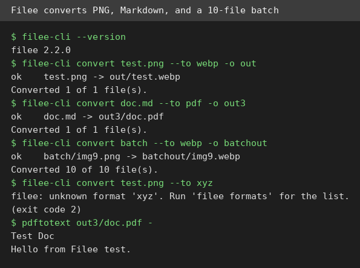
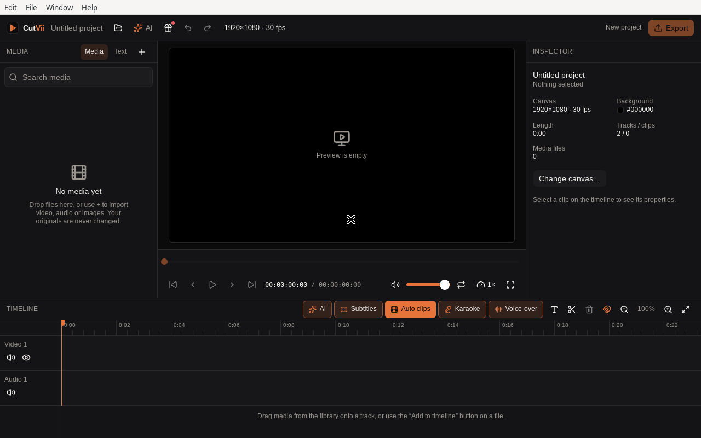
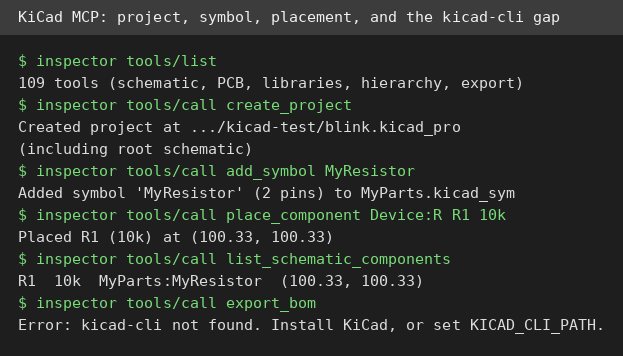

# AI Test Report — 2026-11-02
> Today: tools that stay on your machine, an auditor that double-checks itself, and proof that writing decisions down beats writing them in a fancy format.

## At a glance
- **Filee**: convert almost any file without uploading it anywhere.
- **CutVii**: a free video editor that keeps your footage on your own computer.
- **security-audit skill**: a security checklist that makes a second agent argue with the first.
- **mcp-server-kicad**: let an AI assistant read and edit circuit-board designs by name.
- **"It Doesn't Matter How You Write Down Your Decisions"**: why plain written decisions beat a new AI language.

## 🆕 Open-source project tests

### Filee — convert almost any file without uploading it anywhere ⭐4/5

- **In one sentence**: Filee is a free file converter that runs on your own computer and turns files from one format into another.
- **Why it caught my eye**: it has 20,025 stars on GitHub, version 2.2.0 shipped recently, and it advertises 255 formats with no cloud upload.
- **I tried it**: I downloaded the Linux x64 tarball and ran `filee-cli`, its command-line tool.
  - `filee-cli convert test.png --to webp` finished in about 2 seconds and produced a valid WebP file.
  - `filee-cli convert doc.md --to pdf` produced a real PDF, and `pdftotext` confirmed the text survived.
  - A batch of 10 PNG files converted to WebP, 10 of 10, with no failures.
  - What surprised me: the command line feels like a first-class citizen, with a format list, presets, a watch mode, and documented exit codes. An unknown format prints a clear error and exits with code 2, as documented.
- **The catch**: I tested the command line only, not the graphical app. Some formats need external engines (FFmpeg, a media toolkit, or LibreOffice, an office suite). This machine already had both, so your results on exotic formats may vary.
- **Try it if**: you're a person who converts files often and wants them to stay on your machine.
- **Skip it if**: you convert a file once in a while and your browser tool already handles it.
- **Score**: ⭐4/5, every conversion I ran worked, with the graphical app and exotic formats still unverified.
- **Link**: https://github.com/KnifeLemon/Filee

### CutVii — a free video editor that keeps your footage on your own computer ⭐3/5

- **In one sentence**: CutVii is a free desktop video editor with a timeline (a strip where you arrange clips), local subtitles, and automatic short clips.
- **Why it caught my eye**: version 1.0.3 launched on Product Hunt on 23 October, and it promises paid-editor features with no account and no cloud uploads.
- **I tried it**: the AppImage (a single-file Linux app package) would not mount here because this machine has no FUSE (a tool for mounting such files), so I extracted it by hand.
  - The first launch failed on a missing graphics library, `libEGL.so.1`, then on `libGLESv2.so.2`. After installing system graphics libraries with `apt`, the full editor opened under Xvfb (a display server with no screen) and rendered completely: media panel, 1920×1080 30fps canvas, timeline with Video 1 and Audio 1 tracks, and AI, Subtitles, Auto clips, Karaoke, and Voice-over buttons.
  - What surprised me: a desktop video editor rendered its whole interface on a headless server once the graphics libraries were in place.
- **The catch**: I verified launch and interface only. I did not test importing a clip, subtitles, auto-clips, or export, so the headline features are still unproven here. Install friction is real on minimal Linux systems.
- **Try it if**: you're a Linux user looking for a free local video editor and you don't mind install tinkering.
- **Skip it if**: you need subtitles or exports proven today, or you want a one-click install.
- **Score**: ⭐3/5, the app runs and looks complete, but its selling-point features are untested here.
- **Link**: https://github.com/zidniryi/cutvii

## ✍️ Tech article deep-dives

### It Doesn't Matter How You Write Down Your Decisions. Just Write Them Down. — plain written decisions beat a new AI language
- **Read this if**: you build software with AI coding agents and wonder why the output keeps missing your intent.
- **The argument in 3 bullets**:
  - A vague brief leaves decisions to the model. Brief-based runs agreed with each other 73% of the time but matched the author's rules in only 1 of 200 inputs. They were consistent, and consistently not his.
  - Models are good at finding the questions only a person can answer. After the author answered review questions about payments, 6 of 6 runs handled two tricky cases, versus 2 of 12 without the review.
  - Reading code does not prove what code does. Dedicated reviewers missed a real refund bug in 5 of 6 runs, while running code with random inputs against a known answer caught it.
- **Why it matters to you**: three cheap habits (write decisions down, answer the model's questions, run the code) beat buying a new format or language.
- **My take**: the pre-registered predictions and control arms (comparison runs with one change) make this more trustworthy than most AI-coding advice. The cold water: it is one person's test series on mostly one model family, with 3 to 5 runs per arm, so treat the numbers as direction, not law.
- **Link**: https://medium.com/@konttinen.tuomas/it-doesnt-matter-how-you-write-down-your-decisions-just-write-them-down-13e270dd347c

## 🛠️ Agent skill tests

### security-audit — a security checklist that makes a second agent argue with the first ⭐4/5
- **In one sentence**: this skill is a set of written instructions that turns a coding agent into a security auditor.
- **Why it caught my eye**: it has 56,382 stars, topped GitHub Trending on 22 October, and claims fewer false alarms because a fresh verifier tries to disprove each finding.
- **I tried it**: I cloned the repo, read `SKILL.md` and its companion guides, then ran its hunt-then-verify method on a tiny Python app with 3 planted flaws.
  - The hunt found all 3: a hardcoded admin password, a SQL injection (a trick that smuggles database commands inside input), and a path traversal (a trick that escapes a folder using `../`).
  - Verification ran each flaw with dummy data. The injection returned both users' secrets instead of one. The traversal read a file outside the data folder. The password literal was confirmed in source.
  - What surprised me: the skill says guidance mode is the default, and the full six-phase workflow with report files only runs on an explicit audit request, so it won't hijack a casual question.
- **The catch**: the full workflow is heavyweight (coverage ledgers, sandboxed execution rules, schema validators) and overkill for a quick question. A full run's token cost is unknown, and I applied the method by hand rather than through a multi-agent harness.
- **Try it if**: you're a developer who wants an agent to review code with evidence, not vibes.
- **Skip it if**: you just want a quick "is this code OK" answer without process.
- **Score**: ⭐4/5, all 3 planted flaws were confirmed by execution, but I did not measure false-alarm rates on clean code.
- **Link**: https://github.com/cloudflare/security-audit-skill

## 🔌 MCP tests

### mcp-server-kicad — let an AI assistant read and edit circuit-board designs by name ⭐4/5

- **In one sentence**: this is a plug (an MCP server, a small program that gives an AI assistant extra tools) that lets an AI work with KiCad (free circuit-board design software) files.
- **Why it caught my eye**: version 0.21.1 on PyPI (a Python package index), 109 tools, and it parses files directly, so no KiCad install is needed for the basics.
- **I tried it**: I installed it with `uvx` (a tool that runs Python packages without installing them) and drove it through the MCP Inspector (a tool for calling MCP servers by hand).
  - `tools/list` returned 109 tools across schematics, boards, libraries, hierarchy, and export.
  - `create_project` made `blink.kicad_pro` plus a root schematic. `create_symbol_library` and `add_symbol` made a 2-pin resistor symbol. `place_component` put R1 (10k) at (100.33, 100.33), and `list_schematic_components` read it back exactly.
  - What surprised me: the error messages are genuinely helpful. When stock libraries were missing, the server listed exactly which paths it searched and the three ways to fix it.
- **The catch**: `export_bom` and `run_erc` both fail without `kicad-cli` (KiCad's command-line tool), so the export and checking half of the toolset needs a real KiCad install. Stock symbol libraries need KiCad too, or a manual download, and my fetch of `Device.kicad_sym` failed because the repo listing showed legacy `.lib` files instead.
- **Try it if**: you're a maker who wants an AI to read, edit, or build KiCad schematics by name.
- **Skip it if**: you need parts-list exports or rule checks and you don't have KiCad installed.
- **Score**: ⭐4/5, the file-editing core works without KiCad, but exports and checks need it.
- **Link**: https://pypi.org/project/mcp-server-kicad/

## Notes
- CutVii's headline features (local subtitles, auto-clips, export) are still untested here; a desktop GUI test needs a display, and this run only got as far as launch plus interface render.
- mcp-server-kicad's export and rule-check tools need `kicad-cli`; worth retesting after a real KiCad install.
- A hand-rolled JSON-RPC client stalled on this MCP server's `tools/list` call; the official MCP Inspector CLI worked fine, so prefer it for future MCP tests.
- An `apt-get install imagemagick` download stalled for over 10 minutes; the CutVii screenshot was taken with `ffmpeg` x11grab instead.
- Skipped from the 26 October scout batch: DuckDB 2.0, Magpie, and dsh-our-free-model were already covered in the 28 October and 1 November editions.
