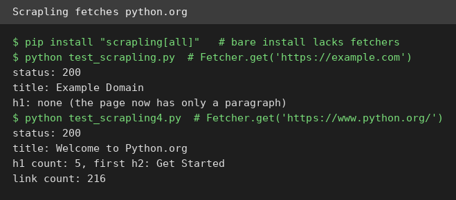
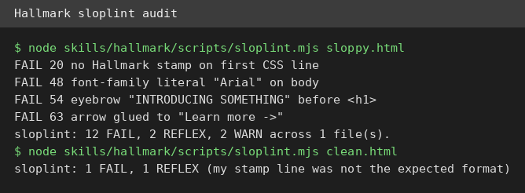
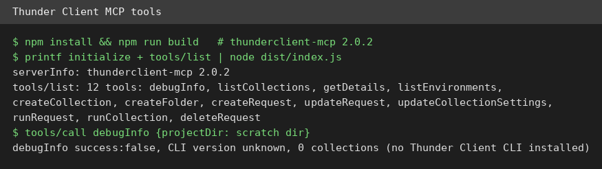

# AI Test Report — 2026-11-04
> Today: a scraper that works once you install the right extras, a desktop-control tool that diagnoses its own failure, and proof that 1,691 installed skills cost less than their descriptions suggest.

## At a glance
- **Scrapling**: grab web pages and pull out titles, headings, and links with a few lines of Python.
- **agent-desktop**: let an AI agent see and operate desktop apps through the system accessibility tree.
- **Hallmark**: a design checklist that flags the tired patterns that make AI-built pages look machine-made.
- **thunderclient-mcp**: let an AI assistant create and run API requests from plain-language prompts.
- **"I have 1,691 skills installed. This is what loads."**: a measured check of what 1,691 agent skills actually cost at startup.

## 🆕 Open-source project tests

### Scrapling — grab a web page and pull out its pieces with a few lines of Python ⭐4/5

- **In one sentence**: Scrapling is a Python library (a reusable code package) for fetching web pages and extracting data from them.
- **Why it caught my eye**: it has about 92,000 stars on GitHub, version 0.5 is current, and it advertises stealth fetching that dodges bot detection.
- **I tried it**: I installed it in a fresh Python virtual environment (an isolated folder for one project's packages) and fetched two real pages.
  - `pip install scrapling` alone was not enough: importing it failed first on a missing `curl_cffi` package, then on a missing `patchright` package. Installing `scrapling[all]` fixed both.
  - `Fetcher.get('https://example.com')` returned status 200 (the web's code for "OK") and the title "Example Domain". The page has no heading or links now, just one paragraph, so there was nothing else to extract.
  - `Fetcher.get('https://www.python.org/')` also returned 200, with title "Welcome to Python.org", 5 top-level headings, a first subheading "Get Started", and 216 links.
  - What surprised me: the page object is rich, with CSS selectors (patterns for picking page elements), XPath (another element-picking language), and text search, but `markdown` is a method you call, not a property you read, so `page.markdown[:120]` raised a TypeError (a wrong-use error).
- **The catch**: I tested plain fetching and extraction only, not the stealth browser engine, the crawler, or the built-in MCP server (a plug that lets AI assistants use the tool). The bare install missing its fetcher extras is a real first-run papercut.
- **Try it if**: you're a Python user who scrapes pages and wants one library for fetching, parsing, and extraction.
- **Skip it if**: you only fetch one page occasionally and the standard `requests` library already does the job.
- **Score**: ⭐4/5, every fetch and extraction I ran worked, with stealth features and the MCP server still unverified.
- **Link**: https://github.com/D4Vinci/Scrapling

### agent-desktop — let an AI agent operate your desktop apps instead of guessing from screenshots ⭐3/5
- **In one sentence**: agent-desktop is a command-line tool that reads a desktop app's accessibility tree (the structured list of buttons, fields, and labels the system exposes) so an agent can click real elements by reference.
- **Why it caught my eye**: it comes from Vercel Labs, version 1.1.0 installed in seconds from npm (the JavaScript package registry), and it promises stable element references instead of fragile pixel guessing.
- **I tried it**: I installed it with `npm install agent-desktop` and ran its help and version commands, then tried a real snapshot.
  - `agent-desktop --version` printed `agent-desktop 1.1.0`, and `--help` listed commands for snapshot, find, screenshot, get, click, type, scroll, and more.
  - `agent-desktop snapshot` on this headless server (a machine with no screen) failed with structured JSON (a machine-readable data format): `PERM_DENIED`, "Accessibility permission not granted", because no D-Bus session bus (a desktop messaging channel) was reachable.
  - After installing `at-spi2-core` (the Linux accessibility toolkit) and running under `dbus-run-session`, the error changed to `WINDOW_NOT_FOUND`, "No focused window found", which is exactly right for a machine running no apps.
  - What surprised me: the failure messages are genuinely diagnostic. Each one names the missing piece and the next fix, instead of crashing with a stack trace.
- **The catch**: I verified install, help, and error handling only. No real snapshot, click, or typing was possible here, because this machine has no desktop session and no open windows. Real control still needs a desktop machine.
- **Try it if**: you're a developer building desktop agents and you want stable element references instead of screenshots.
- **Skip it if**: you need a proven click on a real app today, or you only work on headless servers.
- **Score**: ⭐3/5, the tool installs cleanly and fails helpfully, but actual desktop control is unproven on this machine.
- **Link**: https://github.com/vercel-labs/agent-desktop

## ✍️ Tech article deep-dives

### I have 1,691 skills installed. This is what loads. — your skill pile costs less than its size suggests
- **Read this if**: you collect AI agent skills and worry that a big pile slows every session down.
- **The argument in 3 bullets**:
  - A skill is a folder with a `SKILL.md` file. The spec (the written standard) says only each skill's name and description load at startup, and the full instructions load only when a task matches.
  - The author counted 1,691 skills on his machine: 353,222 characters of names and descriptions, and 12,350,133 characters of instruction bodies, so descriptions are just 2.8% of the text.
  - A bare headless call loaded 43,709 to 45,867 tokens (chunks of text a model processes) with skills on, versus 33,786 with skills and commands off. The gap is about 10,000 to 12,000 tokens, roughly a quarter of the total.
- **Why it matters to you**: if your agent feels slow, counting skills is the wrong first move. Measure the startup gap on your own setup, and trim descriptions first, because the description is the only skill text that loads without being asked.
- **My take**: this is unusually honest measurement writing, and it refuses to claim more than it ran. The cold water: the 353,222 description characters should be about 88,000 tokens at four characters per token, nine times the measured gap, so the harness (the test runner) is trimming or capping the list somewhere the author did not find. Also, the off switch disables commands too, so skills and commands cannot be split apart in this number.
- **Link**: https://medium.com/@adityaarsharma/i-have-1-691-skills-installed-this-is-what-loads-69f3f1d5a250

## 🛠️ Agent skill tests

### Hallmark — a design checklist that stops AI-built pages from looking AI-built ⭐4/5

- **In one sentence**: Hallmark is a skill (a written playbook for a coding agent) that gives AI-built web pages a distinct look, then checks them against a list of tired design habits.
- **Why it caught my eye**: version 2.0.0 ships 48 themes and a checker script called `sloplint`, and it claims to catch the patterns readers now recognize as machine-made.
- **I tried it**: I cloned the repo and ran `sloplint.mjs` (a Node script, no agent needed) on two pages I wrote by hand.
  - On a deliberately sloppy page, it reported 12 FAIL, 2 REFLEX (waivable defaults), and 2 WARN, and exited with code 1. It caught a literal font name outside the token block, an all-caps tracked eyebrow label above the heading, an italic word inside the heading, and an arrow glued to a link label.
  - On a small page I wrote to follow its floor rules, it still reported 1 FAIL and 1 REFLEX: my Hallmark stamp comment was not in the expected format, so the checker did not recognize it.
  - What surprised me: the checker runs standalone in plain Node, so you can audit any page without buying into the full agent workflow. Its fixes are specific, like "labels are the body face, a step smaller, sentence case, untracked".
- **The catch**: I tested the static checker only. The browser render tier needs Chrome plus `puppeteer-core` (a browser-control library), and the full agent loop (build, check, fresh-context review) needs a coding agent, so both are untested here. The purple-to-blue gradient on my sloppy page was not flagged in static mode, so the static tier is not the whole story.
- **Try it if**: you're a developer whose agent-built pages all look the same and you want a concrete checklist to push against.
- **Skip it if**: you already have a locked design system, or you want a fully automatic fix rather than a report.
- **Score**: ⭐4/5, the standalone checker catches real design tells with specific fixes, with the browser tier and agent loop still unverified.
- **Link**: https://github.com/Nutlope/hallmark

## 🔌 MCP tests

### thunderclient-mcp — let an AI assistant run your API requests from plain words ⭐3/5

- **In one sentence**: thunderclient-mcp is a server using MCP (a standard plug that lets AI assistants call outside tools) that lets an assistant create, run, and fix API requests (structured calls one program makes to another) in Thunder Client.
- **Why it caught my eye**: Thunder Client's own docs page for it was updated 2026-11-03, it is MIT licensed, and it promises that environment secrets stay hidden from the assistant.
- **I tried it**: I cloned the repo, built version 2.0.2 with `npm install` and `npm run build`, then spoke to it over stdio (plain text input and output) with raw JSON-RPC (a message format for remote calls).
  - The initialize handshake answered with server name `thunderclient-mcp`, version 2.0.2, and tool support.
  - `tools/list` returned 12 tools: debugInfo, listCollections, getDetails, listEnvironments, createCollection, createFolder, createRequest, updateRequest, updateCollectionSettings, runRequest, runCollection, and deleteRequest.
  - Calling `debugInfo` on a scratch folder returned `success: false`, CLI version "unknown", and zero collections and environments, because the Thunder Client CLI and extension are not installed on this machine.
  - What surprised me: the server is honest about its own limits. It reports what it cannot see instead of inventing collections, and its tool descriptions warn that environment values are never returned.
- **The catch**: the protocol layer works, but nothing end to end was proven here. Without Thunder Client installed, no request was created or run, so the headline promise is still unverified on this machine.
- **Try it if**: you're a Thunder Client user who wants an assistant to manage collections and run requests for you.
- **Skip it if**: you do not use Thunder Client, or you want a server that works standalone without the extension.
- **Score**: ⭐3/5, the server builds and lists real tools cleanly, but running a request needs the Thunder Client install this machine lacks.
- **Link**: https://github.com/thunderclient/thunderclient-mcp

## Notes
- The 2026-11-03 edition is missing from the reports folder and the README list. This run did not backfill it; it may be worth checking whether that day's run failed.
- Hallmark's browser render checks and agent loop, Scrapling's stealth engine, and thunderclient-mcp's request running all remain unverified here for the reasons given above.
