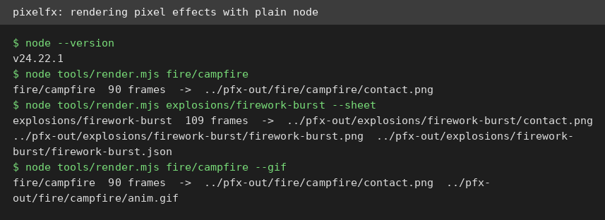
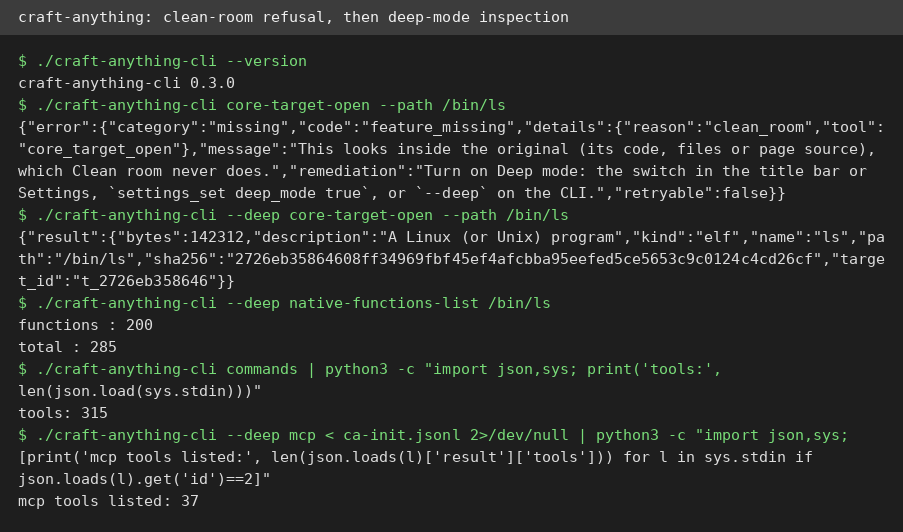
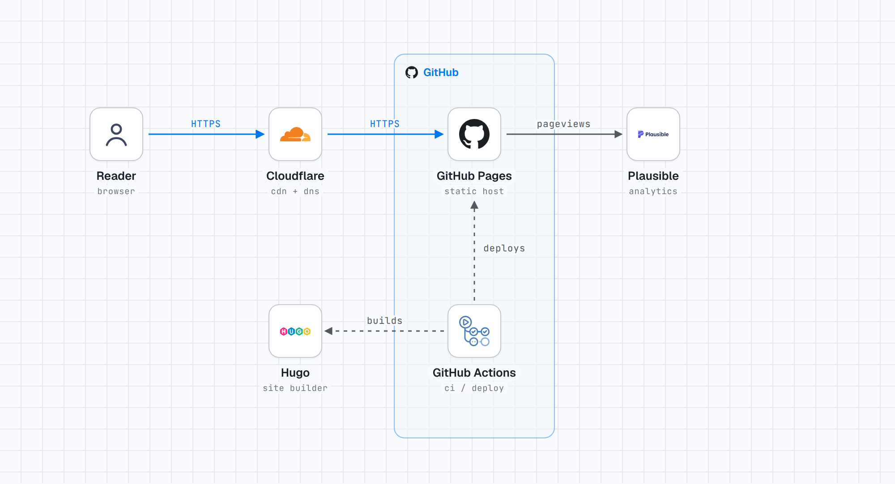

# AI Test Report — 2026-11-05
> Today: pixel fire you can render with plain Node, a Rust engine that reads real binaries, and the week AI games finally got fun.

## At a glance
- **pixelfx**: 244 tiny pixel-art effects you can render and export as sprite sheets with plain Node.
- **craft-anything**: point a Rust engine at a program and it lists functions, strings, and assembly.
- **stack-diagram**: describe your stack in one sentence and get a clean architecture diagram with real logos.
- **craft-anything MCP server**: the same engine as a plug for AI assistants, with 37 tools on first hello.
- **"The October inflection point for vibe game development"**: Simon Willison argues AI can now build games that are fun, not just games that look like games.

## 🆕 Open-source project tests

### pixelfx — 244 pixel-art effects you can render with plain Node ⭐4/5

- **In one sentence**: pixelfx is a JavaScript library (a reusable code package) of 244 hand-coded pixel-art effects, from campfires to plasma balls, plus a skill that helps an AI agent make new ones.
- **Why it caught my eye**: it appeared on GitHub on October 30 and passed 4,900 stars in six days, and it promises game-ready output with no install step beyond Node.
- **I tried it**: I cloned the repo and rendered effects with the Node (a JavaScript runtime) already on this machine, no `npm install` at all.
  - `node tools/render.mjs fire/campfire` produced a 90-frame contact sheet (a grid of animation frames) in seconds.
  - `node tools/render.mjs explosions/firework-burst --sheet` produced the same plus a 1.5 MB sprite sheet (one image holding every frame) and a 34 KB JSON file (a machine-readable data file) describing each frame.
  - `node tools/render.mjs fire/campfire --gif` produced an animated GIF (a looping image) of the same fire.
  - What surprised me: the whole render pipeline is plain Node with zero runtime dependencies. The only listed dependency is esbuild, a build tool, and only for development.
  - `node tools/check.mjs` passed with exit code 0, flagging only slow-frame warnings (4.8 to 5.8 ms per frame) on a few heavy effects.
- **The catch**: effects render on a canvas (a drawing surface in the browser), so you still need a game or web page to show them, and I did not test the bundled Claude Code skill that generates brand-new effects.
- **Try it if**: you're a game hobbyist who wants fire, explosions, and magic without drawing a single pixel by hand.
- **Skip it if**: you need 3D art, or you want effects that work outside a browser or game engine.
- **Score**: ⭐4/5, every render I ran worked with zero setup, with the effect-making skill still untested.
- **Link**: https://github.com/patch-gg/pixelfx

### craft-anything — point a Rust engine at a program and read how it works ⭐4/5

- **In one sentence**: craft-anything is an open-source engine, written in Rust (a fast systems language), that inspects programs, apps, and websites and reports what it finds, so a coding agent can rebuild something similar.
- **Why it caught my eye**: it launched October 31, passed 13,000 stars in five days, and ships 320 tools (small commands) for studying software, from native binaries (compiled programs) to Android apps.
- **I tried it**: I downloaded the Linux release (a 63.5 MB archive) and ran its command-line tool directly, no build needed.
  - `./craft-anything-cli --version` printed `craft-anything-cli 0.3.0`.
  - My first inspection was refused: clean-room mode (a privacy setting that forbids looking inside the original) blocked `core-target-open` on `/bin/ls` and told me to add `--deep`.
  - With `--deep`, the same command opened `/bin/ls`, a 142,312-byte Linux program, and reported its SHA-256 fingerprint (a unique hash of the file).
  - `./craft-anything-cli --deep native-functions-list /bin/ls` found 285 functions, and `native-strings-find` located the string "cannot access" with an evidence record.
  - `native-function-disassemble` printed real assembly (low-level CPU instructions) for `free@plt`, two instructions long.
  - What surprised me: every answer comes back as an evidence record with a confidence level, coverage count, and stated limits, not just raw output.
  - `./craft-anything-cli commands` listed 315 commands on this build, close to the 320 tools the README claims.
- **The catch**: the headline feature, having an agent rebuild a website or app, needs a coding agent plus an API key (a paid credential), and I did not test it. The desktop app is a separate download I did not open.
- **Try it if**: you're a curious builder who wants to see inside a binary or app bundle without installing Ghidra or IDA.
- **Skip it if**: you only want the rebuild feature and have no agent setup or API key ready.
- **Score**: ⭐4/5, the inspection engine works headlessly and reports honestly, with the rebuild flow still unproven here.
- **Link**: https://github.com/storytold/craft-anything

## ✍️ Tech article deep-dives

### The October inflection point for vibe game development — AI can now build games that are fun, not just games that look like games
- **Read this if**: you have ever typed "build me a game" into an AI chat and got back something pretty but dull.
- **The argument in 3 bullets**:
  - October 2026 is a turning point, the way November 2025 was for coding agents (AI helpers that write software): Claude Opus 5.5 (a large AI model) now handles game design, not just graphics and 3D models.
  - Simon Willison built four browser games with almost no code review (he never looked at the code): a spot-the-difference tree game in one prompt, a 15-minute fantasy RPG (a role-playing game) called Emberwick, a Command & Conquer-style strategy game called Battle Drones, and a pumpkin-farming sim.
  - The hard part has moved from building to imagining: no single project took more than 4 hours of his time, so the new challenge is inventing concepts that would not exist without AI.
- **Why it matters to you**: the recipe is testable in one prompt. Tree Appreciator came from a single chat message asking for a three.js (a 3D graphics library) game about appreciating trees, and you can play the result in a browser.
- **My take**: the "fun" verdict is one person's honest impression, not a measured test, and the 4-hour figure hides the agent's runtime. Pumpkin Farmer alone took nearly two days of model work and millions of tokens (units of text the model processes), so this is neither free nor instant. Still, the four playable games are real evidence, and the GPT-6 comparison (it "looks great" but "doesn't play nearly as well") is a single run, not a blind test.
- **Link**: https://simonwillison.net/2026/Oct/28/vibe-game-development/

## 🛠️ Agent skill tests

### stack-diagram — describe your stack in one sentence, get a clean architecture diagram ⭐4/5

- **In one sentence**: stack-diagram is an agent skill (a written playbook an AI assistant follows) that turns a one-sentence stack description into an architecture diagram with official brand logos.
- **Why it caught my eye**: it appeared November 1, passed 1,700 stars in four days, and promises vendor-correct diagrams (real logos, correct group boxes) instead of generic boxes and arrows.
- **I tried it**: I read the full skill, then followed it step by step to diagram a personal blog: Hugo (a site builder), GitHub Pages, Cloudflare, Plausible, and GitHub Actions.
  - `python3 scripts/fetch_icons.py` fetched the Hugo, GitHub, and Cloudflare logos from svgl (a logo library) and the Actions logo from gilbarbara/logos, all in seconds.
  - It failed on Plausible, printing `FAIL plausible no source has it`, so I passed the official logo URL from plausible.io and it worked.
  - `python3 scripts/build.py` turned my hand-placed layout into a 122 KB self-contained HTML file (one file, no network needed).
  - `python3 scripts/render_png.py` produced light and dark PNGs at double scale. I checked the light one by eye: no arrow crosses any label, and every logo is visible.
  - What surprised me: the skill's own geometry rules (nodes are 132 by 100 pixels, arrows connect box edges, never through text) actually prevented the usual diagram mess on the first try.
- **The catch**: PNG export needs Playwright (a browser-automation library) plus Chromium, and on this machine that meant installing Playwright and pointing it at a cached Chromium binary by hand. The gallery-sharing step was not tested, since it needs your explicit yes.
- **Try it if**: you're a builder who draws stack diagrams for docs or talks and wants real logos without opening a drawing app.
- **Skip it if**: you only need one quick diagram and do not want to hand-place coordinates.
- **Score**: ⭐4/5, the full pipeline works and the diagram came out clean, with PNG setup rougher than the skill admits.
- **Link**: https://github.com/caru-ini/stack-diagram

## 🔌 MCP tests

### craft-anything MCP server — the same inspection engine, as a plug for AI assistants ⭐4/5
- **In one sentence**: this is craft-anything's MCP server (a plug that lets AI assistants call a tool), serving the same inspection commands over the standard MCP protocol (a shared language for AI tools).
- **Why it caught my eye**: the CLI lists 315 commands, so the question is how much of that power an assistant actually sees through the MCP plug.
- **I tried it**: I piped a three-message handshake (initialize, initialized, tools/list) into `./craft-anything-cli --deep mcp` over standard input and output.
  - The server answered with protocol version 2025-03-26 and `serverInfo` name `craft-anything`, version `0.3.0`.
  - `tools/list` returned 37 tools, the Essentials set, starting with `core_target_open`, `core_session_show`, and `core_evidence_show`.
  - The server instructions say the rest arrive through `list_toolsets` and `enable_toolset`, so an assistant starts with the small set and asks for more.
  - What surprised me: in clean-room mode the MCP server lists only tools that look from the outside, and a refused tool explains how to turn Deep mode on, just like the CLI did.
- **The catch**: I listed tools only. I did not run a full agent session that opens a target and chains tools, so multi-step behavior is still unproven.
- **Try it if**: you're wiring an AI assistant to inspect code or binaries and want a server that explains its own limits.
- **Skip it if**: you expect all 315 commands on first connect, or you work only in clean-room mode.
- **Score**: ⭐4/5, the handshake and tool list work exactly as documented, with a full agent session still untested.
- **Link**: https://github.com/storytold/craft-anything

## Notes
- This machine restarted mid-run and wiped /tmp, so the first pixelfx renders and stack-diagram icons were lost and re-run into the workspace. Nothing in this report comes from the lost run; all numbers above are from the re-runs.
- Worth following up: pixelfx's effect-making skill (can it make a new effect from a prompt?), and craft-anything's rebuild flow (needs a coding agent and an API key).
- The drafts pool from the weekly scout is exhausted: the November 2 drafts were all covered in earlier editions. Fresh sourcing from GitHub trending and search filled this edition.
