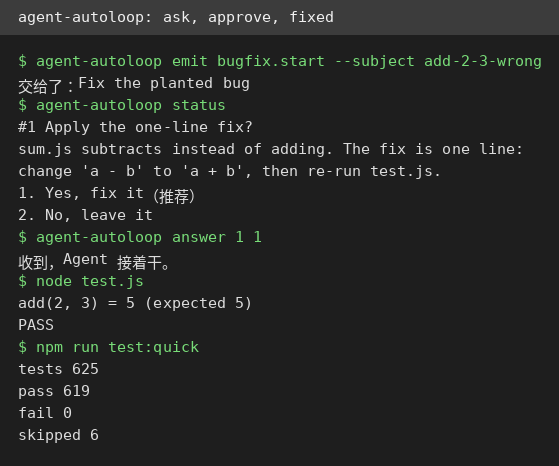
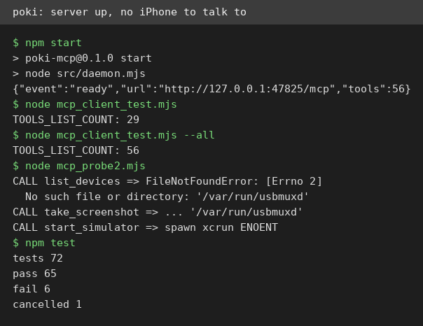

# AI Test Report — 2026-11-06
> Today: four tools that all work, each waiting on one missing piece, plus a laptop model that reads raw weights.

## At a glance
- **agent-autoloop**: a hub that runs coding agents in the background and only asks you when a decision is needed.
- **NOIR**: a desktop tool that audits what your Android apps can leak, if you have a phone to plug in.
- **claude-animated-shorts**: a playbook that turns code into cartoon story shorts, rendered on your own machine.
- **poki**: a plug that lets an AI assistant drive a real iPhone, if you own a Mac.
- **"Qwen 3.8 27B on my laptop can interpret model weights, too"**: Simon Willison checks whether a laptop model can name a game from raw numbers alone.

## 🆕 Open-source project tests

### agent-autoloop — a background hub for your coding agent, with a human approval gate ⭐4/5

- **In one sentence**: agent-autoloop is a self-hosted hub (a program you run on your own machine) that runs command-line coding agents (AI helpers that write code from a terminal) in the background, and only interrupts you when a human call is needed.
- **Why it caught my eye**: it appeared November 3 and passed 3,200 stars in three days, promising background agents that cost nothing while they wait for you.
- **I tried it**: I installed it from the repo with Node (a JavaScript runtime) 24 already on this machine, no build step.
  - `sh install.sh --agent codex --no-service --port 33115` finished in about 1 second, and the hub started on 127.0.0.1:33115 using about 78 MB of memory.
  - `agent-autoloop try` with Codex not signed in hung for 4 minutes with no timeout, so I stopped it. The loop never fails fast when its agent cannot log in.
  - With the project's own scripted stand-in agent, the full loop worked. `emit bugfix.start --subject add-2-3-wrong` handed a planted bug to the agent, it found `add(2, 3)` returning -1, and asked card #1, "Apply the one-line fix?"
  - `agent-autoloop answer 1 1` resumed the same run, applied the fix, and `node test.js` printed `add(2, 3) = 5`, PASS. While waiting for my answer, zero processes ran and zero tokens were used.
  - What surprised me: the whole ask, answer, and resume cycle took about 2 seconds of compute, and `npm run test:quick` passed 619 of 625 tests with 0 failures in 240 seconds.
- **The catch**: it is useless without a signed-in agent, and the hang with no timeout could trap a newcomer. The interface is Chinese only, and I did not verify the real Claude or Codex multi-turn path, only the scripted stand-in.
- **Try it if**: you're a Claude Code or Codex user who wants cron-driven background jobs with human approval gates.
- **Skip it if**: you have no signed-in CLI agent yet, or you need an English interface today.
- **Score**: ⭐4/5, the loop genuinely works as claimed with a serious test suite, but the silent hang and Chinese-only CLI keep it from a 5.
- **Link**: https://github.com/KKKKhazix/agent-autoloop

### NOIR — see what your Android apps can leak, if you have a phone to plug in
- **In one sentence**: NOIR is a desktop privacy audit tool (a program that checks what your phone apps collect) that plugs into an Android phone and lists each app's permissions and the tracking addresses baked into it.
- **Why it caught my eye**: it appeared October 31 and passed 2,400 stars in a week, promising reversible fixes with no root access and no data leaving your machine.
- **I tried it**: I downloaded the Linux release (a 63.8 MB zip) and ran it directly, no Java install needed.
  - `./portable/NOIR/bin/NOIR --version` printed `NOIR 0.2.6`, and `--about` and `--help` rendered cleanly.
  - `noir setup --yes` failed with an SSL error, because its bundled Java ignores this machine's proxy settings. I installed adb (Android's debug bridge) by hand instead.
  - `noir scan` with no phone attached failed fast in 1.9 seconds with a clear 4-step guide to enable USB debugging, no hang and no stack trace.
  - What surprised me: there is no offline mode for APK files (Android app packages) at all, even though the code for reading them is already written, just not wired to any command.
- **The catch**: a physical Android phone with USB debugging is mandatory for every real audit, and the README and CLI are Chinese only. The README install section still shows v0.1.1 filenames. The from-source build also failed here, blocked by sandbox limits rather than the project.
- **Try it if**: you're an Android user who wants to see which of your apps phone home, and where.
- **Skip it if**: you have no Android phone handy, or you wanted to audit APK files you downloaded.
- **Score**: No score, the actual audit could not be tested without hardware.
- **Link**: https://github.com/Verlintas/NOIR

## ✍️ Tech article deep-dives

### Qwen 3.8 27B on my laptop can interpret model weights, too — a laptop model names games from raw numbers
- **Read this if**: you wondered whether AI models can understand other models by staring at their raw numbers.
- **The argument in 3 bullets**:
  - A new paper, "Sparks of Weight-Space Programming", claims frontier models can tell what a network was trained to do just by reading its weights (the numbers inside a trained model).
  - The same paper says models can even edit those numbers to fix a model, with one edit lifting a math score from 7.9% to 48.1%.
  - Simon Willison tested the no-tools half of the claim on his own laptop with Qwen 3.8 27B (a 17 GB open model). It named Pac-Man at 72% confidence after 46 minutes, Pong at 75% after 64 minutes, and Breakout at 88% after 52 minutes, and missed Freeway.
- **Why it matters to you**: it shows a laptop model doing something that sounds like mind reading, with the full prompts published so you can rerun the test yourself.
- **My take**: the three correct guesses are real and the reasoning traces are fun to skim, but each took about an hour and tens of thousands of reasoning tokens, and the paper's bigger claims about editing weights stay unverified here. Willison's own verdict is right: this is cool, not the end of source code.
- **Link**: https://simonwillison.net/2026/Nov/3/qwen-can-interpret-model-weights/

## 🛠️ Agent skill tests

### claude-animated-shorts — cartoon story shorts from code, rendered on your own machine ⭐4/5

- **In one sentence**: claude-animated-shorts is an agent skill (a written playbook an AI assistant follows) that generates vertical cartoon story shorts with 2D characters in a painted 3D world, rendered locally with three.js (a 3D graphics library) inside Remotion (a video-rendering framework).
- **Why it caught my eye**: it appeared November 1 and passed 1,700 stars in five days, promising finished-looking animation frames with no AI video generator and no subscription.
- **I tried it**: I read the full skill and built a minimal Remotion project from its templates, since the repo ships no starter project.
  - `npm install remotion@4 @remotion/cli@4 @remotion/three@4 three @react-three/fiber@8.18 ...` installed 280 packages in 26 seconds.
  - `npx remotion still ... --frame 100` produced a 540x960 frame in 2 minutes: bean-head soldiers marching on a wooden bridge, depth blur and all.
  - `npx remotion render ... --frames 100-119` produced a real 20-frame clip in 13 minutes, about 30 to 40 seconds per frame in software rendering.
  - What surprised me: the shipped example looks like finished animation, not a demo stub, and the skill's own warnings about slow software rendering checked out exactly.
- **The catch**: `three@0.180` breaks the build, so you must pin `three@0.169.0`. The repo has no starter project, no voice pipeline, and 26 prop files return 404 errors on every render. A full 67-second short would take 17 to 22 hours on this machine without a GPU (a graphics chip).
- **Try it if**: you're a creator with a GPU machine and Claude Code who wants repeatable cartoon shorts without paying a video generator.
- **Skip it if**: you're on a CPU-only machine, or you expect a one-click install.
- **Score**: ⭐4/5, the shipped example genuinely renders and looks great, but missing version pins, starter project, and prop files mean real friction before the first frame.
- **Link**: https://github.com/mromidev/claude-animated-shorts

## 🔌 MCP tests

### poki — let an AI assistant drive a real iPhone, if you own a Mac ⭐2/5

- **In one sentence**: poki is an MCP server (a plug that lets AI assistants call a tool) that lets an agent tap, type, and screenshot a real iPhone, with no jailbreak.
- **Why it caught my eye**: it appeared November 5 with 195 stars and a bold promise, local control of a real phone through 56 tools.
- **I tried it**: I cloned the repo and started its server on this Linux machine.
  - `./bin/setup` refused at once: "Poki MCP requires macOS and a full Xcode installation."
  - `npm ci` installed 23 packages in 8 seconds, and `npm start` brought the daemon up at 127.0.0.1:47825 with 56 tools.
  - A real MCP handshake listed 29 tools on the default profile and 56 with all tools enabled.
  - Every device call failed: `list_devices` and `take_screenshot` hit a missing `/var/run/usbmuxd`, and `start_simulator` failed with `spawn xcrun ENOENT`.
  - What surprised me: its own test suite still passed 65 of 72 tests on Linux, with the 6 failures all being macOS-only pieces.
- **The catch**: nothing here can touch a phone without macOS, Xcode, and an iPhone, so the headline feature went completely untested.
- **Try it if**: you're a Mac owner with an iPhone who wants an agent to drive it.
- **Skip it if**: you're on Linux or Windows, or you have no iPhone to connect.
- **Score**: ⭐2/5, the server starts and answers, but every action needs Apple hardware, so on this machine it does nothing.
- **Link**: https://github.com/JosssphZhou/poki

## Notes
- Three of today's four tools need hardware this VM does not have: a signed-in CLI agent (agent-autoloop), an Android phone (NOIR), and a Mac plus iPhone (poki). The fourth, animated-shorts, needs a GPU for sane render times.
- The terminal screenshot helper now renders Chinese text (patched today with a Noto CJK fallback), since two of today's CLIs speak Chinese only.
- Follow-ups: retest agent-autoloop with a signed-in Claude Code agent; retest NOIR with a real Android phone; retest poki on a Mac with an iPhone; render a full animated short on a GPU machine.
