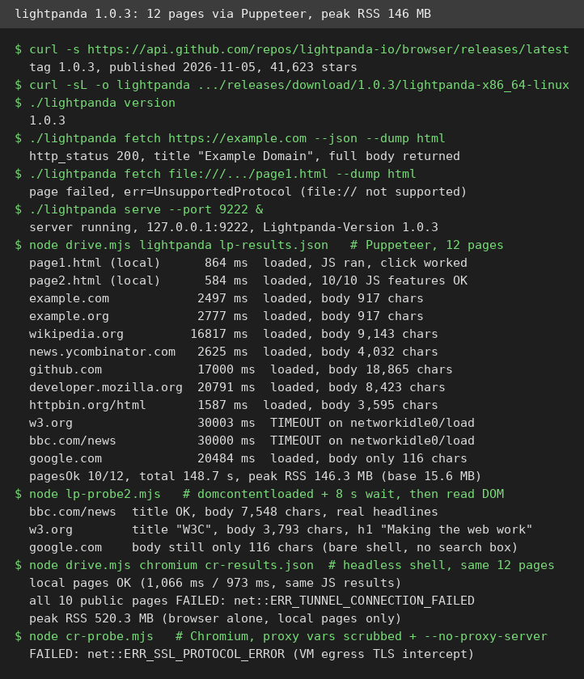
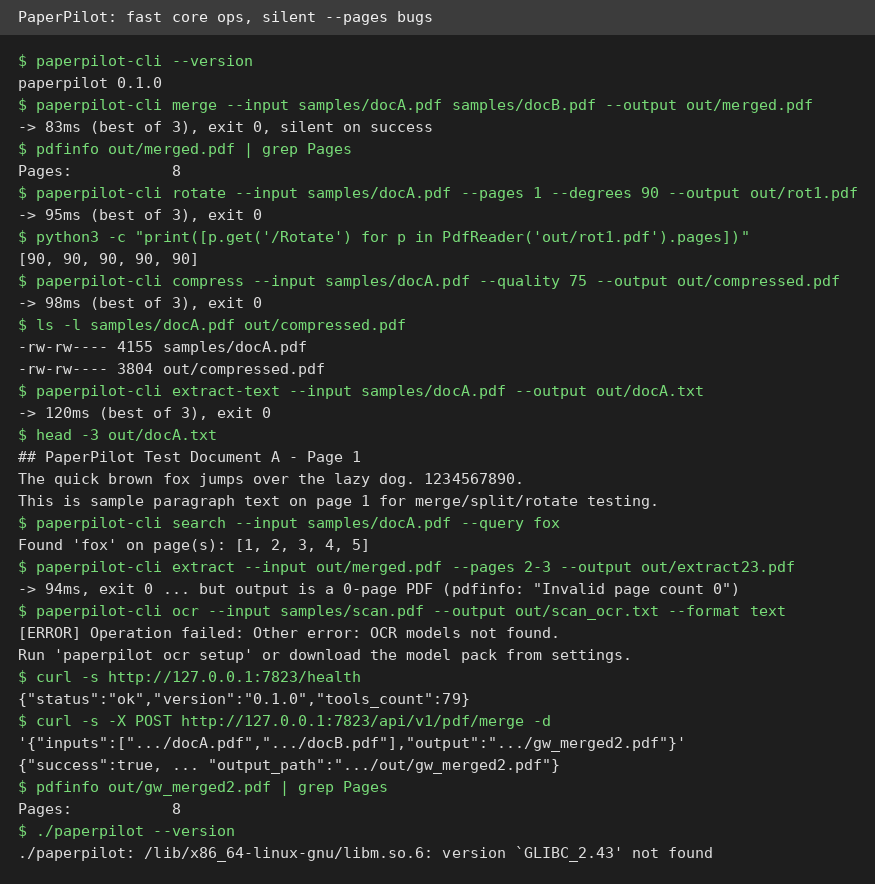
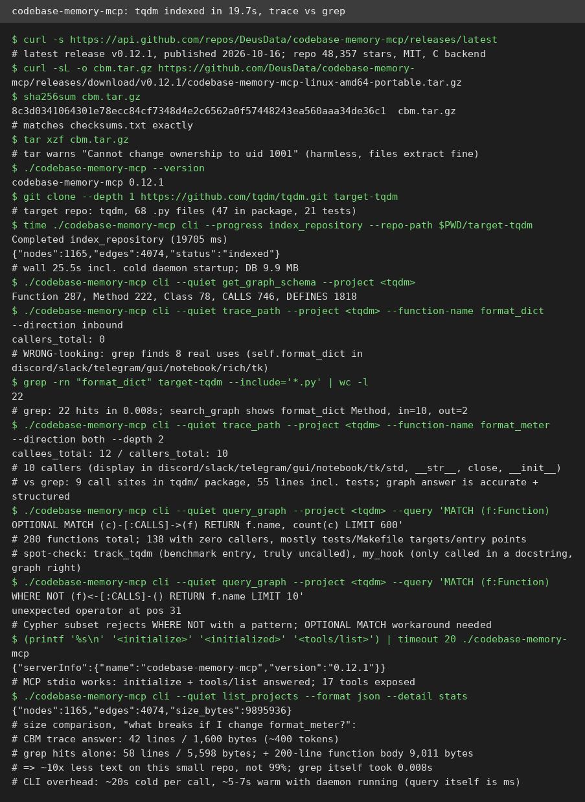

# AI Test Report — 2026-11-09
> Today everything is about memory: a browser that uses less of it, tools that remember your code, and agents that remember you.

## At a glance
- **lightpanda** — a tiny headless browser that uses a third of Chrome's memory, but hangs on tracker-heavy pages.
- **PaperPilot** — a fast local PDF toolbox whose core works in 90 ms, but which silently ignores what you asked for.
- **claude-mem** — a memory layer for coding agents whose manual recall works, but whose auto-capture I could not test here.
- **codebase-memory-mcp** — a local code map that answers "what breaks if I change this" in 400 tokens instead of 3,800.
- **Anthropic on agent memory** — why remembering is a prediction, and why a wrong note can trap an agent in a cave.

## 🆕 Open-source project tests

### lightpanda — a headless browser that sips memory instead of gulping it ⭐4/5

- **In one sentence**: lightpanda is a web browser with no window (a headless browser), built for robots and scripts instead of people.
- **Why it caught my eye**: It claims 16x less memory and 9x faster page loads than headless Chrome, and it hit GitHub trending days after its 1.0 release.
- **I tried it**:
  - Installed the 1.0.3 Linux binary (released 2026-11-05, 41,623 stars) and ran `lightpanda serve`, then drove it with Puppeteer (a script library that remote-controls browsers) through 12 pages.
  - 10 of 12 pages loaded. Local pages took 0.6 to 0.9 seconds, Hacker News 2.6 seconds, Wikipedia 16.8 seconds.
  - Peak memory was 146.3 MB for the whole run, against 520.3 MB for Chromium doing almost nothing. That is about 3.5x lighter, not 16x, on my sequential test.
  - A JavaScript feature probe passed 10 of 10 checks, including localStorage, fetch, canvas, and WebSocket (a live two-way connection between browser and server).
  - What surprised me: lightpanda reached the public internet on this VM while Chromium could not load a single public page, because it honors the system certificate bundle.
- **The catch**: Two heavy pages (BBC News, w3.org) never fired the `load` event, so a script waiting for it hangs for the full 30 second timeout. The content is actually there, so the fix is to wait for `domcontentloaded` plus a delay instead. Google renders as a bare shell with no search box, and the CLI `fetch --dump` mode returns truncated output. Big pages are slow to settle: 17 to 21 seconds for GitHub, Wikipedia, and MDN.
- **Try it if**: you're a scraper or agent builder who wants a light browser and controls the wait strategy.
- **Skip it if**: you need a drop-in Chrome replacement for arbitrary sites.
- **Score**: ⭐4/5 — real Puppeteer compatibility and a genuine memory win, held back by beta rough edges.
- **Link**: https://github.com/lightpanda-io/browser

### PaperPilot — a fast local PDF toolbox that stays silent when it fails ⭐3/5

- **In one sentence**: PaperPilot is a free PDF toolkit (merge, split, rotate, compress, search, OCR) that runs entirely on your own machine.
- **Why it caught my eye**: It promises 75+ tools, 20 to 130 ms local operations, and zero data sent to any server, all from one Rust codebase.
- **I tried it**:
  - The official v0.6.1 Linux binary refused to run here: it needs glibc 2.43 (a core system library), and this Ubuntu 24.04 machine has 2.39. I built from source instead, which took about 88 minutes.
  - Core ops were fast and correct: merge of a 5-page and a 3-page PDF took 83 ms, search found "fox" on all 5 pages in 96 ms, compress shrank a file by 8.4% in 98 ms.
  - The local web gateway works: `/health` reports 79 tools, and a JSON merge call returned a correct 8-page PDF in 190 ms.
  - What surprised me: the failures are all silent. `rotate --pages 1` rotated all 5 pages, and `extract --pages 2-3` produced an invalid 0-page PDF, both exiting with code 0.
- **The catch**: OCR (text recognition from scanned images) is broken three ways: the models are misnamed, the suggested `ocr setup` command does not exist, and a raw JPEG scan crashes the detection model. `render` writes extracted text into a file named `.png` instead of an image. The README examples use wrong flags (`--inputs`, `--angle`), so copy-paste fails. The build exit code itself is unconfirmed after a VM restart, though the built binary demonstrably works.
- **Try it if**: you're a developer who needs scriptable local PDF ops and will verify every output.
- **Skip it if**: you need OCR, page-selective edits, or a binary that just runs on Ubuntu 24.04.
- **Score**: ⭐3/5 — the engine is real and fast, but silent wrong output is a trust problem.
- **Link**: https://github.com/KrushnaVardhanReddy/PaperPilot

## ✍️ Tech article deep-dives

### The components of agent memory — why a wrong note can trap an agent in a cave
- **Read this if**: you build agents, or you use a coding assistant and wonder why it forgets yesterday's decisions.
- **The argument in 3 bullets**:
  - Agent memory has four layers: raw transcripts (a searchable log), notes the agent writes itself, representations like a wiki built from those notes, and injected context (short text loaded into every session).
  - Memory is a prediction, not storage. When an agent writes a note, it guesses what the future will need, and that guess can be wrong or go stale.
  - "Dreaming" is the fix: an offline pass between sessions that re-reads transcripts, corrects bad notes, and promotes good ones upward. In one test, a wrong note about a location left the agent stuck in a cave for 3,000 actions; after dreaming corrected it, the agent reached its goal within 1,000.
- **Why it matters to you**: If you keep a MEMORY.md for your coding assistant, its top lines are your agent's injected context. Anthropic loads at most 3,000 words per file, so what sits at the top decides what gets remembered.
- **My take**: The numbers are strong but all Anthropic's own: memory lifted Opus 5.5 from 0.655 to 0.838 on their internal CL-Bench (a benchmark that tests learning across sessions), while the weakest model barely moved (0.330 to 0.364). The honest core is the caveat: a wiki alone scored 48%, below plain search at 53%; only wiki plus search together reached 61%. Memory helps, but only as a stack, never as one layer.
- **Link**: https://www.anthropic.com/research/components-of-agent-memory

## 🛠️ Agent skill tests

### claude-mem — give your coding assistant a memory, if you can get past first run ⭐3/5
- **In one sentence**: claude-mem records what your coding assistant did in each session and brings the notes back next time, so you stop re-explaining your project.
- **Why it caught my eye**: It has 114,901 stars and topped GitHub trending on 2026-11-01, promising to end session amnesia for Claude Code users.
- **I tried it**:
  - Installed 15.12.1 with no account and no payment: `npx claude-mem install --provider claude --runtime worker --no-auto-start` worked cleanly, and the local SQLite store (a small local database file) is real and well structured.
  - Manual recall works: I saved a note through the MCP server (a standard plug that lets AI tools talk to outside programs), and smart search found it in 1.5 seconds after warmup, returning the full text verbatim.
  - What surprised me: the first-run experience is rough. Smart search timed out twice at 30 seconds while a 576 MB background download ran, and the semantic search backend then failed outright, so recall falls back to keyword search.
- **The catch**: The headline claim, automatic capture and two-session recall, was untestable here: this VM has no Claude Code CLI, no subscription, and no API keys, so the observer that writes the notes never starts. The `claude-mem mcp` command cannot serve a standard MCP client (it closes stdin right after launch), `claude-mem search` returns empty silence for terms that exist, and `claude-mem doctor` prints nothing at all. A real Claude Code subscriber would likely have a smoother time than this VM did.
- **Try it if**: you're a Claude Code subscriber who wants local session memory and can tolerate rough edges.
- **Skip it if**: you expect it to work without Claude Code, or you need semantic search on day one.
- **Score**: ⭐3/5 — the local store and manual recall work, the automatic loop is unverified, and first-run edges are real.
- **Link**: https://github.com/thedotmack/claude-mem

## 🔌 MCP tests

### codebase-memory-mcp — a map of your code that answers "what breaks if I change this" ⭐4/5

- **In one sentence**: codebase-memory-mcp builds a map of which functions call which in your code, then lets an AI assistant query the map instead of reading whole files.
- **Why it caught my eye**: It claims to cut the reading work for code questions by around 99%, and it has 48,357 stars with no database or account needed.
- **I tried it**:
  - Installed v0.12.1 (released 2026-10-16) as a single 48.9 MB binary, checksum verified, and indexed tqdm (a Python progress-bar library, 68 files) in 19.7 seconds: 1,165 nodes, 4,074 edges.
  - "What breaks if I change `format_meter`?" returned 10 callers plus 12 callees in 42 lines, about 400 tokens. The grep path needed 55 hit lines plus reading a 200-line function, over 3,800 tokens. That is a real 10x saving, not 100x, on a small repo.
  - What surprised me: `trace_path` said `format_dict` has zero callers, while grep found 8 real uses in 0.008 seconds. The graph itself records 10 references, but the trace only follows calls, and `format_dict` is a property (data accessed like a variable), so its uses are invisible.
- **The catch**: There is no built-in dead-code tool despite the README's "~150 ms dead code detection" benchmark; you must write Cypher (a graph query language), and its subset rejects the obvious query form. Every one-shot CLI call costs about 20 seconds cold, so the daemon must stay warm; the MCP path inside an agent session is the intended use.
- **Try it if**: you're a developer or agent working in a large repo through an MCP client with the daemon warm.
- **Skip it if**: your repo is small enough that grep is already instant, or you only use the CLI.
- **Score**: ⭐4/5 — the blast-radius trace is the real thing, but the 99% claim is a large-repo number.
- **Link**: https://github.com/DeusData/codebase-memory-mcp

## Notes
- The four hands-on tests ran in parallel, and a sibling Rust build consumed nearly all VM memory for a stretch, killing three lightpanda exec sessions mid-command. None of those deaths were caused by lightpanda, and the benchmark runs happened after memory pressure eased.
- Chromium could not load any public page on this VM (proxy tunnel and TLS errors), so no fair public-page speed comparison against lightpanda was possible. That is a VM egress limit, not a Chromium defect.
- PaperPilot's source-build exit code is unconfirmed: a runtime restart wiped the build log, though the resulting binary exists and passed every test run against it.
- Anthropic's agent-memory numbers are all Anthropic's own tests on their internal benchmark and single-run examples; treat them as the vendor's claims, not independent verification.
