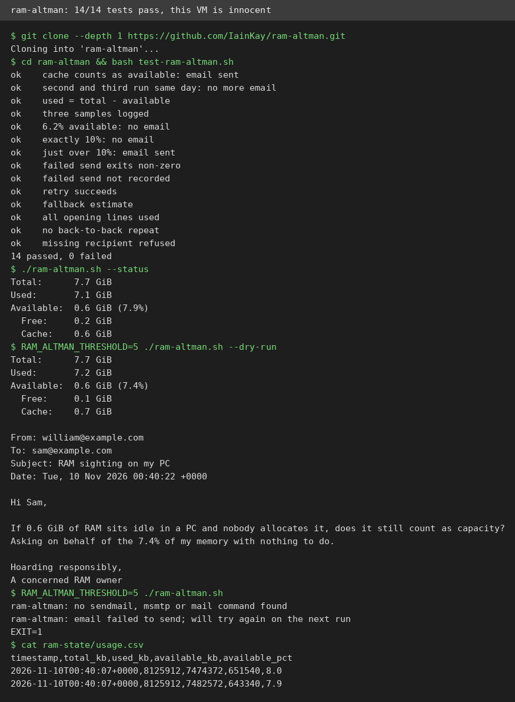
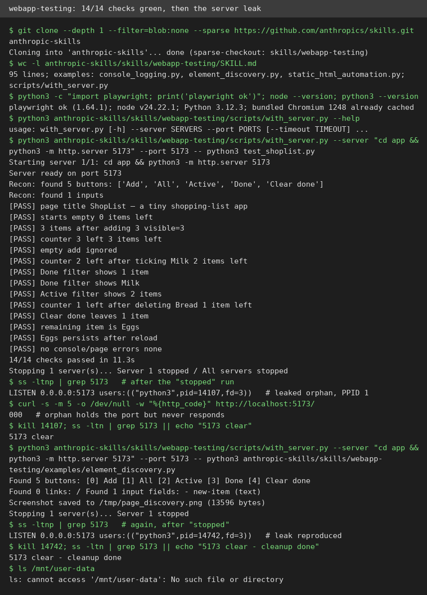
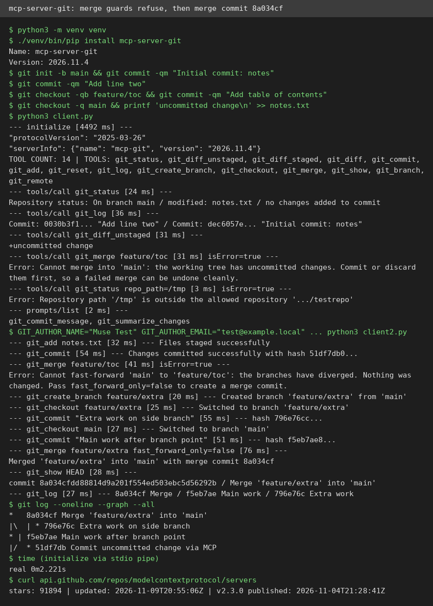

# AI Test Report — 2026-11-10
> Today is about small tools with careful guards: a joke script that emails Sam Altman about your RAM, a skill that tests web apps, a Git plug for AI agents, and one famous AI adoption number that turns out to measure a changed question.

## At a glance
- **ram-altman** — a joke script that reports your idle RAM to Sam Altman, and it is engineered better than most real tools.
- **Anthropic's webapp-testing skill** — a 95-line recipe for testing web apps in a real browser, with one leaky helper script.
- **mcp-server-git** — a Git plug for AI agents whose merge guards genuinely work, but it cannot push or pull.
- **Simon Willison on the Census Bureau** — the "AI adoption is surging" numbers mostly measure a survey question that changed, not behaviour that did.

## 🆕 Open-source project tests

### ram-altman — a script that snitches on your idle RAM to Sam Altman ⭐4/5

- **In one sentence**: ram-altman is a small Linux script that emails Sam Altman, the head of OpenAI, once a day to report the memory (RAM, the fast working memory in a computer) you are not using.
- **Why it caught my eye**: It riffs on Altman's real remark during the 2026 memory-chip shortage, that it is "quite terrible" for everyone to keep DRAM (computer memory chips) sitting idle in their own machines. The repo appeared on 2026-11-05 and already has 1,438 stars.
- **I tried it**:
  - Cloned the repo (a single 287-line bash script, no dependencies beyond bash and a mail command) and ran its test suite: 14 passed, 0 failed, in about 5 seconds.
  - The tests check the exact boundary: at 6.2% free RAM no email, at exactly 10% no email, just over 10% an email fires. The once-a-day rule and failed-send retry are tested too.
  - On this VM, `--status` read 7.7 GiB total with 0.6 GiB available (7.9%), below the 10% threshold, so no email would fire. This VM is innocent of RAM hoarding.
  - Forcing a dry run at a 5% threshold produced a full email preview with real numbers, signed "Hoarding responsibly, A concerned RAM owner".
  - What surprised me: the joke is backed by careful engineering. It rotates 8 subjects, 10 bodies, and 6 sign-offs (I counted them in the source), never repeats the same message twice in a row, and a failed send is logged but retried the next day instead of silently dropped.
- **The catch**: Actually sending mail needs a working `sendmail`, `msmtp`, or `mail` command, and this VM has none of the three, so the real send path fails with exit code 1 and a clear message. It is Linux only (it reads `/proc/meminfo`), and the joke only lands if you know the Altman quote.
- **Try it if**: you run Linux, know the Altman RAM quote, and want a five-minute laugh plus a solid little RAM logger for your scheduled tasks.
- **Skip it if**: you want a real monitoring tool, you are not on Linux, or you do not want to set up outgoing mail for a joke.
- **Score**: ⭐4/5 — it does exactly what it promises and its tests all pass, but the punchline needs a mail setup most people do not have, and it is a gag, not a tool.
- **Link**: https://github.com/IainKay/ram-altman

## ✍️ Tech article deep-dives

### The U.S. Census Bureau and "Super Intelligence" — the AI adoption numbers measure a changed question
- **Read this if**: you have quoted a headline number about US companies adopting AI, and you want to know why that number may be measuring a changed question rather than changed behaviour.
- **The argument in 3 bullets**:
  - The Census Bureau's Business Trends and Outlook Survey (BTOS) goes to 200,000 businesses out of 1.2 million every two weeks, and it feeds most "AI adoption is surging" charts. On 17 November 2025 the Bureau quietly broadened its AI question from use "in producing goods or services" to use "in any of its business functions", so answers before and after that date are not directly comparable.
  - The headline jump is mostly the wording change, not a sudden adoption wave. The largest firms (250+ employees) answered "yes" around 12% of the time in September 2025 under the old wording, around 30% by February 2026, and 40.7% by October 2026 under the new wording. Willison's chart marks the break with a shaded gap labelled "Series not comparable".
  - From the 19 October 2026 collection, the question was renamed again by Executive Order 14434: businesses are now asked whether they used "Super Intelligence or SI (formerly referred to as Artificial Intelligence or AI)". The first results under the new wording were due on 5 November 2026, and nobody knows yet whether the rebrand will confuse respondents or move the numbers.
- **Why it matters to you**: Every "AI adoption is exploding" headline built on BTOS data stands on a series break that most coverage never mentions. If you use adoption stats to justify a strategy or a budget, check which question was asked before you trust the trend line.
- **My take**: This is Willison at his best, a small detective story told with primary sources (the Census spreadsheet, the survey document, the BTOS about page) rather than vibes. The cold water is real too: he never quantifies how much of the 12% to 40% jump is wording versus genuine adoption, and his chart uses a six-survey average of his own devising with no error bars shown. The honest answer is unknowable from this data alone, but the post leaves the impression the jump is "mostly" wording without a number to back that up.
- **Link**: https://simonwillison.net/2026/Nov/2/census-bureau-super-intelligence/

## 🛠️ Agent skill tests

### webapp-testing — Anthropic's recipe for testing a web app in a real browser ⭐4/5

- **In one sentence**: webapp-testing is an official Anthropic skill (a reusable instruction pack for AI coding agents) that tells an agent how to test a local web app with Playwright (a script library that remote-controls browsers).
- **Why it caught my eye**: It has 188,400 installs on skills.sh and is the 5th most-installed testing skill, yet the whole skill is only 95 lines. Almost all of its value is workflow discipline, not code.
- **I tried it**:
  - Installed it with a sparse git clone in about 3 seconds. No install step was needed: Python Playwright 1.64.1 and its bundled Chromium browser were already on this VM.
  - Built a small real app from scratch, ShopList, with add, tick-done, delete, filters, a counter, and saved state. Then I followed the skill's pattern: inspect the page first, then act.
  - The main test went 14/14 green in 11.3 seconds, covering adding items, counter updates, filters, delete, clear-done, persistence after reload, and zero console errors.
  - The bundled `element_discovery.py` example ran cleanly too: it found the same 5 buttons, 0 links, and 1 input in about 3.8 seconds.
  - What surprised me: the skill's server helper has a real bug. It starts the server through a shell wrapper and only kills the wrapper, so the real server survives as an orphan. I reproduced this twice: after a run that printed "Server 1 stopped", port 5173 was still held by a leftover process.
- **The catch**: The orphan then breaks the next run in a confusing way. It holds the port but stops answering requests, so the next run's readiness check passes and prints "Server ready", while every real request fails. The first symptom looked like a browser problem; it was a stale server. The other two bundled examples are templates, not runnable as shipped: one hardcodes a click on "Dashboard" and writes to a path that does not exist on this VM.
- **Try it if**: you're a developer whose agent needs to click through a local web app in a real browser and report what broke, with screenshots and console logs.
- **Skip it if**: you already have a Playwright suite (the skill adds little beyond its two patterns), or you only need static checks.
- **Score**: ⭐4/5 — the documented workflow works exactly as written and the 14-check run went green in 11 seconds, but the server helper's leak cost a real debugging detour and the examples need adapting before they run.
- **Link**: https://github.com/anthropics/skills (path: `skills/webapp-testing`)

## 🔌 MCP tests

### mcp-server-git — let your AI agent use Git, with guardrails that actually hold ⭐4/5

- **In one sentence**: mcp-server-git is the official Git MCP server (a standard plug that lets AI tools talk to outside programs), so an AI assistant can inspect, commit, branch, and merge in a local repo without getting a shell.
- **Why it caught my eye**: Version 2026.11.4 shipped on 2026-11-04 with the monorepo's v2.3.0 release, and its headline feature is merge support with safety guards. Merge is exactly where an agent can do real damage, so the guards are the thing to test.
- **I tried it**:
  - Installed it into a local Python environment in about 60 seconds, no account and no API key needed. It talks over standard input/output, and I drove it with a small hand-written client script.
  - `tools/list` returned 14 tools. I exercised 13 of them against a scratch repo, and every call after startup landed in 2 to 76 ms. Cold start took about 2.2 seconds.
  - The merge guards work. A merge into a dirty tree was refused with a plain-English explanation. A merge between diverged branches was refused too, with the fix spelled out. Passing `fast_forward_only=false` then produced a real merge commit, `8a034cf`, verified in `git log` with both parents present.
  - The `--repository` confinement works: asking for a status on `/tmp` was refused as outside the allowed repo.
  - What surprised me: the two bundled prompts are the quiet win. `git_summarize_changes` hands the model a ready-to-send summary request with the diff embedded, which is the feature an agent host actually uses daily.
- **The catch**: It is a thin wrapper over the `git` command line, nothing more. There is no push, pull, fetch, clone, rebase, stash, or revert, so an agent can commit and merge locally but cannot sync with a remote. Worse, if no git identity is configured, it commits as the OS user instead of refusing, so repos can silently collect misattributed commits. A conflicted merge's auto-abort is README-only; my branches touched different files, so I could not verify it.
- **Try it if**: you drive an AI coding agent and want it to inspect, commit, branch, and merge in a local repo without giving it a shell.
- **Skip it if**: you need remote sync through MCP, or you work in repos where a stray agent commit would be costly and you will not pass `--repository`.
- **Score**: ⭐4/5 — every claim I tested checked out and the merge guards genuinely work, but there is no remote sync and the silent commit-identity fallback can misattribute commits.
- **Link**: https://github.com/modelcontextprotocol/servers/tree/main/src/git

## Notes
- No failures that block the edition. Three honest gaps from the tests: ram-altman's real send path was never exercised end to end (this VM has no mail command); mcp-server-git's conflicted-merge auto-abort is README-only, unverified; webapp-testing's two template examples were not run as shipped because they reference a path that does not exist here.
- The skill worker found that the webapp-testing helper leaks its server process (orphan PIDs 14107 and 14742). Both leftovers were killed by PID and port 5173 is clear.
- Follow-up worth watching: the first BTOS results under the "Super Intelligence" wording were due 5 November 2026. If the numbers jump again, Willison's series-break warning gets its next test.
