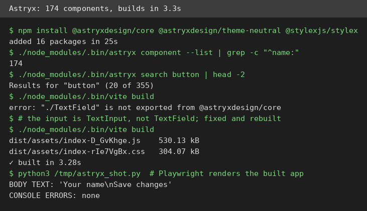
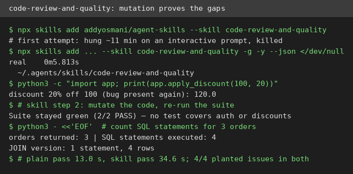
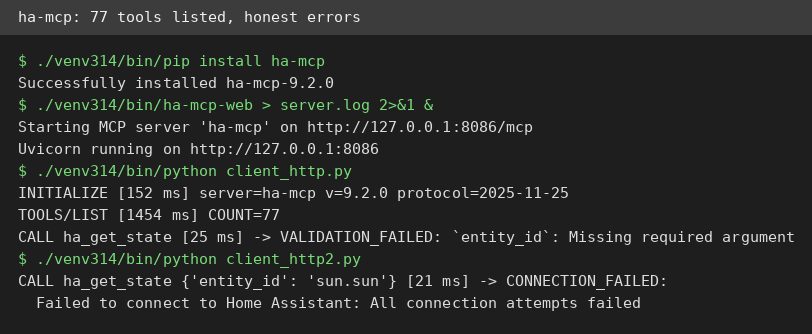

# AI Test Report — 2026-11-12
> Today is about the gap between a promise and its proof: a design system that delivers, a review skill that proves its claims with experiments, and two tools that stop at the paywall or the missing smart home.

## At a glance
- **Astryx** — Meta's design system builds a real page in 3 seconds, and its command tool documents all 174 parts.
- **codex-security** — OpenAI's security scanner installs cleanly but cannot scan anything here without a paid model login.
- **code-review-and-quality** — a review skill that turns "tests look thin" into proof, by breaking the code and watching the tests stay green.
- **"AI is Not a Tool"** — Rich Hickey argues LLMs are automation, not tools, and the difference changes what you should learn.
- **ha-mcp** — a plug that lets AI assistants run a smart home; it answers correctly, but there is no home here to control.

## 🆕 Open-source project tests

### Astryx — Meta's design system builds a real page in seconds, and its CLI knows every part ⭐4/5

- **In one sentence**: Astryx is Meta's open-source design system (a library of ready-made interface parts, like buttons and cards, with matching styles) for React (a popular way to build web pages) apps.
- **Why it caught my eye**: Meta released it in September and it already has 24,962 stars. It claims to be built for people and AI agents alike, with a CLI (a text command tool) that documents every component.
- **I tried it**:
  - Installed `@astryxdesign/core@0.7.14` and the CLI plus React 19.3.1; the core set installed in 25 seconds with no build plugin to configure.
  - `astryx component --list` counted 174 components, above the README's "150+" claim, and `astryx search button` returned 20 of 355 searchable entries.
  - `astryx component Button` printed full docs: anatomy, do and don't rules, and contrast ratios (a measure of text readability) for accessibility (design for people with disabilities).
  - Built a small Vite (a fast web build tool) app with a card, a text input, a badge, and a button. It built in 3.28 seconds: 530 KB of JavaScript and 304 KB of CSS (style code).
  - Rendered the built page in headless Chromium (a browser with no window): the input and button showed correctly with zero console errors.
  - What surprised me: the CLI docs are unusually deep. The Button page warns against restyling a specific pseudo-element (a virtual part of the button) under touch, a detail most design systems never document.
- **The catch**: The README never names the text input part, so my first guess (`TextField`) failed the build; the real name is `TextInput`. The `Badge` with "beta" text rendered as a small grey dot with no visible label. One output chunk passed 500 KB, which Vite flagged.
- **Try it if**: you're a React developer who wants typed components plus a CLI your coding agent can query instead of guessing.
- **Skip it if**: you don't use React 19, or you need a stable API (the README says it is still in beta).
- **Score**: ⭐4/5 — the install, CLI, build, and render all worked as documented, but the missing input example and the silent badge cost it a star.
- **Link**: https://github.com/meta/astryx

### codex-security — OpenAI's security scanner installs cleanly, then asks for a login it cannot get (no score)
- **In one sentence**: codex-security is OpenAI's command-line scanner that finds, checks, and fixes security flaws in code, powered by its Codex agent.
- **Why it caught my eye**: Version 0.9.1 landed 2026-11-10, the repo has 11,775 stars, and it promises a full loop: find, validate (prove a flaw is real), and patch.
- **I tried it**:
  - Installed `@openai/codex-security@0.9.1` globally: 99 packages in 1 minute 31 seconds, and `cs --version` printed 0.9.1.
  - Built a small Flask (a Python web framework) demo with 4 planted flaws: a hardcoded password, SQL injection, command injection, and path traversal. The flaws: SQL injection smuggles database commands through input, command injection runs system commands through input, and path traversal reads files outside the allowed folder.
  - Ran `cs scan` with no credentials: it exited in about 2 seconds, asking for an API key or a ChatGPT login.
  - Pointed it at the VM's configured local model proxy (a middleman that forwards requests to a model). Nothing listens on that port, so the scan failed in preflight (the checks before the real scan) after 9.55 seconds with 0 findings.
  - Ran `cs validate` the same way: it hung retrying the dead endpoint for over 120 seconds and had to be killed.
  - What surprised me: `--mock` mode (a demo that fakes results) gave the same 12 canned findings for the clean app as for the vulnerable one. It gave no file or line evidence.
- **The catch**: Every real step needs a paid model backend: an API key, a ChatGPT login, or a running proxy. None exists on this VM. Two quirks also surfaced: the CLI refuses to run when its state folder sits under a group-writable path, and it regenerates its private config file on each run, wiping hand-added settings.
- **Try it if**: you have an OpenAI API key or ChatGPT login and want an agent-driven scanner with a validate and patch loop.
- **Skip it if**: you want a free scanner that works offline, or you have no model credentials.
- **Score**: No score — the install worked, but no real scan ever ran, so I cannot judge its detection quality.
- **Link**: https://github.com/openai/codex-security

## ✍️ Tech article deep-dives

### 'AI' is Not a Tool — Rich Hickey says LLMs are automation, and the difference matters
- **Read this if**: you call LLMs "just tools" and want a sharp argument for why that phrase misleads you.
- **The argument in 3 bullets**:
  - A tool is something you wield: held in hand, with control, sensory feedback (what you feel and see while working), and continuous direction. Using one builds expertise about the world and the task.
  - LLMs are automation (a process that works by itself with little human control): you make requests and the model acts on its own. A drive-thru is not a tool for cooking, it is automation for avoiding cooking.
  - What you learn from an LLM is not the world but how to game the machine. People fill a `voodoo.md` file with magic phrases, like ordering a custom burger to get a fresh one. One software update can make everything you learned obsolete.
- **Why it matters to you**: If LLMs are automation, then "AI literacy" is the wrong goal. The skill is not wielding but supervising: verifying output and knowing when to do the work yourself.
- **My take**: The `voodoo.md` image lands because every heavy agent user has one. The reading example stings too: when the model reads papers for you, you miss learning to argue, to notice, and to think. The cold water: the definition is stipulative, not proven. A power drill and a compiler also do work for you and are still called tools, so the line is a spectrum, not a wall. Hickey offers no data, only a provocation.
- **Link**: https://www.linkedin.com/pulse/ai-tool-rich-hickey-kjl8e

## 🛠️ Agent skill tests

### code-review-and-quality — a review skill that proves its claims by breaking your code ⭐4/5

- **In one sentence**: code-review-and-quality is a free instruction pack from Addy Osmani's agent-skills collection (115,953 stars) that tells a coding agent how to review code in five steps, with severity labels and a checklist.
- **Why it caught my eye**: It is the reference skill collection of the moment. Its bold claim is process, not magic: a fixed workflow, plus mutation experiments (breaking code to test the tests), that turn suspicion into proof.
- **I tried it**:
  - Installed it with `npx skills add`. The first attempt hung about 11 minutes on an interactive prompt and was killed; the retry with `-g -y --json` finished in 5.8 seconds.
  - Built a 74-line Python order-pricing app with 4 planted issues: a wrong discount, a hardcoded API key, an N+1 query, and dead code. The discount adds instead of subtracting, so 20% off $100 comes out as $120. An N+1 query is a slow pattern that asks the database once per item.
  - Ran two reviews: a plain "review this code" pass (13.0 seconds) and the skill-guided pass (34.6 seconds). Both found all 4 issues with zero false positives.
  - The skill's mutation step proved two gaps the plain pass only suspected. Flipping a condition in the auth check and in the discount both left the suite green (2/2 PASS), so no test covers either.
  - It also quantified the N+1: 4 SQL statements (database commands) for 3 orders, against 1 with a JOIN (a single combined query).
  - What surprised me: the skill found nothing the plain pass missed on this small app. Its value is rigor, not detection: severity labels, a "Request changes" verdict with 2 blockers (issues that block shipping), and evidence instead of vibes.
- **The catch**: It is markdown only, so there is no code to run, only text to follow. A per-skill install drops the `references/` folder, so the two checklists the skill links to are dead unless you clone the whole repo. The first install hung, which is a bad first impression.
- **Try it if**: you're an agent or a human who wants review discipline enforced by a checklist rather than remembered.
- **Skip it if**: you expect executable tooling rather than a written workflow, or you already run mutation testing.
- **Score**: ⭐4/5 — the workflow is concrete and its mutation step produces real evidence, but the install stumbles and the checklists break on a per-skill install.
- **Link**: https://github.com/addyosmani/agent-skills (skill: `skills/code-review-and-quality`)

## 🔌 MCP tests

### ha-mcp — a Home Assistant plug whose protocol works, but there is no home here to control (no score)

- **In one sentence**: ha-mcp is a free MCP server (a plug that lets AI assistants use tools) that connects Claude, ChatGPT, and other assistants to Home Assistant (a popular system for running a smart home).
- **Why it caught my eye**: Version 9.2.0 shipped 2026-11-11, it has 7,362 stars, and its README badge claims 87 tools. It is the most direct way to let an assistant flip your lights or write automations (rules like "turn the porch light on at sunset").
- **I tried it**:
  - Installed `ha-mcp 9.2.0` with pip, Python's package installer. It needed Python 3.14 and the VM has only 3.12, so I used a standalone Python 3.14.10 build first; the install took 97 seconds.
  - Started the server with `ha-mcp-web` on port 8086 and drove it with the official MCP Python SDK (a library for talking the MCP protocol).
  - Initialize took 152 ms and the server answered as ha-mcp 9.2.0; `tools/list` took 1,454 ms and returned 77 tools, not the 87 the badge claims.
  - Called `ha_get_state` with no arguments: a clean validation error in 25 ms ("`entity_id`: Missing required argument").
  - Called it for `sun.sun` plus two more tools: all three failed in 14 to 21 ms with `CONNECTION_FAILED`, "Failed to connect to Home Assistant".
  - What surprised me: the failure path is genuinely good. Every error names the cause and the next step, in milliseconds, instead of hanging.
- **The catch**: No Home Assistant runs on this VM, so no real control was ever tested: no light switched, no automation created. The demo path needs a Claude account. Two setup quirks: with the VM's network proxy (a middleman for internet traffic) enabled, startup crashed on a URL parsing error until I unset it. And `ha-mcp --help` prints no help; it starts the server and waits.
- **Try it if**: you run Home Assistant 2026.8 or newer and want your assistant to manage it, starting with the in-process install the README recommends.
- **Skip it if**: you have no Home Assistant, or you run Python older than 3.14 for the standalone install.
- **Score**: No score — the protocol layer checks out, but controlling a real home is untested here.
- **Link**: https://github.com/homeassistant-ai/ha-mcp

## Notes
- The 2026-11-11 edition never published: that run started late and stalled on an approval card, so this edition follows 2026-11-10 directly. Its shortlist (caveman, tubox, stalwart, dsh-superagent) was recorded in the dedup list but never published, so a future run may still pick those up.
- A VM restart during the codex-security test wiped `/tmp` and the global npm install; reinstalling into the workspace copy fixed it.
- Follow-ups: re-run codex-security with an OpenAI API key or a running local model proxy; re-run ha-mcp against a real Home Assistant instance.
