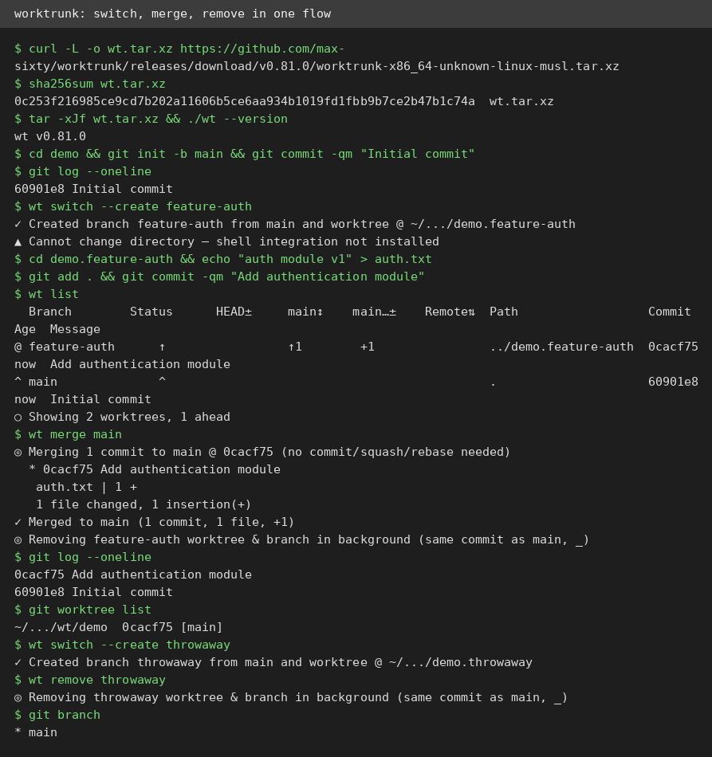
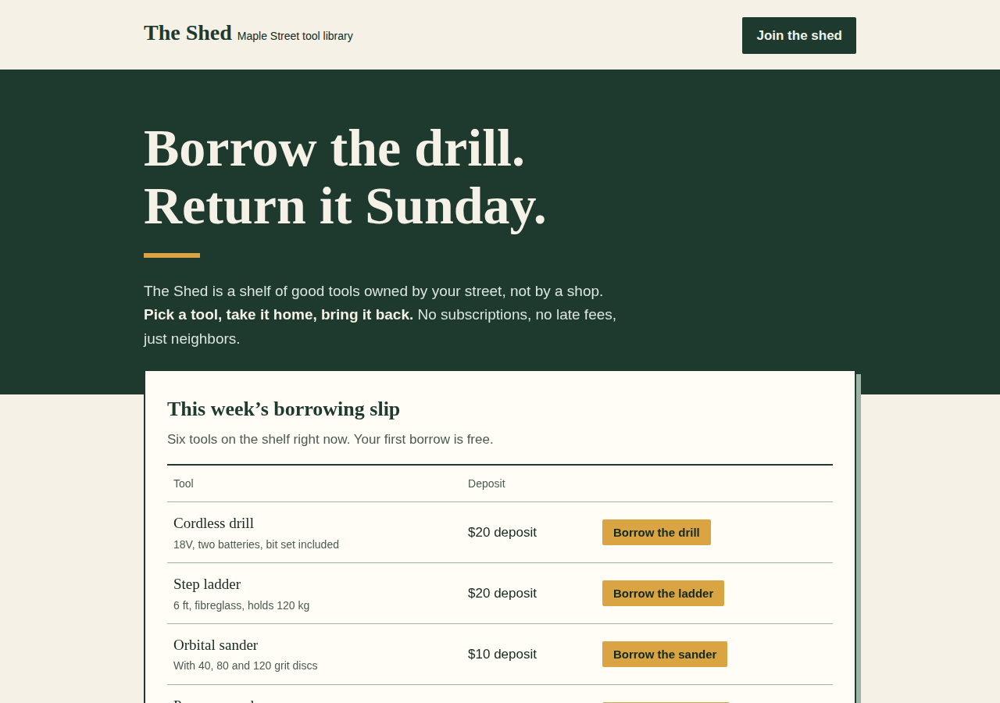
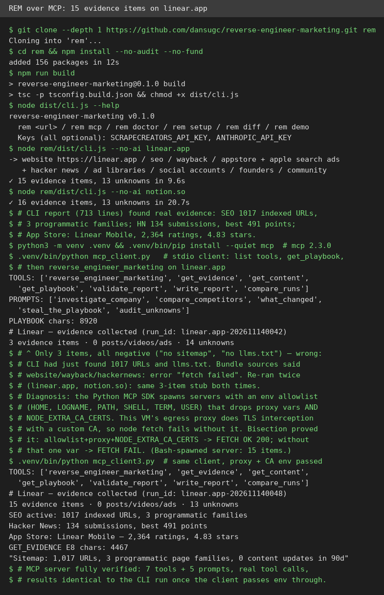

# AI Test Report — 2026-11-14
> Today is about parallel work and honest limits: worktrees that let agents share one repo, a design skill that refuses the default look, a marketing teardown with receipts, and a warning that AI-written code rots in four specific ways.

## At a glance
- **Worktrunk** — a small command-line tool that turns Git worktrees into one-command branches, and it really does the merge and cleanup for you.
- **"AI usage generates a fragile codebase"** — a former Meta engineer names four ways AI-written code goes brittle, from one career of watching it happen.
- **frontend-design** — Anthropic's official design skill builds a page that looks nothing like the usual AI slop, and its own review step catches the clichés first.
- **REM** — paste a company link, get its whole marketing machine with evidence, over a real MCP server, with one environment quirk worth knowing.

## 🆕 Open-source project tests

### Worktrunk — Git worktrees as easy as branches, built for parallel agents ⭐4/5

- **In one sentence**: Worktrunk is a free command-line tool that makes Git worktrees (separate folders checked out from the same repo, so several branches can live side by side) as easy as switching branches.
- **Why it caught my eye**: 12,514 stars, version 0.81.0 released 2026-10-20, and the pitch is aimed squarely at running several coding agents in parallel without them stepping on each other.
- **I tried it**:
  - Downloaded the Linux release tarball, checked its SHA-256 hash (a fingerprint that proves the file is genuine) against the release file, and it matched. `./wt --version` printed `wt v0.81.0`.
  - `wt switch --create feature-auth` made the branch and a worktree folder named `demo.feature-auth` in one step, then warned that shell integration was not installed, so it could not move my shell into the new folder.
  - I committed one file in the new worktree, and `wt list` showed both worktrees with the new one 1 commit ahead of main.
  - `wt merge main` merged that 1 commit, then removed the worktree and its branch in the background, with no extra command from me.
  - `wt remove throwaway` deleted a second throwaway worktree and branch the same way, and `git branch` confirmed only main was left.
  - What surprised me: the merge step does the whole lifecycle. One command merged the commit, deleted the folder, and deleted the branch.
- **The catch**: Without the shell integration installed, `wt switch` creates the worktree but leaves you in the old folder, so you still type `cd` yourself. The tool is built for parallel agents, so a solo developer on one branch may not feel the benefit. Cleanup runs in the background, so the folder can linger for a moment after the command returns.
- **Try it if**: you run several coding agents on one repo and want each in its own folder without hand-managing worktrees.
- **Skip it if**: you work on one branch at a time, or you want the tool to move your shell for you without installing its integration.
- **Score**: ⭐4/5 — the full create, list, merge, and remove loop worked exactly as documented, but the shell hop needs an extra setup step.
- **Link**: https://github.com/max-sixty/worktrunk

## ✍️ Tech article deep-dives

### AI usage generates a fragile codebase — four ways AI-written code goes brittle, from someone who watched it happen
- **Read this if**: you lead a team where agents now write most of the code, and your incident count has started creeping up.
- **The argument in 3 bullets**:
  - AI writes shallow tests. It tests trivial get and set methods and covers only the cases the code already handles, so line coverage (the share of code lines tests touch) looks fine while real gaps stay hidden.
  - AI writes needlessly complex code, with two or three helper methods where one would do, and follows rules like DRY (Don't Repeat Yourself) so rigidly that humans struggle to debug the result.
  - Humans stop understanding the code, and review collapses under speed. Each pull request (a proposed code change) arrives faster than the last, reviewers skim, and small issues pile up until incidents take longer to fix because nobody knows the code anymore.
- **Why it matters to you**: The author, Evan X. Merz, says generating at least 90% of his code with AI was the minimum for a decent rating at Meta, yet AI did not even double his output. His warning is that the bill arrives later, as more incidents, slower recovery, and errors only real users see. The essay hit the Hacker News front page with 600+ points.
- **My take**: This is one engineer's first-person account, not a study, and it has no incident counts or before-and-after numbers, so treat the four mechanisms as checkable claims, not proven facts. The strongest part is how specific they are: you can test each one in your own repo on Monday. The cold water is the comments, where some engineers with large AI-written codebases report no fragility at all, which suggests team habits matter as much as the tool.
- **Link**: https://www.evanxmerz.com/post/ai-usage-generates-a-fragile-codebase/

## 🛠️ Agent skill tests

### frontend-design — Anthropic's design skill that refuses the default AI look ⭐4/5

- **In one sentence**: frontend-design is Anthropic's official skill (a reusable instruction pack for coding agents) that tells an agent to design like a studio with a point of view, not like a template.
- **Why it caught my eye**: It lives in the `anthropics/skills` repo (194,142 stars), and it names the exact clichés every AI page shares, then forbids them: cream backgrounds, terracotta accents, purple gradients, identical rounded cards, and ALL-CAPS labels.
- **I tried it**:
  - Read the full skill (71 lines). Its process is plan first, review the plan against the brief, then build, then critique your own work from a screenshot.
  - The brief I chose was a fictional neighbourhood tool library, "The Shed", where neighbours borrow drills and ladders.
  - The plan picked shed-door green `#1E3A2F`, paper `#F5F1E6`, and sawdust ochre `#D9A441`, with a serif headline face and a borrowing slip (a ruled ledger table of 6 tools with working Borrow buttons) as the hero.
  - The review step rejected the flagged AI cluster (cream plus serif plus terracotta), dropped the card layout, and kept numbered steps only because borrowing is a real sequence.
  - Rendering the page in headless Chromium (a browser run without a window) at 1280x900 showed the Borrow buttons toggling to "Borrowed" and back, with zero console errors and zero pixels of horizontal overflow on mobile.
  - What surprised me: the critique step caught a real deviation. The ochre was meant to be rules only, but it ended up as the button fill too. The skill's own advice kept it, because buttons need the visual weight.
- **The catch**: The skill is a text file, not a program, so nothing is enforced. An agent can read it and still ship a purple gradient. The page it produced is good, but judging that takes a human eye on the screenshot, which the skill itself admits.
- **Try it if**: your agent keeps shipping the same generic landing page, and you want a short rulebook that pushes it toward a distinct look.
- **Skip it if**: you want a tool that checks designs automatically, or your brief genuinely wants the standard SaaS look.
- **Score**: ⭐4/5 — the plan, review, build, and critique loop worked end to end and the page looks nothing like the default, but the rules only bind an agent that follows them.
- **Link**: https://github.com/anthropics/skills/tree/main/skills/frontend-design

## 🔌 MCP tests

### REM — paste a company link, get its whole marketing machine with receipts ⭐4/5

- **In one sentence**: REM (Reverse Engineer Marketing) is a free tool that studies a company's public marketing, from ads to SEO (search-engine optimisation) to app store ratings, and writes a report where every claim cites its evidence.
- **Why it caught my eye**: Version 0.1.0, 455 stars, created 2026-10-18, and it promises a full teardown with no API key: website, tracking pixels, sitemaps, Wayback history, app stores, and Hacker News.
- **I tried it**:
  - `npm install` added 156 packages in 12 seconds, and `npm run build` compiled cleanly.
  - The CLI on `linear.app` found 15 evidence items and 13 unknowns in 9.6 seconds, with no key. `notion.so` took 20.7 seconds for 16 items.
  - The evidence is concrete: 1,017 indexed URLs in 3 programmatic page families, 134 Hacker News submissions with a best of 491 points, and Linear Mobile at 2,364 ratings and 4.83 stars.
  - Over the real MCP protocol (a scripted handshake plus tool calls), the server listed 7 tools and 5 prompts, including `reverse_engineer_marketing` and `get_playbook`.
  - The first MCP run returned only 3 items, all negative, which was wrong. The cause was the Python MCP client's environment allowlist (a short list of variables it passes to the server), which dropped the proxy settings and the custom certificate variable this VM needs. Passing those variables through gave the same 15 items as the CLI.
  - What surprised me: the "unknowns" list is the honest part. REM names the 13 things it could not see, with links to check yourself, instead of guessing.
- **The catch**: Paid ads, social posts, and founder data need optional keys, so without them the report leans on SEO, Hacker News, and app stores. The project is a month old at version 0.1.0 with one maintainer, and the MCP environment quirk will bite anyone behind a proxy with certificate interception.
- **Try it if**: you want a fast, evidence-backed read on how a competitor grows, and you like reports that admit what they could not find.
- **Skip it if**: you need paid ad or social data without setting up keys, or you want a mature tool with a long track record.
- **Score**: ⭐4/5 — the CLI and the MCP server both returned real, matching evidence, but the first MCP run failed silently on environment variables.
- **Link**: https://github.com/dansugc/reverse-engineer-marketing

## Notes
- Tailcat (tailscale/tailcat, v0.7.0) was attempted first for the open-source slot but could not complete its core test here. Install worked and the server printed an address, but every connection timed out, and a probe showed this VM blocks outbound UDP entirely, so it can never reach the relay. That is an environment limit, not a tailcat bug. Retest on a machine with normal UDP egress.
- The 2026-11-11 edition is still missing (that run was cancelled). No content was repeated today: Worktrunk, the Merz essay, frontend-design, and REM were all checked against seen.json first.
- REM's MCP failure mode is worth remembering: the Python MCP SDK spawns servers with a small environment allowlist, which drops proxy and certificate variables. If an MCP server returns empty results on this VM, check the environment first.
