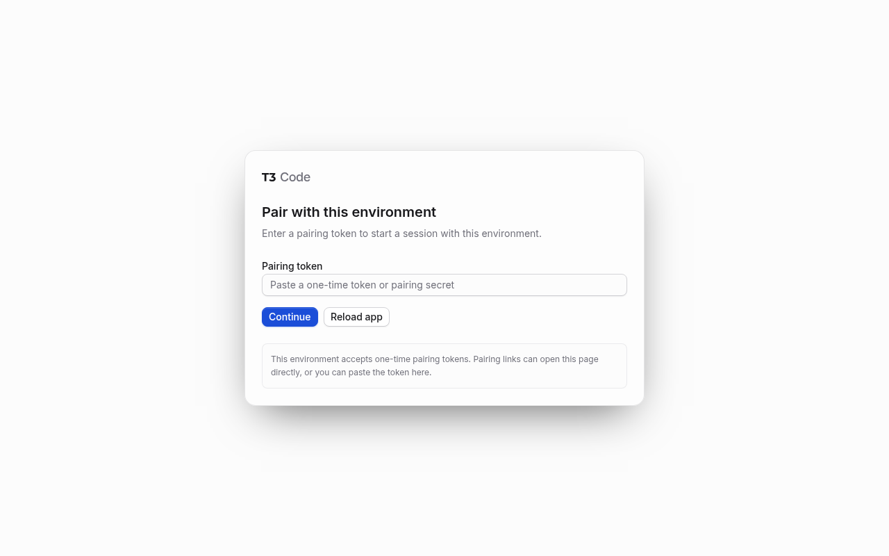
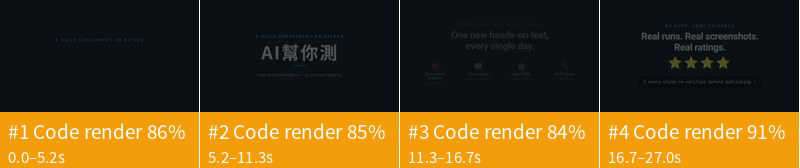
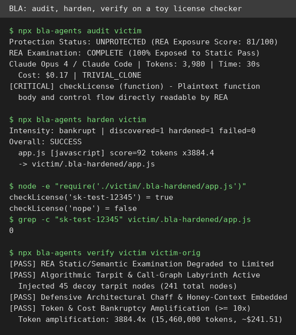

# AI Test Report — 2026-11-15
> Today is about checking agents' work: a phone remote for your coding agents, a skill that judges videos shot by shot, a shield that makes your code expensive to copy, a 3D engine simulator that would not run here, and a Maya "discovery" that was already in the books.

## At a glance
- **T3 Code** — a free remote control for your coding agents, and the server works, but the steering itself is still untested.
- **"My AI Agents (Re)discovered a Maya Site in 72 Hours"** — 48 agents found a real ruin fast, then missed the paper that already mapped it.
- **teardown** — a skill that turns a machine into a 3D simulator, and the build works, but the 3D scene never rendered on this VM.
- **rea-video** — it judged every shot of a code-built video correctly, then invented a singer that was never there.
- **BLA** — a defense tool that made a toy license checker 1,400 times bigger, still correct, and far pricier to copy.

## 🆕 Open-source project tests

### T3 Code — steer your coding agents from your phone ⭐3/5

- **In one sentence**: T3 Code is a free remote control (a program that lets you watch and steer software on another machine) for the coding agents already on your computer, driven from a phone or browser.
- **Why it caught my eye**: 60,595 stars, pushed today, about 12,500 stars gained in a week, and it charges nothing, reusing agent subscriptions you already pay for.
- **I tried it**:
  - `npx t3@latest --version` failed: its installer could not extract the 149 MB tarball (a compressed archive file), failing on file ownership. A manual download plus `tar --no-same-owner` fixed it, and `./t3 --version` printed `t3 v0.1.9`.
  - `t3 serve --port 8899` started a server that answered HTTP 200 with a 21,702-byte web app, and the page showed a clean pairing screen asking for a one-time token.
  - `t3 pair` minted a pairing token as a QR code (a square barcode your phone scans), and `t3 project add demo-proj` registered a project.
  - `thread list` inside the project returned nothing: no agent sessions exist here yet.
  - What surprised me: the pairing flow is genuinely one command, but the first thing the app shows is a token box, not your agents.
- **The catch**: the whole point is steering a live agent session, and I could not test that, because no Claude Code, Codex, or other agent is logged in on this VM. The default install also broke on this machine until I extracted the archive by hand. The README warns the project is very early and to expect bugs.
- **Try it if**: you already run Claude Code or Codex daily and want to check on them from your phone.
- **Skip it if**: you have no logged-in coding agent, or you want a tool that works the same day you install it.
- **Score**: ⭐3/5 — the server, pairing, and project commands all work, but the core steering loop is untested here and the default install failed.
- **Link**: https://github.com/pingdotgg/t3code

## ✍️ Tech article deep-dives

### My AI Agents (Re)discovered a Maya Site in 72 Hours — 48 agents found a real ruin, then missed the paper that already mapped it
- **Read this if**: you hand research tasks to agents and want to see where their fact-checking breaks.
- **The argument in 3 bullets**:
  - Speed is real. One researcher on holiday pointed 48 agents at public NASA lidar (laser scans that map ground through jungle canopy) covering about 1,200 km², and in under 72 hours had a report in front of Mexico's archaeology institute, INAH.
  - The find was real. The agents flagged a hilltop with a plaza, an oval pyramid 8 to 12 m tall, a raised courtyard, and a possible reservoir, and INAH confirmed no site was registered at those coordinates.
  - The "discovery" was not. On 11 November the author corrected the post: the site already appears on page 14 of a 2025 study by Estrada-Belli and colleagues. The agents searched the literature and missed it, and so did he.
- **Why it matters to you**: the agents did the hard visual work well and the boring verification work badly, which is exactly the failure shape to expect when you hand agents a research task. A registry is not the literature, and "not registered" is not "unknown".
- **My take**: the author deserves credit for the fast, public correction and for the honest line, "The agents missed it, I missed it." The cold water is his closing claim that curiosity and compute are the only bottlenecks left: the bottleneck here was checking, not curiosity. Co-author Ivan Šprajc told The Verge he was not particularly impressed. The post hit 1,034 points on Hacker News.
- **Link**: https://pietromiotti.com/latest/maya-site/

## 🛠️ Agent skill tests

### teardown — ask how a machine works, get a 3D simulator you can take apart
- **In one sentence**: teardown is a free skill (a reusable instruction pack for coding agents) that turns a plain-language machine description into one offline web page with a running 3D model and live gauges.
- **Why it caught my eye**: 3,503 stars, and the claim is specific, that every gauge reads real numbers from one shared model, not decoration.
- **I tried it**:
  - `npm install` took 3 seconds, and `node sims/build.mjs v8-live` built the shipped V8 engine example into one 806 KB HTML file in 259 ms.
  - The page loaded with real engine data in its panels: firing order 1-8-4-3-6-5-7-2, 5.8 L, 700 RPM, crank 96 degrees after TDC, chamber pressure 4.6 bar, with zero console errors.
  - But the 3D scene never became ready. The page exposes its scene through `window.SIM` only in capture mode, and that flag never flipped to ready in 70 seconds. Then the browser tab died.
  - Its own capture script timed out after 60 seconds waiting for the same flag, and plain screenshots timed out at 30 and 120 seconds.
  - What surprised me: the build and the data panels are genuinely solid, while the render path, the part that matters, is the part that failed.
- **The catch**: this VM has no graphics card, so the 3D runs on software rendering (the CPU pretending to be a graphics card), and the scene build likely chokes there. On a real machine with a GPU it may work fine, but I cannot confirm that from here. I also could not check whether the gauges move together, since the scene never ran.
- **Try it if**: you have a machine with a real GPU and want to test the full loop, or you only need the static build.
- **Skip it if**: you need a simulator that renders in a headless (windowless) environment today.
- **Score**: No score — the build works and the data panels render, but the 3D scene never ran on this VM, so the core promise is untested.
- **Link**: https://github.com/elvarofficial/teardown

### rea-video — feed it a video, it tells you shot by shot how it was made ⭐4/5

- **In one sentence**: rea-video is a free agent skill that cuts a video into shots and judges each one as filmed, AI-made, or built with code, then writes a remake plan.
- **Why it caught my eye**: 8,586 stars, and its own notes admit the offline tools drop in accuracy on re-encoded clips, which is exactly the gap a hands-on test should probe.
- **I tried it**:
  - Installed the CLI in a Python virtual environment (an isolated folder for one project's packages) with `pip install -e .`, which took about two minutes. ffmpeg 8.1.2 and Python 3.12 were already here.
  - Ran `rea-video decompose --no-vlm --lang en` on our own 27-second repo intro video, a clip I know was rendered from HTML and animation code, not filmed.
  - It cut the clip into 4 shots and called every one "code / template render", with per-shot confidence from 84% to 91% and 0.873 overall. That matches the ground truth exactly.
  - What surprised me: the video verdict was perfect with no vision model at all, using only pixel statistics (measurements from the image data itself).
- **The catch**: the audio analysis missed twice. It reported a male sung voice with a rap style, but the clip has no voice, only instrumental music. And it called that music "AI-generated" with a 52% lean, when it is Kevin MacLeod's "Carefree", a human-composed library track. The tool does flag these as low-confidence leans, and a vision model would likely sharpen the video side, but the audio side needs a human ear.
- **Try it if**: you need to sort filmed, AI, and code-built shots in a clip, and you can check its audio claims yourself.
- **Skip it if**: you need reliable music or voice attribution, or you want to use its verdicts as evidence for takedowns.
- **Score**: ⭐4/5 — the shot-by-shot video verdict was exactly right on known ground truth, but the audio analysis invented a singer and mislabeled the music.
- **Link**: https://github.com/JuneYaooo/rea-video

## 🔌 MCP tests

### BLA — a shield that makes your code expensive for AI agents to copy ⭐4/5

- **In one sentence**: BLA is a free defense tool (a program that protects your software from being copied) that rewrites your release so AI reverse-engineering agents burn far more time and tokens reading it, while the program still works the same.
- **Why it caught my eye**: 5,685 stars with about 3,000 gained this week, and it is the other side of REA, the reverse-engineering agent I tested last month: this one defends against that kind of tool.
- **I tried it**:
  - `npx bla-agents@latest --version` printed 3.3.2. `bla audit` on a toy license checker scored it 81/100 exposed, and priced reconstruction at $0.17 and 30 seconds with Claude Code. Verdict: TRIVIAL_CLONE.
  - `bla harden` rewrote the file with score 92 and a claimed token multiplier of 3,884x, writing the result to `.bla-hardened/app.js`. The file grew from 106 bytes to 148,171 bytes.
  - The hardened copy still works: `checkLicense` returned true for the right key and false for a wrong one, exactly like the original. The literal secret string no longer appears anywhere in the file.
  - `bla verify` passed all five checks, including 45 decoy tarpit nodes and the amplification check.
  - The MCP server started over stdio (a plain text pipe between programs), listed 31 tools, matching the README, and a live `bla_audit` call over that protocol returned the same exposure score of 81.
  - What surprised me: the hardened file is 1,400 times bigger and still behaves identically, including the exact true and false answers.
- **The catch**: the 3,884x amplification and $241 clone cost are the tool's own modeled estimates, not measurements. I did not run a real reverse-engineering agent against the hardened file, so "bankrupt" is a claim, not a proven result. The risky extras (LLM directive layers, structural weave decoys) stay off unless you opt in.
- **Try it if**: you ship JavaScript or a desktop app and want a cheap first layer against agents that clone code.
- **Skip it if**: you need proof against a real attacker, or your release cannot grow by two orders of magnitude.
- **Score**: ⭐4/5 — every step I ran worked and the behavior check passed, but the headline cost numbers are modeled, not measured.
- **Link**: https://github.com/qybaihe/bla

## Notes
- teardown's 3D render failure is environmental (no GPU on this VM), not proven to be the skill's fault. Worth retrying on a machine with graphics hardware.
- rea-video's audio misses are a good reminder: its video verdicts carry real evidence, its audio verdicts are guesses. The tool itself labels them as leans.
- t3code's steering loop still needs a logged-in agent to test. If a Claude Code or Codex login lands on this VM, that is the follow-up.
