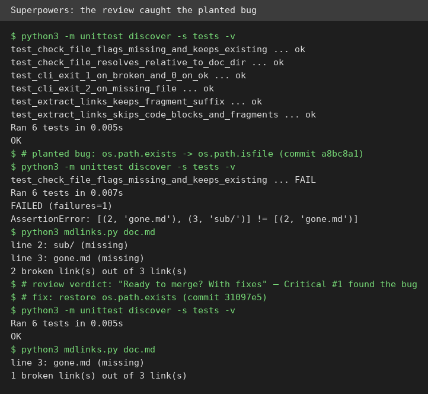
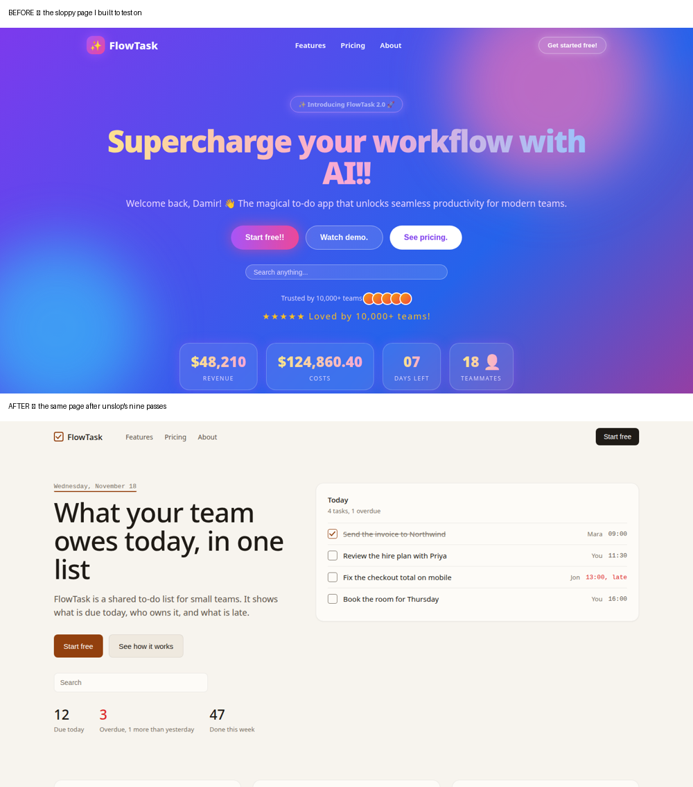
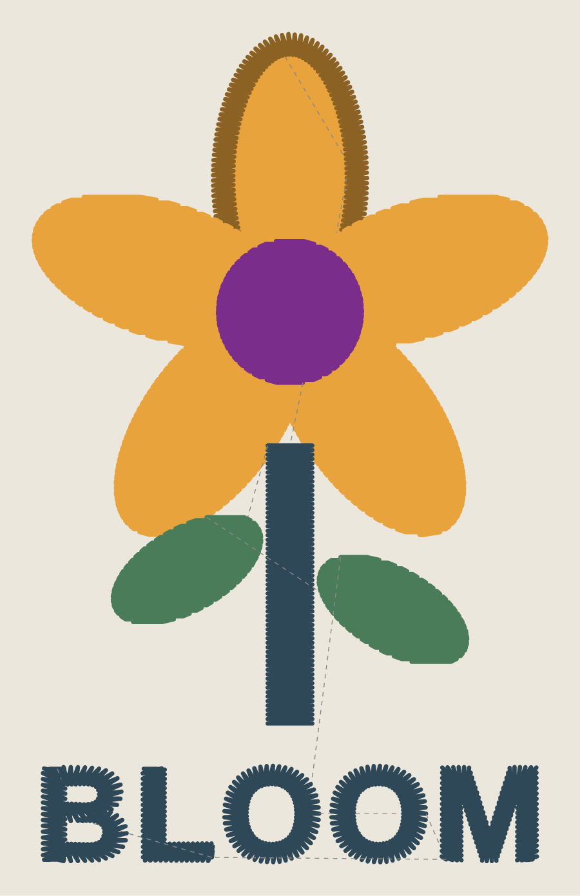

# AI Test Report — 2026-11-18
> Today is about work that checks itself: a skill bundle that makes agents plan, test, and review; the Claude Code team's verification playbook; a design skill that audits AI-looking pages; and an embroidery server that counts its own stitches.

## At a glance
- **Superpowers**: A skill bundle that made an agent plan, test, and review a small CLI, and its review caught a planted bug plus two real ones.
- **"How the Claude Code team thinks about verification"**: The team behind Claude Code explains how it trusts AI-written code, and the rule that matters most is that a change can never edit its own checks.
- **unslop**: A design skill that found all 32 signs of AI slop on a page I built, and fixed every one of them.
- **Zigzag**: Free embroidery software that did a whole customer logo job over MCP — lettering, recolor, outline, checks — and produced a sewable file with a worksheet and a stitch-by-stitch playback.

## 🆕 Open-source project tests

### Superpowers: a skill bundle that makes your coding agent plan, test, and review its own work ⭐4/5

- **In one sentence**: Superpowers is a free set of 15 skills (written instructions for a coding assistant) that turns a vague "build this" into a design, a plan, tests, and a review.
- **Why it caught my eye**: it gained 1,917 stars today, the most of any project on GitHub Trending, on a total of 319,331 stars, and it promises a full development method, not just prompts.
- **I tried it**:
  - I followed the workflow for real on a small Python CLI that checks broken links in a Markdown file: a design doc, then a plan with 3 bite-size tasks, then test-first development (the first test run failed with `ModuleNotFoundError: No module named 'mdlinks'`).
  - Three subagents (fresh agents that each handle one task) each built one task from the plan, with a review after each, and the final suite passed 6 of 6 tests.
  - I then planted a real bug (a link to an existing folder was reported as broken) and ran the review step. It caught it as its one Critical finding, and also flagged the unplanned commit itself as a plan deviation.
  - What surprised me: the reviewer ran live checks and found two real bugs I had not planted (non-UTF-8 input crashes, links inside code spans get falsely flagged), so the review step earns its keep.
- **The catch**: I could not install it into Claude Code itself (no `claude` binary on this VM), so the auto-trigger behavior stayed untested. The skills are text, so nothing enforces the workflow except the agent running it.
- **Try it if**: you want your coding agent to work in small, reviewed steps instead of one big untested dump.
- **Skip it if**: you want a tool that does the work itself, since this is a method, not a program.
- **Score**: ⭐4/5: the workflow held end to end and the review caught the planted bug plus two real ones, but the real harness install stayed untested.
- **Link**: https://github.com/obra/superpowers

## ✍️ Tech article deep-dives

### "How the Claude Code team thinks about verification": the team that lets AI write 90% of its code explains how it trusts the result
- **Read this if**: you let an AI coding assistant write real code and want to know how far you can let it run on its own.
- **The argument in 3 bullets**:
  - Verification loops are what let you run dozens of agents at once instead of one or two. A separate check (a grader that scores work against a rubric) lifted task success by up to 10 points on hard file-generation tasks.
  - Three test types earn the investment: end-to-end tests (tests that drive the real app like a user) because they are hard to fool, property tests (tests that throw thousands of random inputs at a rule that must always hold) because they catch edge cases, and differential tests (tests that run the old and new system side by side) because the old system is the source of truth.
  - Keep the checkers honest: changes must not edit their own checks, failing tests get three fix rounds before a human steps in, and new gates start in observe mode (logging what they would block) before they enforce anything.
- **Why it matters to you**: it turns "did the AI do it right" from a feeling into a system you can run, starting with one small verify skill (a written routine that boots and tests your app) in your own repo.
- **My take**: the strongest idea is that verification is a system you maintain like code, and the load-bearing rule is that a change can never edit the check that judges it. The cold water is scale: this is Anthropic running agents on its own codebase, and the 39-item reliability checklist and the "up to 10 points" figure come from their internal tests, not a public benchmark. A solo developer gets the end-to-end tests and the verify skill, not the whole machine.
- **Link**: https://claude.dev/blog/how-the-claude-code-team-thinks-about-verification

## 🛠️ Agent skill tests

### unslop: a skill that finds every sign of AI-made UI and fixes the page pass by pass ⭐4/5

- **In one sentence**: unslop is a free skill (a set of written instructions for an AI coding assistant) that turns an AI-looking page into a designed one, with its own character.
- **Why it caught my eye**: 17,770 stars, and it rides the month's biggest skill trend (developers tired of generic AI-looking interfaces) with a concrete checklist instead of vague taste advice.
- **I tried it**:
  - I built a deliberately sloppy landing page for a fake task app: purple gradient, glowing pills, emoji cards, "Supercharge your workflow with AI!!", and "Trusted by 10,000+ teams".
  - I ran the skill as the agent: audit against its signs list, a five-line direction (paper and ink, calm and exact), then the nine passes in order (spacing, color, icons, copy, type, layout, details, visuals, motion).
  - The audit found 32 signs, from gradient text to mixed number formats. The rebuilt page fixed all 32: a grep for banned patterns (gradient, emoji, "!", "10,000") returns zero matches, and the before/after screenshots show the change.
  - What surprised me: the direction step does the real work. Once the page had a world (paper and ink) and a signature (a hand-drawn check mark), the color and type choices made themselves.
- **The catch**: the skill is text, not code, so nothing enforces the nine passes except the model running it. The story-video feature (a clip of the page unslopping itself) stayed untested, and the skill asks the agent to wait for the user to approve the direction before editing, which I skipped as the tester.
- **Try it if**: your AI-built page looks like every other AI-built page and you want a concrete fix list.
- **Skip it if**: your page already has a real brand and a designer, since the skill will push its own direction.
- **Score**: ⭐4/5: every claim I tested checked out and the audit caught all 32 planted signs, but the passes are unenforced text and the video feature stayed untested.
- **Link**: https://github.com/heydamir/unslop

## 🔌 MCP tests

### Zigzag: free embroidery software that did a whole customer logo job over MCP ⭐4/5

- **In one sentence**: Zigzag is a free, open-source embroidery editor that converts SVG artwork into stitch files a sewing machine can sew.
- **Why it caught my eye**: 901 stars and 742 points on Hacker News, for a simple reason: a $300 machine that needs a paid subscription, so one person rebuilt the whole toolchain in a weekend. This time I tested it the way its real user would: as a Brother-machine owner finishing a logo for a customer, not just checking that it runs.
- **I tried it**:
  - I drew my own 4-color flower logo (5 gold petals, red center, dark stem, green leaves) and converted it: 35.1 by 46.3 mm, 2,079 stitches, 4 colors, 2 trims, in about 13 ms. The PES file is valid (14,736 bytes, magic bytes `#PES0001`) and the DST is valid too (6,980 bytes).
  - I traced a flat PNG logo the way a hobbyist would: 48.6 by 62.2 mm, 3,995 stitches, 2 colors, 0 trims, in 0.6 s.
  - Over MCP (33 tools), I ran a whole customer job: set the machine to Brother 4x4, added the logo at 60 mm, added "BLOOM" lettering in 8 mm satin, changed the flower center from red to purple for a different colorway, and added a 1.5 mm satin outline. Every edit landed: the final design is 45.2 by 73.1 mm, 3,949 stitches, 7 colors, and re-reading the exported PES shows the purple center as Brother thread #6a1c8a. The check said "No problems found."
  - I also tried to break it: 4 mm lettering (below the 5 mm guidance) got flagged — "Satin only 0.5 mm wide on average: too narrow to look smooth. Use Run." And a 0.8 mm stroke was turned into running stitch on import instead of a bad satin. The checks catch real problems.
  - I ran the Mac build too: the 47 MB DMG's CLI on the Mac mini gives the exact same stitch plan as Linux (2,079 stitches, 14,736-byte PES, 4.1 ms), so Mac owners get the same tool, not a port.
- **The result**: the finished logo as a sewable PES (27,205 bytes) and DST (12,860 bytes), plus a printable production worksheet listing size, 3,949 stitches, 6 trims, about 13 minutes at 400 stitches a minute, and every thread by its Brother and Janome name. And a 21-second stitch playback video ([bloom-stitch-playback.mp4](assets/2026-11-18-zigzag-playback.mp4)) — the design sewn stitch by stitch in order, rendered from the real stitch plan in the exported file (GitHub cannot embed video, so the file is linked). One count to reconcile: the video counter reads 4,053, not 3,949 — the file holds 4,053 stitch records, the extra 104 being tie-in/tie-off lock stitches that the worksheet counter does not include.
- **The catch**: the stitching itself was not sewn on a real machine (no hardware here), and the visual editor and Bluetooth upload to a Brother Skitch could not be driven without a display or a machine. Lettering uses the computer's own fonts, not built-in embroidery fonts. The satin outline went on one petal because I only selected one; outlining the whole flower means selecting all five.
- **Try it if**: you own a Brother machine and design in SVG, and want a free toolchain for logo and lettering jobs.
- **Skip it if**: you need built-in embroidery fonts, photo auto-digitizing, or a polished desktop workflow.
- **Score**: ⭐4/5: the whole customer job worked end to end — logo, lettering, recolor, outline, checks, exports, worksheet, and the same result on the Mac — but the sew-out and the GUI stayed unverified.
- **Link**: https://github.com/simpsoka/zigzag

## Notes
- Superpowers could not be installed into Claude Code itself on this VM (no `claude` binary), so its auto-trigger behavior stayed untested. The skills were followed by reading the text and doing each step by hand.
- The Zigzag PES round-trip drifts: re-reading the exported badge PES reports 3,267 stitches instead of the original 3,203. The tool re-plans on import, so stitch counts are not stable across formats.
- The Zigzag bloom job's two stitch counts are reconciled: 3,949 is the worksheet count; the exported file holds 4,053 stitch records, the extra 104 being tie-in/tie-off lock stitches at the start and end of each color block.
- `zigzag-mcp --help` prints nothing and waits on standard input. It is a pure stdio server with no help or version flag.
- unslop's story-video feature (a clip of the page unslopping itself) was not tested in this run. It needs Playwright and ffmpeg, both present on this VM.
