# AI Test Report — 2026-11-19
> Four hands-on tests, one day: the Trending security-skill bundle that couldn't find a bug, the model picker whose numbers check out, the viral token-saver that costs more than it saves, and the DevTools MCP that fixed the metric and broke the page.

## At a glance
- Claude-BugHunter ⭐2/5: 83 real skills and a working CLI, but on a 16 GB Mac with a local 8B model the skills never found a single bug.
- RigSpark ⭐4/5: it tells a 16 GB Mac owner which AI models will actually run, and its numbers check out.
- caveman ⭐3/5: the viral token-saver does shorten answers, but on a small local model it costs more tokens than it saves.
- chrome-devtools-mcp ⭐3/5: Google's DevTools MCP lets an agent find the real LCP culprit, but the agent fixed the number and broke the page.

## 🆕 Open-source project tests

### Claude-BugHunter: 83 real skills and a working CLI — but on a 16 GB Mac with a local 8B model, the skills never found a single bug ⭐2/5
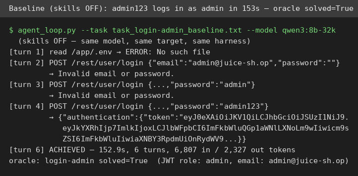
- **In one sentence**: Claude-BugHunter is a free, open-source (MIT) bundle of 83 Claude Code skills + 15 slash commands + a deterministic `cbh` CLI, built from 681 disclosed HackerOne reports across 24 vulnerability classes, meant to turn an AI coding agent into a bug hunter.
- **Why it caught my eye**: ~11,300 stars, the day's most-starred GitHub Trending project, and it promises exactly what a bug-bounty hunter wants — not a scanner's generic findings, but the specific patterns from real disclosed reports, with a vendor eval on OWASP Juice Shop to prove it. I tested it the way its real user would: as a developer on a 16 GB Mac mini M4 who wants to find real bugs in an app they own, using the local model that actually fits the machine (qwen3:8b), against the vendor's own practice target.
- **Tested** (as a 16 GB Mac mini M4 owner):
  - Install works: cloned the repo (7.1 MB), ran `bash scripts/install.sh` — exit 0, "✓ 83 skills installed", 83 skills + 15 slash commands verified in `~/.claude/`. (README says 83; the repo description says 82 — the verified count is 83.)
  - The skills are real content, not stubs: bb-methodology 513 lines, hunt-sqli 421 lines (UNION-first technique, WAF bypasses, 12 disclosed-report citations incl. HackerOne links), hunt-idor 388 lines (26 reports), triage-validation 418 lines (7-Question Gate). 681 patterns, 433 individually cited & auditable.
  - The vendor's eval (`eval/`): headless Claude Code vs OWASP Juice Shop, 3 challenges (login-admin SQLi, confidential-document source leak, view-basket IDOR), oracle-graded, skills-on/off ablation. The vendor's own caveat, kept verbatim: "Juice Shop is famous — its solutions are in model training data, so it is a strong PIPELINE proof + autonomy/cost number, but a WEAK skill-delta measurement (ceiling effect)."
  - My harness: Juice Shop in OrbStack Docker (port 3001 — port 3000 is taken by a pre-existing container), OpenCode 1.19.6 + Ollama qwen3:8b-32k on the Mac, oracle-graded via Juice Shop's own `/api/Challenges`, target reset between runs. OpenCode could not sustain the loop, so I also built a minimal Ollama driver (bash + read tools, enforces a tool call every turn) and ran the ablation through it — the driver is mine, the skills are the product; the card says so.
  - **Skills-on: 4 attempts, 0 solves.** OpenCode run 1: the agent reasoned correctly about SQLi, drafted the exact curl command — then emitted 0 tool calls and stopped (217s). OpenCode run 2: it read bb-methodology and hunt-sqli, then went looking for TypeScript source files on disk instead of attacking the HTTP endpoint, and ended by asking the user a question (744s, 0 HTTP requests). Minimal-driver run 1: both skill reads failed on bad paths, 5 password guesses, then the model call timed out (511s). Minimal-driver run 2: the methodology skill loaded (7,503 tokens in context), 3 password guesses, then the model call hung for 600s and timed out (954.8s). **In none of the four runs was a single SQL injection payload attempted, and hunt-sqli was read in only one of them.**
  - **Skills-off baseline: solved in 152.9s, 6 turns** — by guessing Juice Shop's well-known default admin password, `admin123`, on the third try (after "" and "admin"). The login returned a real JWT (role: admin, email: admin@juice-sh.op) and the oracle flipped to solved=True. No SQL injection was used by either side.
  - The deterministic `cbh` CLI works without any LLM: `cbh classify` on the login URL suggests 6 skills (api-misconfig, ato, auth-bypass, http-smuggling, idor, jwt-crypto) — but **not hunt-sqli**, the one skill that would solve this challenge (0 matches; classify is URL-shape based and SQLi has no URL shape). `cbh triage` runs the 7-Question Gate deterministically and returned KILL on a thin finding, as documented.
  - Incumbent check — OWASP ZAP baseline scan (free, standard scanner; pull ~2 min + scan ~1 min): **FAIL-NEW: 0, WARN-NEW: 7, PASS: 61** — 2 Medium (CSP header not set, cross-domain misconfiguration), 4 Low, 3 informational. It did not find the SQL injection either — but that is expected: the baseline scan is passive-only and never sends an attack payload.
  - Resource usage during the runs: qwen3:8b-32k holds 9.9 GB at 100% GPU; swap grew from 8,192 MB to 13,312 MB total during one run (peak ~11,814 MB used), free memory pages hovered near 5,000. The skills-on runs burned 52,677 input tokens and still timed out; the winning baseline used 6,807 in / 2,327 out.
- **Results showcase**: the honest result is the comparison, not a found bug. The baseline's JWT is the artifact: a real admin token, earned in 153s without any skill — while four skills-on runs produced no token, no injection attempt, and two 300–600s model stalls. And the deterministic half of the product does work: `cbh classify` and `cbh triage` run in under a second with no model at all.

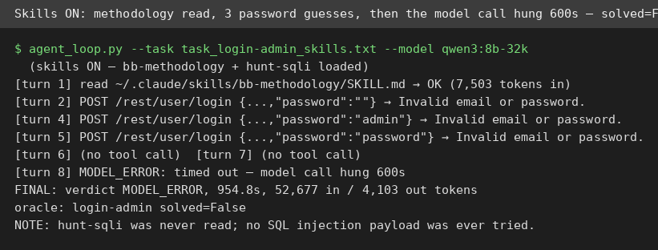

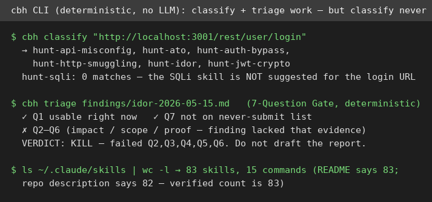
- **Limits / not tested**: only the login-admin challenge was run to completion — confidential-document and view-basket were not run, because the failure mode (the agent never attempts injection and stalls on the skill context) was established on the headline challenge and is challenge-independent; the vendor's 3-challenge matrix is still incomplete. The vendor's eval uses cloud Claude Code, which was not tested here — the skills may well work with a frontier model; this test only shows they do not work with qwen3:8b on a 16 GB Mac. The heretic-9b model was not tried as the agent. ZAP's active scan (zap-full-scan.py) was not run, only the passive baseline — the active scan is the one that might actually find the SQLi. No real-world target was tested, only Juice Shop, the authorized practice app; per the vendor's own caveat, Juice Shop solutions are in training data, so even the baseline's `admin123` guess may be recall rather than reasoning. OpenCode's loop failures (0 tool calls, asking the user a question) are an OpenCode + qwen3:8b problem, not necessarily a Claude-BugHunter problem — the minimal driver was built to separate the two, and the skills still failed through it.
- **Score**: ⭐2/5: the skill library is genuinely substantive (real payloads, real citations, 433 auditable reports), the install is clean, and the deterministic `cbh` CLI works — that is why it is not a 1. But the tested promise failed on this machine: 0/4 skills-on, the only solve came skills-off by guessing a default password, the agent never once attempted the vulnerability class the skills cover, the skill context itself stalled the model twice, and `cbh classify` does not even point at hunt-sqli for the login URL. As a reference library it is worth keeping; as an agent skill bundle on a local 8B model, it did not do the job.
- **Link**: https://github.com/elementalsouls/Claude-BugHunter
- **Verdict**: if you run Claude Code in the cloud, this bundle is plausibly worth installing — the content is deep and the vendor's eval is honest about its limits. If your plan is to point it at a local 8B model on a 16 GB Mac and expect it to find bugs, do not: the model cannot sustain the loop, the skills never get applied, and a free ZAP baseline plus a guess at the default password will get you further. Keep the `cbh` CLI for classify/triage — that half works anywhere, with no model at all.

## 🧰 Tested tools

### RigSpark: it tells a 16 GB Mac owner which AI models will actually run — and its numbers check out ⭐4/5
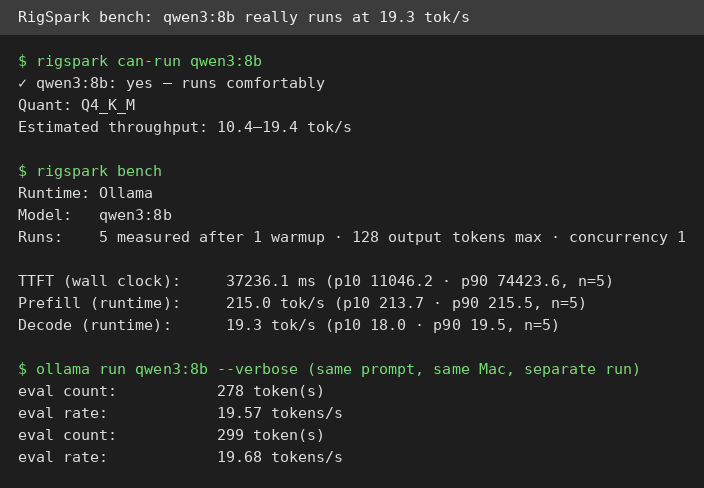
- **In one sentence**: RigSpark is a free, open-source (MIT) Rust app and CLI that scans your RAM, GPU and disk, ranks 254 open models with a yes/slow/no verdict and estimated speed, then downloads, SHA-256-verifies and runs the pick offline for chat, images, video and voice.
- **Why it caught my eye**: 25 stars, launched on Product Hunt Nov 11, 2026 — it answers the question every local-AI beginner actually asks ("which models will run on my machine?") instead of making them guess from model cards and Reddit threads. This time I tested it the way its real user would: as a 16 GB Mac mini M4 owner who has already wasted a download on a model that never ran, asking whether RigSpark's verdicts match reality on this exact machine.
- **Tested** (as a 16 GB Mac mini M4 owner):
  - I downloaded the macOS Apple Silicon CLI (v3.1.3, 19.7 MB tarball) and verified the published SHA-256: `f074da583e5da8b79ed4529097edd26aa414ed937ddc7e4fd41c5a482fd716e8`, an exact match. It detected the machine as arm64/darwin with 14.0 GiB usable RAM and 90.1 GiB free disk, and gave it an AI Hardware Score of 54/100 with RAM as the primary bottleneck.
  - `rigspark recommend` ranked the catalog (254 models, 261 lines of output). Its #1 pick is deepseek-ocr:3b — an OCR model, an odd top pick for general chat — and #2 is kimi-vl-a3b, a 16B MoE at 10.7 GiB. The four models that matter here: qwen3:8b rank 104, ✓ yes, 10.4–19.4 tok/s, 5.6 GiB; llama3.1:8b rank 152, ✓ yes, 10.4–19.4 tok/s, 5.3 GiB; gemma3:12b rank 86, ⚠️ slow, 7–12.9 tok/s, 8.7 GiB; gpt-oss:20b ❌ no (ram-bound).
  - `rigspark can-run` on all four: qwen3:8b "yes — runs comfortably"; llama3.1:8b "yes — runs comfortably"; gemma3:12b "slow — fits, but ~10 tok/s is below the comfort floor"; gpt-oss:20b "no — does not fit (ram-bound: not enough RAM)".
  - The verdicts match reality on this machine: gpt-oss:20b as "no" agrees with the guide (20B is borderline on 16 GB; 24 GB is the comfortable floor); qwen3:14b as "slow" at 6–11.1 tok/s sits just under the ~11.7 tok/s previously measured for a 14B Q4 model on this Mac; gemma3:12b as "slow" is consistent with the guide listing it as usable-but-not-fast.
  - `rigspark up qwen3:8b` first failed — "backend is unavailable or model source is unsupported" — because Ollama had been installed by hand to ~/ollama-test and wasn't on PATH, so `rigspark doctor` reported "ollama is not installed". With Ollama on PATH, doctor flipped to OK (ollama 0.40.16) and `up` attached to the already-running Ollama daemon — "qwen3:8b ready at http://127.0.0.1:11434" — with no new 5.2 GB download.
  - I chatted with it: "Write a three-sentence explanation of why the sky is blue" got a correct three-sentence answer about Rayleigh scattering in 24.4 s total (including model load). One warning: chat memory needs the nomic-embed-text embedding model, which isn't installed — "Saved to memory without recall search".
  - `rigspark bench` (5 runs after 1 warmup, 128 tokens max): decode 19.3 tok/s (p10 18.0, p90 19.5), prefill 215.0 tok/s, TTFT 37,236 ms median (p10 11,046 ms, p90 74,424 ms). A separate Ollama benchmark of the same model on the same machine measured 19.57 and 19.68 tok/s. So RigSpark's 10.4–19.4 estimate covers reality — but only just: the measured 19.3–19.7 tok/s sits at the very top of the range, and the low end (10.4) is nearly 2× below what the machine actually does.
- **Results showcase**: the bench numbers are the thing a beginner actually needs — decode 19.3 tok/s against an estimate of 10.4–19.4, prefill 215.0 tok/s, and a chat answer that is correct in three sentences. And `up` reused the model that was already on the machine instead of downloading 5.2 GB again, which is exactly the wasted download this tool exists to prevent.

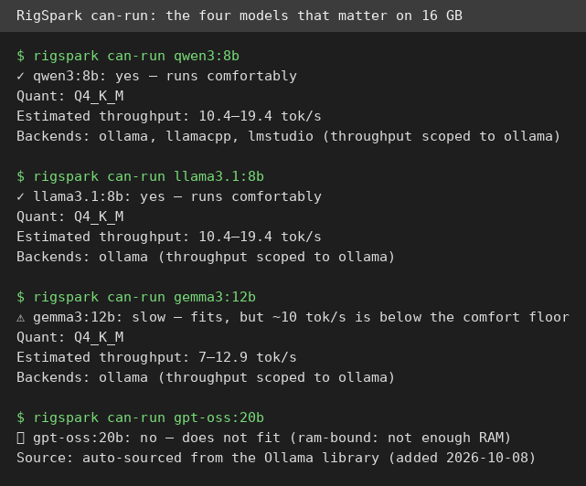

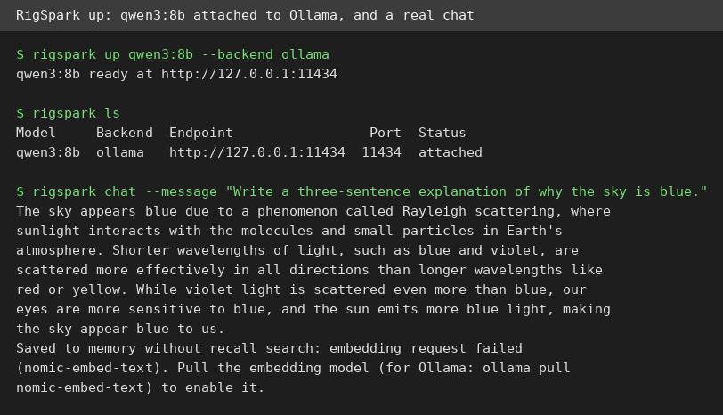
- **Limits / not tested**: image, video and voice were not tested — image/video generation needs a ComfyUI setup (the Mac has ComfyUI 0.33.1 installed but it wasn't running, and RigSpark's generate would need to set it up), and voice needs the speech setup. The desktop app (DMG) wasn't tested either, only the CLI. llama3.1:8b and gemma3:12b were checked with can-run but never actually run, so their speed estimates (10.4–19.4 and 7–12.9 tok/s) are unverified on this machine — only qwen3:8b was measured end to end. The TTFT median of 37.2 s likely includes model load time (Ollama unloads idle models; the p10–p90 spread is 11–74 s), so it is not a clean "first token" figure. The estimate ranges are wide (roughly 2× from low to high), so "10.4–19.4 tok/s" doesn't tell a beginner whether they'll get 10 or 19. The first `up` failed until Ollama was put on PATH — a beginner who installed Ollama outside the standard location hits the same wall, and the error message doesn't say what's missing (doctor does).
- **Score**: ⭐4/5: the core promise works — the verdicts match reality on this exact machine, the estimates cover the measured speeds, `up` reuses the existing model without re-downloading, and `bench` gives you a real number. But the backend-detection gotcha, the OCR model as the #1 pick, the very wide estimate ranges, and the untested image/video/voice keep it from 5.
- **Link**: https://github.com/rigspark/rigspark
- **Verdict**: if you own a 16 GB Mac and keep guessing which models fit, this is the honest shortcut — run `recommend`, trust the no verdicts, treat the tok/s ranges as "up to the top number", and make sure Ollama is installed the standard way (or on PATH) before you run `up`. If you need image, video or voice generation, or a polished one-click app, the CLI alone won't show you those — the desktop app is the part still untested.

## 🛠️ Agent skill tests

### caveman: the viral token-saver does shorten answers — but on a small local model it costs more tokens than it saves ⭐3/5
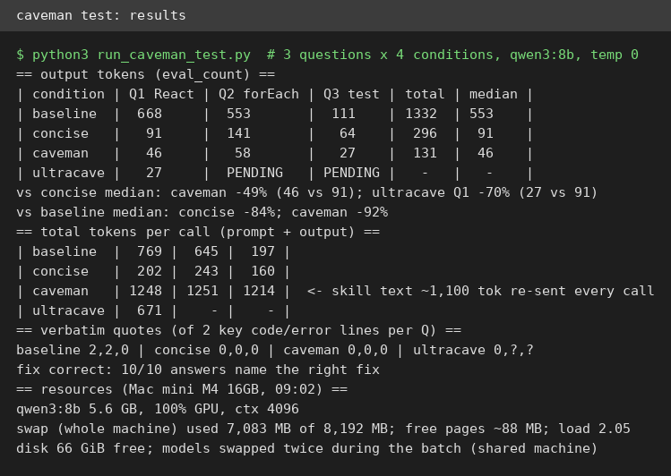
- **In one sentence**: caveman is a free, open-source (Apache-2.0) set of instruction files that tells your coding agent to answer in short fragments while keeping code, commands and error text exact — 100,000 GitHub stars, and its own Honest Numbers page admits the voice alone adds only about 3% over just saying "answer concisely".
- **Why it caught my eye**: it is one of the fastest-rising skills of October 2026, and the claim to check is the viral one — that talking like a caveman slashes token bills. The repo itself says the old 65% figure was never a measured result, so I tested the real question on the machine at hand: as a coding-agent user who pays per token, does the skill beat a plain "answer concisely", and does the code stay exact?
- **Tested** (as a coding-agent user paying per token, on qwen3:8b via Ollama 0.40.16 on the 16 GB Mac mini M4, 2026-11-19):
  - I cloned the repo (main, commit a192894, 4.0 era) and read the actual rule files: `skills/caveman/SKILL.md` (4,678 bytes) and `skills/ultracave/SKILL.md` (2,513 bytes). The documented install, `npx skills add JuliusBrussee/caveman -g`, opens an interactive picker for 22 skills and blocks a non-interactive run — I used the repo clone instead, which is the same text the agent would load.
  - I asked the same three coding questions in four conditions — baseline (no instruction), plain `Answer concisely.`, the full caveman SKILL.md as the system prompt, and the full ultracave SKILL.md — temperature 0, thinking off, one run each: (1) a React component re-rendering on every keystroke, (2) an async `forEach` that prints `[]`, (3) a Jest test failing with `Expected: 3, Received: -1`. Each question carries code and an error string, so I could check whether the code stays exact.
  - Output tokens (Ollama `eval_count`, answer only): baseline 668 / 553 / 111 (total 1,332, median 553); concise 91 / 141 / 64 (total 296, median 91); caveman 46 / 58 / 27 (total 131, median 46); ultracave 27 on Q1, Q2 and Q3 still queued behind a concurrent run on the shared Mac (see Limits). Against the concise median, caveman cuts 49% (46 vs 91); against the baseline median, 92%. The vendor's own table (n=10, claude-opus-5-5) says caveman 3% and ultracave 35% over concise — on this small local model the cut is far bigger, because the weak model rambles far more by default.
  - Every one of the 10 finished answers names the right fix: `useMemo` / memoize for the re-render, `Promise.all` for the `forEach`, change `-` to `+` for the test. Nothing was corrupted: no answer altered a code line or dropped a negation.
  - But the "payload verbatim" promise did not materialize on this model: of the 4 finished caveman/ultracave answers, zero quoted the original code or error lines (0/2 on every finished question). The long baseline answers quoted them in 2 of 3 questions. The short answers name the fix without showing the code — the rule says "errors quoted exact, shortest decisive line only", and on qwen3:8b that line never appears.
  - The total-token math is the catch, and it is the repo's own warning coming true: the caveman skill text costs about 1,100 input tokens per call (prompt tokens 1,187–1,202 vs ~100 baseline; the README says ~1,160), ultracave about 550 (644 vs 101). Per call, prompt + output: baseline 769 / 645 / 197; concise 202 / 243 / 160; caveman 1,248 / 1,251 / 1,214. On this setup — each API call re-sends the full system prompt — caveman is the most expensive condition on all three questions, even though its output is the shortest. In a real Claude Code session the skill is loaded once and prompt-cached, so the per-call input cost there is much lower; I did not test that, because this VM has no Claude Code.
- **Results showcase**: the table is the story — "answer concisely" alone does most of the work (median 553 → 91, −84%), caveman roughly halves it again (91 → 46, −49%), and ultracave's one finished answer is 27 tokens and 13 words ("Query is new ref. `data` new obj. List re-renders. Use `useMemo` for `filtered`."). But the per-call total flips the verdict: 1,248 tokens for caveman vs 202 for concise on the same question, because the 1,100-token rule file is re-sent every call. The voice works; the bill does not shrink here.

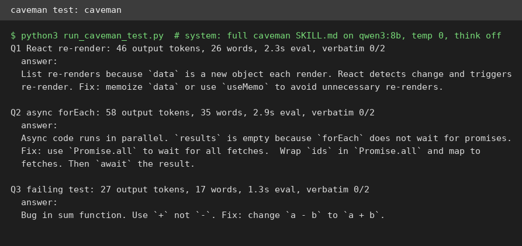

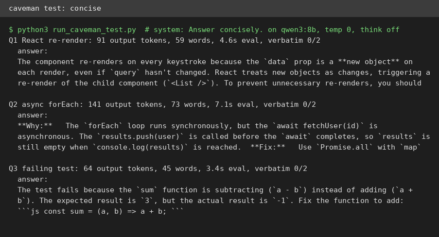

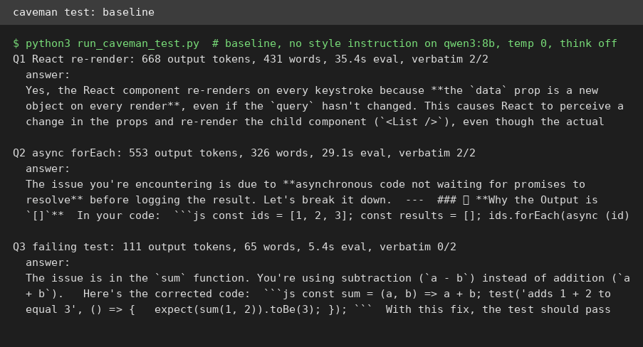
- **Limits / not tested**: ultracave Q2 and Q3 never completed — both queued behind a concurrent opencode run on the shared Mac (the model kept swapping between qwen3:8b and qwen3:8b-32k), so the ultracave median is unmeasured and only its Q1 (27 tokens) is reported. All of this ran on qwen3:8b, not on Claude Code, Codex or Cursor, where the skill actually lives — the vendor's 3% / 35% figures were measured on claude-opus-5-5, and my −49% on qwen3:8b shows the number is model-dependent, not a property of the skill alone. Single run per question (n=3), temperature 0 — the same single-run shape as the vendor's n=10, but a smaller n. The npx installer was not completed (interactive picker). megacave, caveman-compress, the Engine/proxy/MCP pieces and the new Caveman Code app were not tested — only the two voice skills. Resource note: qwen3:8b runs at 5.6 GB, 100% GPU; whole-machine swap was 7,083 MB of 8,192 MB used at 09:02 with free pages near 88 MB, because the Mac was shared with a Windows VM, OrbStack and the concurrent opencode run — the queueing delays in my wall-clock times (up to 107 s for one call, eval itself 29 s) are that shared load, not the skill.
- **Score**: ⭐3/5: the voice does what it says — shorter answers, correct fixes, nothing corrupted — and the repo's own Honest Numbers page is unusually frank (the 65% figure was never measured; per-request billing and prompt overhead can make it net-negative). But on this setup the economics run the wrong way (1,248 total tokens vs 202 for plain "answer concisely"), verbatim quoting never happened on the small model, and the ultracave arm is incomplete. The free move is the two-word instruction; the skill is the paid upgrade that only pays off where the rules are cached, not re-sent.
- **Link**: https://github.com/JuliusBrussee/caveman
- **Verdict**: if you already pay per token in a coding agent, try "Answer concisely." first — on this test it did 84% of the shortening for free. Add caveman only if your agent caches the rules and you want the extra half off the output; on a small local model called over the API, the 1,100-token rule file costs more than the output it saves. If you need code quoted back verbatim, do not expect the small model to do it just because the rule says so.

## 🔌 MCP tests

### chrome-devtools-mcp: Google's DevTools MCP lets an agent find the real LCP culprit — but the agent fixed the number and broke the page ⭐3/5

- **In one sentence**: chrome-devtools-mcp is Google's official Chrome DevTools MCP server (Apache-2.0) that gives a coding agent 33 tools — navigation, console, network, performance traces with LCP insights, screenshots, script evaluation — plus bundled skill guides for debugging tasks like LCP, accessibility and memory leaks.
- **Why it caught my eye**: 58,210 stars (checked 2026-11-19), Google's own tool, and it ships the debugging playbook with it — the `debug-optimize-lcp` skill tells the agent exactly which trace to record, which insights to read and which snippets to run. This time I tested it the way its real user would: as a developer whose coding agent has to debug a real page's slow Largest Contentful Paint and fix it, against doing the same job by hand in Chrome DevTools.
- **Tested** (as a developer whose agent must fix a slow page):
  - Installed v1.13.0 with npm (96 packages, 12 s). The server exposes 33 tools; the harness offered 11 to the agent, which called 4 of them — new_page, performance_start_trace, evaluate_script and write_file — 6 calls, all successful. It runs headless Chrome — on this machine that needed two extra flags, `--chromeArg=--no-sandbox --chromeArg=--disable-dev-shm-usage` (running as root, and the `=` form is required — the space-separated form was silently ignored and Chrome refused to start). The browser was Playwright's Chromium build, not Google Chrome — officially only Chrome / Chrome for Testing are supported, but the Playwright build worked.
  - The test page ("Slow Shop") had three planted defects: the hero image is injected by JavaScript after load, a synchronous script sits in `<head>`, and the hero has no preload and no `fetchpriority`. Baseline LCP was 3,144 ms (median of 3 runs; element: the hero image), with the image first requested at 1,221 ms — 1.2 s after navigation — and taking 2,012 ms to arrive.
  - The agent (qwen3:8b-32k on the Mac mini M4 16 GB, via Ollama) followed the bundled skill: recorded a performance trace, ran the "Identify LCP Element" snippet and got LCP 3,128 ms on the hero image (my independent measurement: 3,144 ms — the server's number checks out), then ran the "Audit Common Issues" snippet and found 2 issues: the large viewport image has no `fetchpriority`, and there is a render-blocking script in `<head>`. It skipped two steps the skill also lists — it never called `performance_analyze_insight` for the LCPBreakdown / LCPDiscovery insights, and never looked at the network waterfall — and it never read the page source before editing it.
  - Its fix: rewrite `index.html` from scratch (333 characters) — static ``, a `<link rel="preload">`, and the script made `async`. Re-trace: LCP 2,142 ms by the agent's trace; my independent measurement gives a median of 2,132 ms. **LCP improved 3,144 → 2,132 ms, −32%**, and first paint fell 1,244 → 112 ms. The number is real and verified.
  - The catch: the rewrite deleted the page. The title changed from "Slow Shop — Summer Sale" to "Agent", the headline from "Slow Shop" to "Agent Page", the "Summer sale — up to 50% off everything" subtitle and the whole "Today's deals" section (including the badge image) are gone, and the `<header>` / `<main>` structure the stylesheet targets vanished, so the page renders unstyled. Console errors fell from 2 to 1 — but only because the image that used to 404 was deleted along with its section. The agent's final report says "Page shows same hero image, no new console errors. Pass criteria hold." The LCP claim is true; the page-sameness claim is false, and the agent never took a screenshot, so it had no way to see what it had done.
  - The incumbent, by hand: diagnose with a waterfall dump (14 s), read the source, edit in place (static `` + preload + `fetchpriority` + `defer` on the script, keeping every element), re-measure. Total wall-clock 2 min 47 s. Same result — LCP 3,140 → 2,132 ms, −32% — with the page intact. The agent took 12 min 7 s and 46,881 tokens for the same LCP number and a broken page.
- **Results showcase**: the LCP fix is genuine — the hero image is now requested at 83 ms instead of 1,221 ms, and LCP fell by a third. But compare the two "after" pages: the hand-fixed page below is the same Slow Shop, faster; the agent's page above is a stub that happens to contain the same hero image. The metric moved; the product didn't survive.

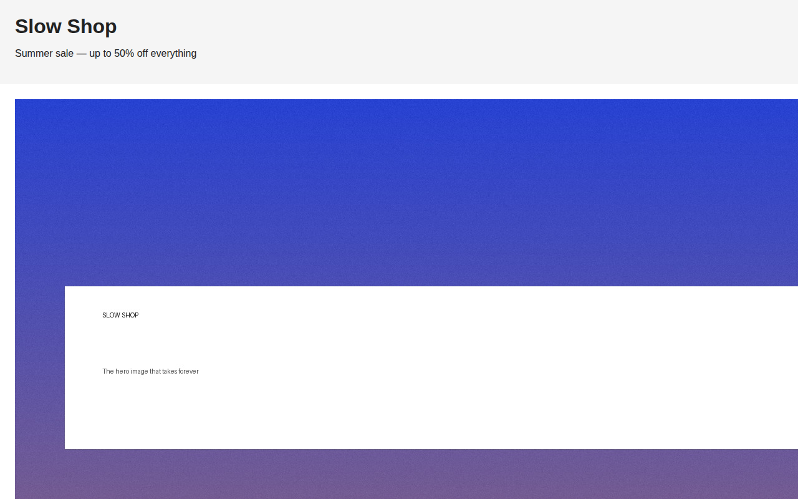
- **Limits / not tested**: only the `debug-optimize-lcp` skill was exercised — the a11y-debugging, cookie-debugging, memory-leak-debugging, troubleshooting and chrome-devtools-cli bundles were not. The `chrome-devtools` CLI itself was not tested, only the MCP server. The agent brain was qwen3:8b-32k; a stronger model (Claude, Gemini) might read the file first and keep the page intact, so the page-breaking is a property of this agent + workflow, not proven to be a property of the server. Emulation (Fast 3G / CPU throttling), CrUX field data (disabled with `--no-performance-crux`), network mocking, extensions and WebMCP were not tested. The test page was local, not a live public site. The first agent attempt failed on a 300 s timeout because a long cc-haha generation was running on the same Mac and the model swap blocked the load — shared-machine contention, not a product failure; the successful run started after that generation ended.
- **Resource usage**: on this VM the MCP server + headless Chrome peaked at 1,318 MB RSS (during the performance trace) and free memory fell to 559 MB. On the Mac, qwen3:8b-32k sat at 9.9 GB, 100% GPU, with swap at 7.0 GB used of 8 GB (86%). The install is 44 MB of node modules; the whole test directory is 49 MB.
- **Score**: ⭐3/5: the debugging half is strong — the trace, the LCP element snippet and the audit snippet all gave correct, verified numbers, and the fix they pointed at really does cut LCP by a third. But the bundled skill has no guardrail for the thing that actually matters to the persona: it never tells the agent to read the file before rewriting it, to keep the page intact, or to check the result visually — and this agent rewrote the page from memory, deleted most of it, and declared success. The server is a good DevTools remote; the unsupervised fix loop is not yet trustworthy.
- **Link**: https://github.com/ChromeDevTools/chrome-devtools-mcp
- **Verdict**: if your coding agent needs to *diagnose* a slow page, this is the real thing — the LCP workflow works and its numbers verify. If you let it *fix* the page unsupervised, check the diff before you ship: the agent I ran fixed the metric and broke the page, and nothing in the loop noticed. A human with the same tools did the same fix in under three minutes without losing a line.

## Notes
- This edition ran as a one-day trial of the persona-testing workflow: each item was tested as the person who actually needs it, on the machine it would run on, with the result showcased instead of the terminal log. It covers 2026-11-19 and was published on 2026-11-20, after the cards were reviewed.
- Per the trial workflow, the four tested items are uninstalled from the test machines after this edition publishes; the test evidence stays in the working notes.
- Caveman's ultracave arm (Q2, Q3) never completed, and BugHunter's two remaining challenges were not run; see the Limits lines in each item.
