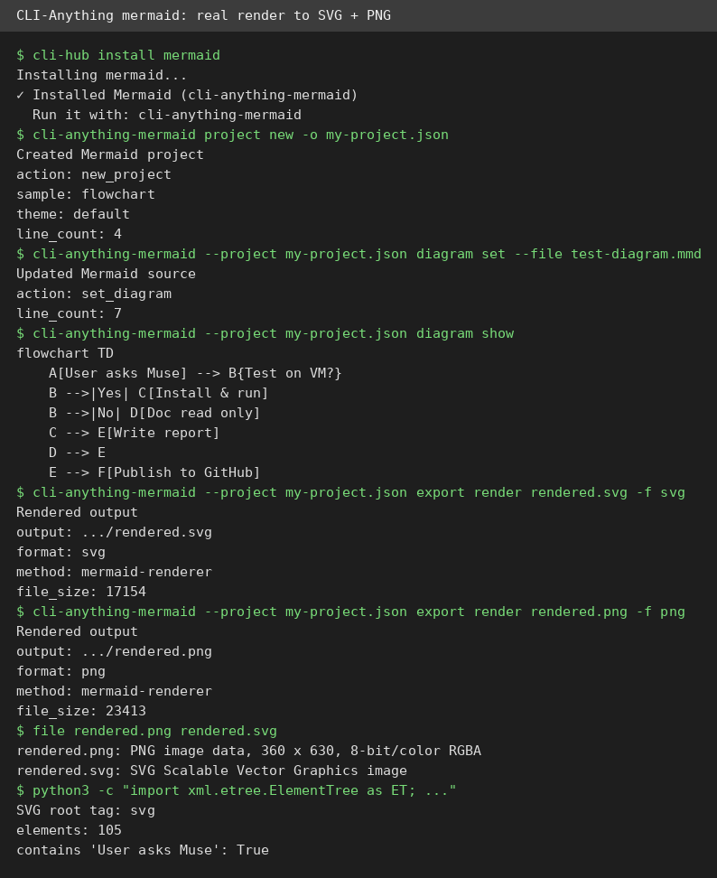
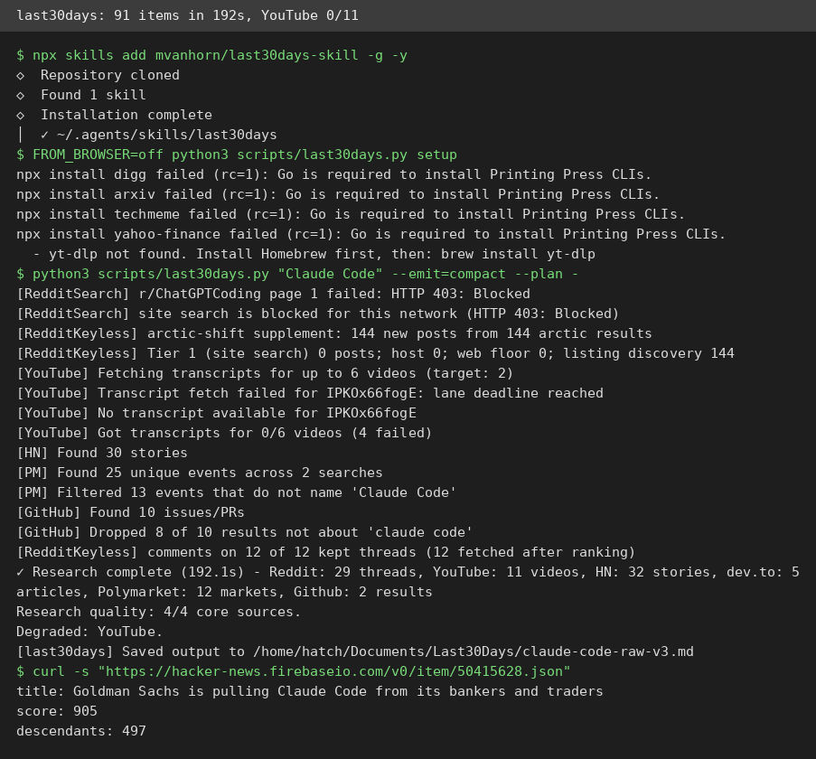
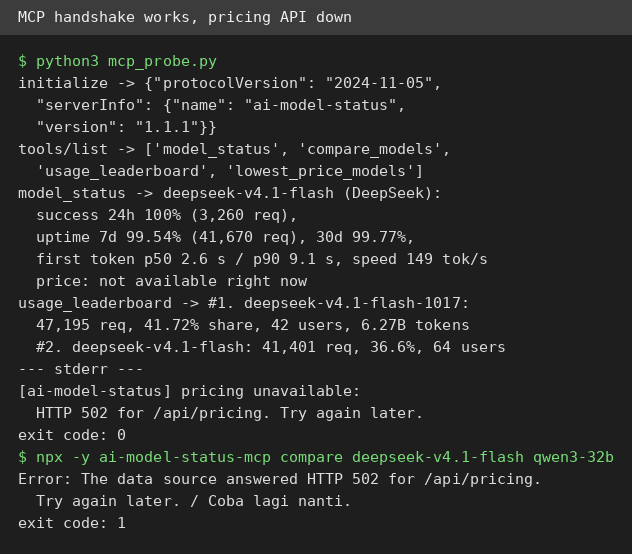

# AI Test Report — 2026-11-20
> Today is about the fine print: a CLI that renders in the cloud, a research skill that works with no keys, a status server that admits its limits, and a free fix for the memory crunch.

## At a glance
- **CLI-Anything** — a kit that turns desktop apps into typed commands; its diagram tool works, but it renders in the cloud.
- **"Do not buy RAM, compress!"** — squeeze more from the RAM you have, with one real measurement to back it.
- **last30days** — a research skill that reads Reddit, Hacker News, and betting markets for you, with no API key, and the claims check out.
- **AI Model Status MCP** — a tiny server that tells your agent which AI model is up and fast, but its price tools were down all morning.

## 🆕 Open-source project tests

### CLI-Anything — turn desktop apps into commands your agent can type ⭐3/5

- **In one sentence**: CLI-Anything turns desktop apps into typed commands (a CLI, a tool you drive by typing) so AI agents can use them.
- **Why it caught my eye**: 60,550 stars and third on today's GitHub Trending list, with a bold promise: make any software agent-ready, plus a hub that installs 103 ready-made app CLIs with one command.
- **I tried it**:
  - `pip install cli-anything-hub` gave hub 0.4.1 in 12.7 seconds, inside a venv (a private Python folder), since this machine's system pip blocks direct installs. `cli-hub list` showed 103 CLIs (79 built by the project, 24 public ones) in 35 categories.
  - I installed the Mermaid CLI (a tool that draws diagrams from text) in 1 minute 37 seconds and did a real job: I wrote a 7-line flowchart and rendered it to SVG (a scalable image format) in 5.3 seconds (17,154 bytes) and PNG in 2.9 seconds (23,413 bytes, 360 by 630). The SVG parses as valid XML (a structured text format) with 105 elements and holds my diagram text.
  - `export share` produced a working mermaid.live link, and `--json` output is clean.
  - What surprised me: nothing renders locally. The CLI sends your diagram to mermaid.ink, a public web renderer, and saves the reply. The bundled skill file says so plainly, but the repo's "CLI versions of desktop apps" framing overpromises for Mermaid.
- **The catch**: a bad diagram is accepted silently, then rendering dies with a raw Python traceback (an unhandled error dump) ending in HTTP 400, and the bad save had already wiped the good diagram from the project file. `cli-hub launch mermaid` fails from a venv install because it looks on PATH (the list of folders your shell searches for programs). The desktop-app CLIs (Blender, GIMP, Obsidian) need those apps installed, so they stayed untested here. The meta-skill install took 57 seconds for one 4,447-byte file, and the installer called it "Safe" with 1 Socket alert and a Snyk "Med Risk" flag.
- **Try it if**: you're building an agent that needs to produce Mermaid diagrams and share links without installing anything heavy.
- **Skip it if**: you need offline rendering, private diagrams (your text leaves your machine), or real local control of a desktop app.
- **Score**: ⭐3/5 — the Mermaid CLI works end to end, but it is a cloud wrapper, not a local tool, and its error handling is raw tracebacks.
- **Link**: https://github.com/HKUDS/CLI-Anything

## ✍️ Tech article deep-dives

### "Do not buy RAM, compress!" — your RAM can hold more than you think
- **Read this if**: you run Linux on a machine whose RAM you cannot upgrade, or your cloud bill grows with memory.
- **The argument in 3 bullets**:
  - Memory compression is old tech: Windows, macOS, and Android phones already squeeze RAM, but most Linux distros (variants of the Linux operating system) ship it off. Fedora and Pop!_OS turn it on; Ubuntu does not.
  - The author's test: about 100 Firefox tabs on a 32 GB machine, 5.7 GB of data squeezed into 1.7 GB of RAM, a 1 to 3.35 ratio, using zram (a Linux feature that compresses RAM).
  - The cost is small: a little more CPU work and a touch of delay, for up to four times the effective capacity by his numbers.
- **Why it matters to you**: memory prices are climbing fast, and soldered RAM cannot be upgraded at any price. A free software switch beats buying a new machine.
- **My take**: one honest measurement on one machine, not a benchmark, and the "could have cut our cloud spend in half" line is a guess, not a result. Still, the core claim takes an afternoon to check yourself, and the author shows his work. Try it before you spend.
- **Link**: https://curiousbits.nl/blog/do-not-buy-ram-compress/

## 🛠️ Agent skill tests

### last30days — ask one question, get a brief built from what people actually said ⭐4/5

- **In one sentence**: last30days is a free skill (an instruction pack that teaches an agent a job) that researches any topic across Reddit, Hacker News, YouTube, and betting markets, then writes one grounded brief.
- **Why it caught my eye**: 70,790 stars, tenth on today's GitHub Trending list, and a sharp pitch: search what people upvote and bet on, not what editors rank.
- **I tried it**:
  - `npx skills add mvanhorn/last30days-skill -g -y` installed version 4.3.2 (19 MB) in 65.7 seconds. Without `-y` the installer waits on an interactive prompt; my first try hung for 132 seconds.
  - I ran it on "Claude Code" with no API keys (no secret passwords for services). The run took 192.1 seconds and returned 91 items from 6 sources. Reddit gave 29 threads, Hacker News 32 stories, YouTube 11 videos, Polymarket 12 markets, GitHub 2, dev.to 5.
  - Reddit's own search refused this machine (an access-denied error), but the skill fell back to an ArcticShift listing feed and still returned 29 real threads. YouTube gave 0 of 6 transcripts, titles only.
  - I spot-checked three claims against live sources. A Hacker News story ("Goldman Sachs is pulling Claude Code") matched exactly: 905 points, 497 comments. A Polymarket odds line matched within 1 point (36% vs 37% live). A YouTube quote matched word for word, though its view counts could not be checked here.
  - What surprised me: the fallback layer, not the headline path, is what makes "zero config" true here. The skill also grades itself honestly: "Research quality: 4/4 core sources. Degraded: YouTube."
- **The catch**: X, TikTok, and Instagram need your own keys or logins, so the "searches people" pitch is partial without them. First-run setup tries to install helper tools that need Go (a programming language toolchain), which this machine lacks, so Digg, arXiv, Techmeme, and Yahoo Finance never started. The installer also flags the skill "Critical Risk" with 6 Socket alerts, so skim the scripts before running them. Two small blemishes: the engine's fix-it advice blamed a stale yt-dlp (a video download tool) that was freshly installed, and its own totals disagree by a few votes between sections.
- **Try it if**: you use an agent host and want a grounded brief on any topic without paying for search APIs.
- **Skip it if**: you need X or TikTok coverage, or YouTube transcripts, and you will not bring your own keys.
- **Score**: ⭐4/5 — the keyless core works and every claim I checked held up, but YouTube is titles-only here and setup overpromises its helper installs.
- **Link**: https://github.com/mvanhorn/last30days-skill

## 🔌 MCP tests

### AI Model Status MCP — ask your agent which AI model is up, fast, or cheap ⭐3/5

- **In one sentence**: AI Model Status MCP is a tiny MCP server (a standard way for AI tools to offer functions) in one file with no add-ons. It reports which AI model is up, fast, or cheap, from one gateway's public data.
- **Why it caught my eye**: nine days old, one 698-line file, zero dependencies (no extra libraries), no API key, and a README that admits its numbers come from one small gateway, not the market.
- **I tried it**:
  - The zero-dependency claim checks out: package.json (the file that lists a project's add-ons) has no dependencies field, and the whole server is one 698-line file. Its own test suite passed 18 of 18 in 12.7 seconds.
  - `status deepseek-v4.1-flash` worked: 100% success over 24 hours (3,260 requests), 99.54% uptime over 7 days (41,670 requests), first word in 2.6 seconds for half of requests, 149 tokens a second.
  - `top` worked: two DeepSeek V4.1 Flash variants take 41.72% plus 36.6% of requests, with 112,001 requests this week against 97,173 last week.
  - I spoke real MCP protocol to it directly: initialize, tools/list (exactly the 4 tools), and two tool calls all returned live data.
  - I cross-checked every number against the gateway's public JSON files (machine-readable data files): all matched to the digit, with data stamped about an hour old.
  - What surprised me: the test suite is better than a 9-day-old project suggests, with failure-mode tests for bad data and slow sources. And the "fastest model" crown rests on exactly 20 requests.
- **The catch**: the two price tools, `compare` and `cheap`, both failed all morning: the gateway's pricing page answered HTTP 502 (a bad-gateway error), and a re-check 10 minutes later still failed. The server fails honestly, with a clear message in two languages, and `status` keeps working with "price: not available right now". The deeper limit is sample size: the top model has 42 users, the fifth has 3, and 97% of traffic comes from one coding tool, OpenCode. Treat every ranking as one community's sample, not the market.
- **Try it if**: you pick models for coding-agent sessions and want a quick, no-key check of whether one is up and fast on a real gateway.
- **Skip it if**: you need price comparisons (broken today) or market-wide data: this is 42 users' traffic, not the world.
- **Score**: ⭐3/5 — the server is solid and honest, with numbers verified live to the digit, but half its value (prices) was unreachable all morning and the data is one small gateway.
- **Link**: https://github.com/EzkielynaGroup/ai-model-status-mcp

## Notes
- Trending picks: today's #1 (Claude-BugHunter) was tested in the 2026-11-19 trial edition, which is still unpublished and awaiting its verdict, and #2 (obra/superpowers) was already covered, so CLI-Anything is the next-ranked uncovered project.
- The RAM essay reached Hacker News' front page on 2026-11-19 (232 points, 193 comments).
- The 2026-11-19 trial edition stays unpublished; nothing in this edition repeats its four items.
- This machine's system pip blocks direct installs (PEP 668), so CLI-Anything was installed in a venv (a private Python folder). That is a machine quirk, not a project flaw.
- The RAM article's "cut cloud spend in half" line is the author's guess, flagged in the write-up above.
- last30days was run without an agent host, so its scripts were driven directly following its own runbook; the skill's agent-host behavior (auto-triggering, interactive setup) stayed untested.
