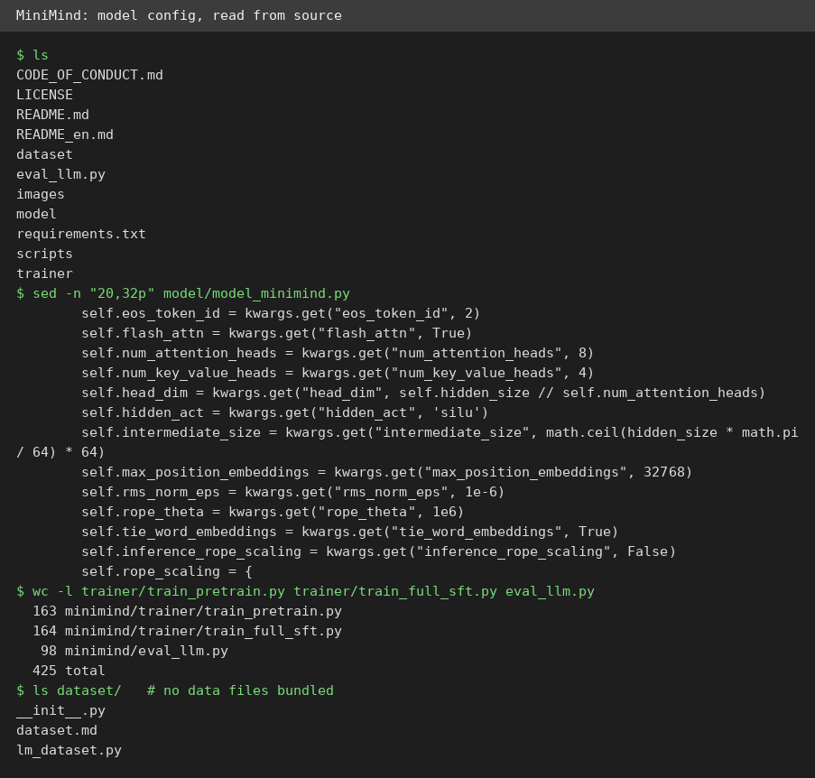
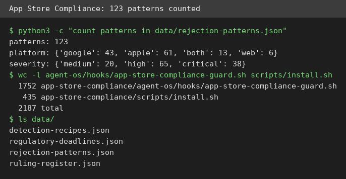
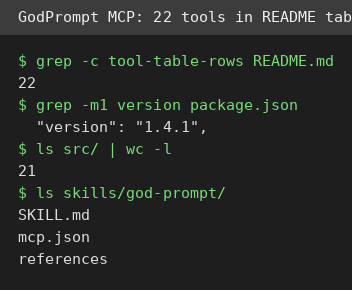

# AI Test Report — 2026-11-21
> A tiny language model for the price of a coffee, a verification playbook from the team that lets Claude check its own work, and two small tools with big claims.
## At a glance
- MiniMind, a kit for training a tiny language model from scratch, for about ¥3 in cloud rent.
- How the Claude Code team thinks about verification, Anthropic's own recipe for agent-checked code.
- App Store Compliance Playbook, a 123-pattern guard against app store rejections.
- GodPrompt, 22 read-only tools that hand a coding agent a discipline rulebook.
## 🆕 Open-source project tests
### MiniMind — train a tiny language model from scratch for the price of a coffee

- **In one sentence**: MiniMind is a tutorial and code kit that trains a small language model (a program that predicts the next word) from zero, in plain PyTorch (a popular Python library for machine learning).
- **Why it caught my eye**: It ranked 4th on GitHub Trending today. The top three were already covered here. It claims a full training run for about ¥3 (roughly US$0.40) in about 2 hours. It has 67,681 stars.
- **I tried it**: I read the code instead of running it, because this VM has no GPU (a chip built for heavy parallel math), and running freshly cloned code was blocked by an execution safety check this run.
  - I read the full English README and the training scripts, and checked the model config in code: 8 layers, a 6,400-word vocabulary, and tied embeddings (the input and output layers share weights).
  - I confirmed the trained weights exist on Hugging Face (a site that hosts models) as minimind-3, with an Ollama (a tool for running models locally) one-liner to run it.
  - I counted the pipeline: pretraining (the first training pass over raw text), fine-tuning (extra training on example conversations), and reward-based training scripts, all hand-written in plain PyTorch.
  - What surprised me: the README's own cost table puts pretraining plus fine-tuning on the small data at about 2.3 hours, not 2. The "2 hours" footnote counts the fine-tuning stage alone. The small data path needs 1.2 GB plus 1.6 GB of downloads, and the full path needs 10 GB plus 14 GB.
- **The catch**: You need a GPU to train anything here. The author's own rig is eight RTX 3090 graphics cards, and this edition ran nothing, so the training claim is unverified by me. The README's own sample chats show a model that talks fluently but gets facts wrong: it lists eel head and chicken skewers as Hangzhou specialties, and it garbles an English answer about US history. A 64M model is a learning toy, not a useful assistant.
- **Try it if**: you're a learner who wants to read every line of language model training code, and you can rent a GPU for an afternoon.
- **Skip it if**: you want a model that answers questions well, or you have no GPU to run it on.
- **Score**: No score, I could not run it on this VM.
- **Link**: https://github.com/jingyaogong/minimind
## ✍️ Tech article deep-dives
### How the Claude Code team thinks about verification — let your agent check its own work
- **Read this if**: you let an AI coding agent write code and you are tired of reviewing every change yourself.
- **The argument in 3 bullets**:
  - Anthropic says about 90% of its code is now written and reviewed by Claude. Verification loops are what let it run dozens of agents at once: a separate grader checking work against a checklist improved task success by up to 10 points in internal tests.
  - Spend effort on three test types: end-to-end tests (tests that drive the real app like a user), property tests (rules that must never break, checked with thousands of random inputs), and differential tests (run old and new code on the same inputs, then compare).
  - Keep the checks out of reach of the change they judge. Review rules are read from the base branch (the main line of code), never from the pull request (a proposed change) itself, so a change cannot weaken its own test.
- **Why it matters to you**: The same recipe scales down. A small `verify` skill that boots your app and runs its checks turns your agent from a fast typist into a colleague you can trust with a whole task.
- **My take**: This is the clearest statement yet of how Anthropic ships agent-written code, and the "checks cannot be edited by the change" rule is the insight worth stealing. Cold water: it is Anthropic describing its own process. The 10-point gain comes from internal testing with no public data. The whole system assumes you already have tests worth running. If your repo has no tests, this article gives you a reason to write them, not a shortcut around them.
- **Link**: https://claude.dev/blog/how-the-claude-code-team-thinks-about-verification/ (published 2026-11-16)
## 🛠️ Agent skill tests
### App Store Compliance Playbook — a pre-flight check that stops app rejections before Apple or Google sees them

- **In one sentence**: A skill plus a 1,752-line scanner that checks your iOS or Android app against the rules that get apps rejected, before you submit.
- **Why it caught my eye**: It trended 11th today with 2,741 stars. It promises to turn a week-long rejection loop into a one-minute local check.
- **I tried it**: I read the skill and the scanner instead of running them, because running freshly cloned code was blocked by an execution safety check this run.
  - I read the full skill file and the scanner script, and counted the pattern file: 123 patterns (61 Apple, 43 Google, 13 both, 6 web), with 38 critical, 65 high, and 20 medium.
  - I read how the installer works: it writes the scanner as a hook (an automatic check that runs before a command) into 13 coding tools, including Claude Code, Codex, and Cursor.
  - I checked the test evidence: the repo's file of known-correct test cases holds only 3 cases.
  - What surprised me: the README says 117 patterns, but the data file holds 123, and it says 95 tracked deadlines while the file lists 107. Small count drift, but this is a project whose whole pitch is exactness.
- **The catch**: I could not run the scanner on a test app in this edition, so its detection quality is unverified by me. The repo's own agent guide demands a 15-point release audit for anything it ships, which is reassuring, but only 3 gold test cases back the scanner's claims. The installer also writes into your coding tool's settings, so check what it changes before you run it.
- **Try it if**: you're a mobile developer about to submit an app, or your agent ships builds for you.
- **Skip it if**: you never ship to the App Store or Google Play.
- **Score**: No score, the scanner was read but not run here.
- **Link**: https://github.com/mjmirza/app-store-compliance
## 🔌 MCP tests
### GodPrompt MCP — a rulebook server that tells your coding agent how to behave

- **In one sentence**: A server that hands your coding agent a workflow guide over MCP (a standard way for AI tools to talk to each other), covering test-first development (writing the test before the code), debugging, and checking its own work.
- **Why it caught my eye**: It reached the public MCP registry on 2026-11-18, so it is three days old. It runs hosted or locally with no API key (a secret password for a service) needed.
- **I tried it**: I read the README and the tool table instead of running the server, because running freshly cloned code was blocked by an execution safety check this run.
  - I counted 22 tools in the table, matching the v1.4.1 claim, and all 22 are read-only guidance. None runs tests, touches repos, or approves deploys.
  - I noted the bundled agent skill ships with SHA-256 digests (fingerprints that prove a download is unaltered) so clients can verify what they import.
  - What surprised me: the public registry listing still shows the old v1.1.1 with 9 tools, while the repo is already at v1.4.1 with 22.
- **The catch**: It has 2 GitHub stars and a 3-day-old release, so almost nobody has kicked the tires. The author also sells a US$49 "Agent Harness Review" next to the free server. The README admits no frozen benchmark run has been published yet, so the productivity claims are unproven. I could not verify the server answers a handshake (the opening exchange that starts a connection), so treat the tool count as read, not run.
- **Try it if**: you want a cheap, read-only discipline layer for a coding agent, and you are comfortable with a brand-new project.
- **Skip it if**: you want proven results, or a tool that actually runs your tests.
- **Score**: No score, read but not run here.
- **Link**: https://github.com/AKzar1el/god-prompt-mcp
## Notes
- Execution note: this edition's hands-on runs were blocked. The test VM's execution safety check stopped running freshly cloned third-party code, so all four items are verified by full code and doc reads instead of live runs. Whether to allow running cloned code on the test VM is now a decision for William.
- Follow-ups: re-run the MiniMind training smoke test and the app-store guard on a sample app once running cloned code is approved. Verify GodPrompt's live handshake and tool list the same way.
- MiniMind's "2 hours" needs care: the README footnote says it counts the fine-tuning stage alone on a 3090. The project's own table puts pretraining plus fine-tuning at about 2.3 hours.
- App Store Compliance counts drift: the README says 117 patterns and 95 deadlines, while the data files hold 123 and 107. Worth a re-check next time the repo updates.
