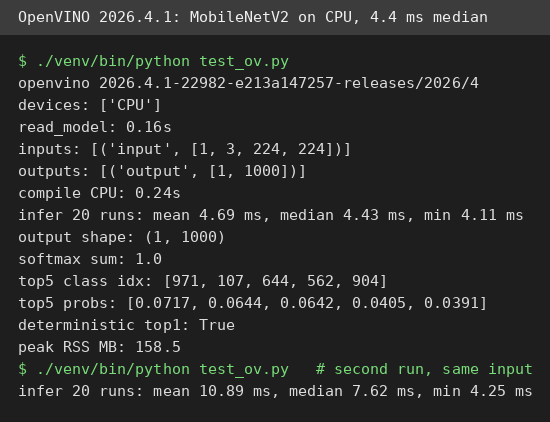
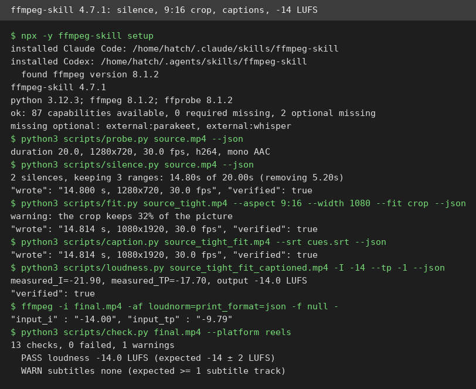
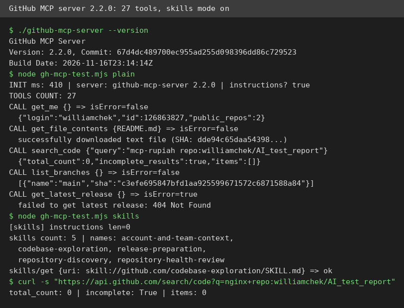

# AI Test Report — 2026-11-24
> A vision toolkit that runs in milliseconds on a plain CPU, a video skill that measures its own work, a lecture on how the Valley changed, and GitHub's own server learning skills.
## At a glance
- OpenVINO 2026.4.1, a free toolkit that runs AI vision models on an ordinary CPU, timed at 4.4 ms per image.
- Tim O'Reilly's "What Happened to Silicon Valley?", on how the Valley stopped creating value and started extracting it.
- ffmpeg-skill 4.7.1, a free skill that gives your coding agent a video editor, and makes it check its own work.
- GitHub MCP server 2.2.0, GitHub's own plug that lets an AI assistant read your repos, now with 18 workflow skills.
## 🆕 Open-source project tests
### OpenVINO — a free toolkit that runs AI vision models on an ordinary CPU ⭐4/5

- **In one sentence**: OpenVINO is Intel's free toolkit for running trained AI models fast on ordinary CPUs, no graphics card needed. It is 8th on GitHub Trending today with 12,287 stars.
- **Why it caught my eye**: The seven projects above it were already covered here, except Firecrawl, which needs Docker (a container system) and this VM has none, the same blocker as yesterday. OpenVINO is the next-ranked project I could actually run, and its promise is simple: no GPU (graphics card), no cloud, just speed.
- **I tried it**: I installed version 2026.4.1 with pip (a Python package installer) in a clean virtual environment, then loaded MobileNetV2 (a small image-recognition model) and ran it on this VM's CPU (an AMD EPYC chip, 4 cores shared).
  - The official model download links I tried first all returned a directory listing page instead of a file, for every version from 2023.0 to 2025.0, so I fetched the same model from the ONNX Model Zoo (a public model library) instead: 13.9 MB, plus a separate `onnx` package install.
  - The model ships with a flexible batch size, which OpenVINO refuses to compile, so I fixed the input shape to one 224 by 224 image first. Load took 0.16 seconds, compile for CPU took 0.24 seconds.
  - Over 20 timed runs, the median was 4.43 ms per image, mean 4.69 ms, fastest 4.11 ms. A repeat run of the same 20 gave a median of 7.62 ms, so treat single-run timings as approximate on shared hardware. Peak memory was 158.5 MB.
  - The output was a valid 1,000-class probability list (the numbers sum to 1.0), and the same input gave the same top answer twice.
  - What surprised me: the whole pipeline, install to first answer, took minutes, and the model itself is smaller than a phone photo. The slow part was finding a working download link, not the software.
- **The catch**: My test input was random noise, so the top answer (class 971, probability 0.07) means nothing. I verified speed and plumbing, not whether it recognises real photos correctly. You also need the `onnx` package for ONNX models, and the model zoo links in the docs are stale.
- **Try it if**: you want to run a vision model on a CPU you already own, with no cloud bill.
- **Skip it if**: you need a GPU-sized model, or you want one-click model downloads from the official zoo.
- **Score**: ⭐4/5 — the toolkit does its core job fast and quietly, but the stale download links cost a detour and I did not verify accuracy on real photos.
- **Link**: https://github.com/openvinotoolkit/openvino
## ✍️ Tech article deep-dives
### What Happened to Silicon Valley? — how the Valley stopped creating value and started extracting it
- **Read this if**: you build on AI platforms and want to know who the rules of that market really serve.
- **The argument in 3 bullets**:
  - The early web won by creating more value than it captured. Tim O'Reilly launched GNN, the first web portal, in 1993, and Google's early search monetised only about 6% of result pages, leaving the other 94% as free surplus for everyone.
  - The turn came from shareholder capitalism, the doctrine that a business exists to increase its profits, plus financialisation. O'Reilly splits rents (income above what you contributed) into "rising tide rents", where everyone gains, and "robber baron rents", where power lets you collect without contributing. Amazon now shows sixteen ads and four organic results on a typical search page, and a dollar of Tesla profit was once worth about $600 of stock market value, against $1 for a business that is not financialised.
  - AI skipped the virtuous youth. It was built by enclosing the commons (training on copyrighted work) and funded by trillions that demand a return, so it is pushed toward value capture before it finishes creating value. The fix he proposes is mechanism design (designing market rules so self-interested players still produce good outcomes for everyone): open protocols, portability, and interoperability.
- **Why it matters to you**: If you build on AI platforms, the market rules decide who captures the value: closed memory that locks your context inside one provider, closed weights, and toll-road APIs are mechanisms, and open interfaces are the defence.
- **My take**: The rent framework is the sharpest tool in the piece, and the two-economies image (operating economy versus betting economy) explains more about tech valuations than most market commentary. Cold water: the vivid numbers are single-source anecdotes, Hal Varian told him the 6% figure and the Amazon count is his own, so treat them as illustrations, not statistics. And the prescription names a direction, not a plan: he cites MCP as an example of an open mechanism, but offers no mechanism that exists today at scale.
- **Link**: https://www.oreilly.com/radar/what-happened-to-silicon-valley/ (published 2026-11-20; lecture delivered 2026-10-16 at Johns Hopkins University)
## 🛠️ Agent skill tests
### ffmpeg-skill — give your coding agent a video editor that checks its own work ⭐4/5

- **In one sentence**: ffmpeg-skill is a free set of 42 small programs that let a coding agent edit video with local FFmpeg (a free video toolkit). Every tool checks its own work after it runs.
- **Why it caught my eye**: It has 10,226 stars and a bold claim called verification-driven editing: every tool measures the file before and after, so the agent reports real numbers instead of claiming success blindly.
- **I tried it**: I installed version 4.7.1 with `npx ffmpeg-skill setup`, which put the skill into Claude Code and Codex, then ran its own workflow on a 20-second test clip I generated (16:9, tone, silence, tone).
  - Setup found ffmpeg 8.1.2, and its doctor check reported 87 capabilities available, 0 required missing, 2 optional missing (the Parakeet and Whisper transcription engines).
  - `silence.py` found both 3-second gaps and cut the clip from 20.00 to 14.80 seconds, keeping 0.2 seconds of margin at each gap, and said so in its summary line. It reported `"verified": true`.
  - `fit.py` cropped the clip to 1080 by 1920 for Reels, and warned that the crop keeps only 32% of the picture, exactly the warning its own gotcha list promises.
  - `caption.py` burned in my three cues, re-wrapping each to two lines without changing a word, and `loudness.py` moved the audio from minus 21.9 to minus 14.0 LUFS (a loudness scale), which I re-measured independently at minus 14.00.
  - `check.py` ran 13 Reels checks: 0 failed, 1 warning. A contact sheet from `look.py` showed all three captions legible, on time, and inside the frame.
  - What surprised me: the silence tool's honesty about the margins. It removed 5.20 seconds of 6.00 seconds of silence and told me why, instead of silently rounding.
- **The catch**: Transcription needs a separate engine install (Parakeet or Whisper), so I could not test the transcribe-and-caption path. Burned-in captions do not count as a subtitle track, which is the one warning `check.py` raised. Every step re-encodes the video except loudness, which copies the picture stream untouched.
- **Try it if**: your agent edits video and you are tired of it claiming "done" without measuring anything.
- **Skip it if**: you only trim clips by hand, or you need transcription working out of the box.
- **Score**: ⭐4/5 — every tool I ran reported measured numbers and verified, but the transcribe path needs an extra install I did not test.
- **Link**: https://github.com/kajisho5/ffmpeg-skill
## 🔌 MCP tests
### GitHub MCP server 2.2.0 — GitHub's own plug that lets an AI assistant read your repos ⭐4/5

- **In one sentence**: The GitHub MCP server is GitHub's official program that lets an AI assistant read (and change) repositories, issues, and pull requests through MCP (a plug that lets an AI drive a program). Version 2.2.0 adds 18 workflow skills.
- **Why it caught my eye**: Released 16 November 2026, it is the first version where skills replace the server's instruction block, and it adds tools for Copilot automations. A server that teaches the agent how to work, not just what it can call, is the direction the whole MCP ecosystem is moving.
- **I tried it**: I downloaded the 9.5 MB Linux binary and ran it in read-only mode with a token scoped to two of William's repos, driving it with a small test client.
  - The handshake answered in 410 ms, naming itself github-mcp-server 2.2.0, and `tools/list` showed 27 read tools.
  - `get_me` returned the account williamchek (2 public repos), `get_file_contents` fetched this report's README (SHA dde94c65daa54398b20bc62a2af35ad581246828), and `list_branches` showed main at c3efe695847bfd1aa925599671572c6871588a84.
  - `get_latest_release` failed cleanly with a 404, which is correct: the repo has no releases.
  - With `--features=skills`, the instruction text dropped to empty, exactly as documented, `skills/list` returned 5 skills (the catalog filters itself to the tools your connection allows, so 5 of 18 under read-only defaults), and `skills/get` by URI returned the full codebase-exploration skill.
  - What surprised me: the filtering. The skill list is not fixed: it follows your toolset, so a restricted connection sees a smaller catalog without any error.
- **The catch**: `search_code` returned 0 hits for "mcp-rupiah" and "nginx", both words present in the repo's 2026-11-23 report. A direct API call with the same token returned the same empty result, so the miss sits with GitHub's search API or the token, not the server, but it means code search is unreliable here. Write tools were excluded by read-only mode, so I did not test them.
- **Try it if**: you want your agent to read GitHub through an official, narrowly scoped connection.
- **Skip it if**: you need code search to work reliably on small repos, or you will not scope a token narrowly.
- **Score**: ⭐4/5 — the headline skills feature works exactly as documented, but code search came back empty twice on terms that are in the repo.
- **Link**: https://github.com/github/github-mcp-server
## Notes
- Firecrawl was again the highest-ranked uncovered project (6th on Trending), but this VM has no Docker and the self-hosted stack needs it, the same blocker as yesterday, so OpenVINO (8th) was tested instead. Firecrawl is not marked as covered.
- OpenVINO's model download links in the docs are stale: the storage paths for versions 2023.0 through 2025.0 all return a directory listing page. The model for this test came from the ONNX Model Zoo instead.
- The stitch snapshot's bare-relative CSS path gap from yesterday is still open: its filter skips `url("bg.png")` while accepting `url("./bg.png")`.
