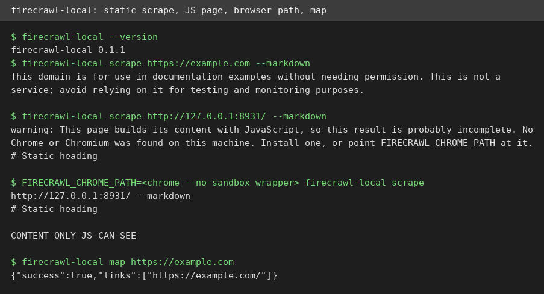
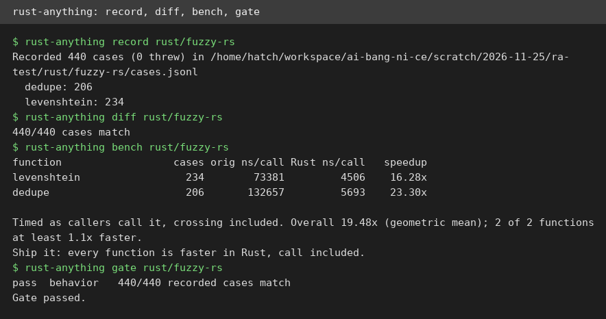
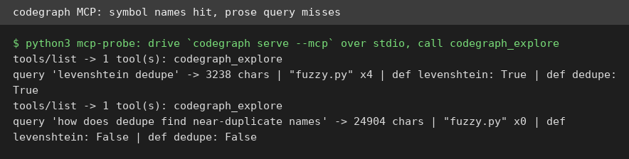

# AI Test Report — 2026-11-25

> Three tools that promise to check your AI's work, and one essay on why the checking is the whole job

## At a glance

- **Firecrawl Local** — turn any website into clean text on your own machine, no account needed.
- **Six Months of Enterprise Development with AI** — six months of agent-written code, measured: most fixes were not in the code at all.
- **rust-anything** — move slow code into a faster language, one function at a time, and prove it still behaves the same.
- **CodeGraph** — a map of your code your agent can question, but ask with function names, not plain sentences.

## 🆕 Open-source project tests

### Firecrawl Local — turn any website into clean text on your own machine ⭐4/5

- **In one sentence**: Firecrawl Local is one program that turns a web page into clean markdown (simple formatted text), with no account and nothing running in the background.
- **Why it caught my eye**: it gained 991 stars today and now sits at 208,943 stars, and the new Local version promises the core of a popular scraping service without the service: no database, no queue, no container, just one binary.
- **I tried it**: I installed it with `cargo install firecrawl-local` (version 0.1.1) and ran `firecrawl-local scrape https://example.com --markdown`, which returned the page as markdown in about 2 seconds. I built a test page where JavaScript (code that runs in the browser) writes text into the page, and without a browser installed it warned me the result was probably incomplete, and the JavaScript text was indeed missing. Pointing it at a Chrome binary with a `--no-sandbox` wrapper made the JavaScript text appear, warning gone. `firecrawl-local map https://example.com` returned the site's one link. What surprised me: the first install failed, not on Firecrawl's code but because this machine's `/tmp` folder holds only 512 MB and the build filled it; moving the build folder elsewhere fixed it.
- **The catch**: installing from source took about 25 minutes of compiling, and you need a Rust toolchain (the tools that build Rust programs) first. JavaScript pages need Chrome, and on a machine that runs as root, Chrome refuses to start unless you wrap it with `--no-sandbox`. The built-in web server (`firecrawl-local serve`, port 3002) refused to fetch pages here: its safety check tripped on this sandbox's outbound proxy, while the command-line scrape of the same page worked fine. Search and structured JSON still go to Firecrawl's cloud.
- **Try it if**: you're a builder who wants web pages as markdown for an agent, on your own machine, with no signup.
- **Skip it if**: you need structured data, screenshots, or search; those live on the paid cloud side.
- **Score**: ⭐4/5 — the local scrape, map, and browser paths all did what the docs promised, but the long compile and the Chrome wrangling cost it a star.
- **Link**: https://github.com/firecrawl/firecrawl

## ✍️ Tech article deep-dives

### Six Months of Enterprise Development with AI — where the bugs in agent-written code really live

- **Read this if**: you let agents write most of your code and wonder what breaks first.
- **The argument in 3 bullets**:
  - Code got cheap, judgment did not: one engineer shipped about 1,200 commits, 594 stories, and 117 architecture decisions in six months, and the work that stayed human was deciding what to build and checking the result.
  - Agents amplify whatever structure you give them: one command-line tool built with no design theory grew to 96,000 lines, with 51% of its commits being fixes or rewrites, against 32% elsewhere.
  - The fix is mechanical checks, not better prose: 272 automated guards (small rules that fail the build when violated) now enforce the design, and three quarters of all fixes were infrastructure (cloud setup, permissions, drift), not application logic.
- **Why it matters to you**: if your agent writes code, your next hire is not a better model but a set of checks that run without the model. Unchecked rules are wishes: the agent kept reporting that it followed the design while quietly breaking it.
- **My take**: the numbers are unusually honest, including the misses (story points predicted nothing, r = 0.12, and 99% of tokens went to re-reading context). The cold water: this is one engineer's private codebase, so treat the exact percentages as one data point, not an industry law.
- **Link**: https://alexdjalali.github.io/posts/six-months-of-enterprise-development-with-ai/

## 🛠️ Agent skill tests

### rust-anything — move slow code into a faster language, one function at a time, and prove it still behaves the same ⭐5/5

- **In one sentence**: rust-anything records what your code does today, then checks each Rust rewrite (a faster systems language) against that recording before you ship it.
- **Why it caught my eye**: it is the fastest-rising skill this week, up 505% in seven days to about 9,200 stars, and it makes a bold promise: it does not translate code, it proves the rewrite.
- **I tried it**: I ran `rust-anything analyze` on the project's own 20-line Python demo (a near-duplicate name finder), and it ranked the unit ready to port with a 98 readiness score. `rust-anything record` generated 440 test cases, including nasty Unicode (a form of text encoding) traps like Turkish dotted capitals, emoji, and Japanese text. I wrote the Rust port myself, following the skill's guide, and `rust-anything diff` replayed all 440 cases through the Rust version: 440 matched. `rust-anything bench` timed both: the Rust version ran 16 to 23 times faster per function, 19.5 times overall. What surprised me: `profile` found the hot function in one pass, reporting 79,800 calls taking 98% of the runtime, before I ported anything. `rust-anything gate` passed all 12 checks on the second run, after I installed the formatting and lint tools it asked for.
- **The catch**: you need a Rust toolchain installed, and the one-command `go` flow hands the port to a coding agent such as Claude Code, which this machine does not have; I played the agent myself. The proof is only as good as the recording: behavior the cases never exercise stays unverified.
- **Try it if**: you're a developer with a slow Python or JavaScript hotspot and a few hours to prove a Rust port correct.
- **Skip it if**: you want a one-click rewrite; the skill gives you the procedure, and you (or your agent) still write the Rust.
- **Score**: ⭐5/5 — every claim I tested checked out, from the 440 matching cases to the measured speedup.
- **Link**: https://github.com/erkamyaman/rust-anything

## 🔌 MCP tests

### CodeGraph — a map of your code your agent can question, but ask with function names, not plain sentences ⭐4/5

- **In one sentence**: CodeGraph reads your code once, builds a map of which function calls which, and lets an AI assistant query that map instead of re-reading files.
- **Why it caught my eye**: it has about 79,000 stars, it indexes locally with no code leaving your machine, and it exposes the map through MCP (a standard plug for AI assistants to use outside tools).
- **I tried it**: I installed 1.6.4 with `npm i -g @colbymchenry/codegraph` and ran `codegraph init` on a real 881-file project; it indexed 16,818 symbols and 64,311 connections in 2 minutes 16 seconds into a 78 MB database. The command line answered `codegraph query levenshtein` with the exact file and line, and `codegraph callers dedupe` with its callers. I then drove the MCP server (`codegraph serve --mcp`) with a small script: it shakes hands, lists exactly one tool, `codegraph_explore`, and answers function-name questions with the right source. What surprised me: asking the same question in plain prose ("how does dedupe find near-duplicate names") returned 24,904 characters that never once mentioned the functions, while the function-name version found both in 3,238 characters.
- **The catch**: the one MCP tool's ranking is the weak spot: prose questions drown in generic matches, so agents must ask with function names. Usage telemetry (anonymous use statistics) is on by default, which sits oddly next to the "100% local" claim; `codegraph telemetry off` stops it, and I turned it off here. The MCP surface is a single tool, so anything beyond exploring needs the command line.
- **Try it if**: you're a developer whose agent burns tokens re-reading a big repo, and you will teach it to ask with function names.
- **Skip it if**: you want an agent to ask open questions in plain English; that path misses today.
- **Score**: ⭐4/5 — the index is fast and accurate, and the MCP server works, but the prose-query miss is exactly where an agent would stumble.
- **Link**: https://github.com/colbymchenry/codegraph

## Notes

- Firecrawl Local's `serve` path failed in this sandbox because the outbound proxy trips its safety check; the CLI path worked in the same sandbox. Worth re-checking on a machine without a proxy.
- Firecrawl Local does not serve the `json` or `summary` formats, and ignores browser `actions`. Crawl, PDF, and Office parsing were not tested today.
- rust-anything's agent-driven `go` flow was not tested (no Claude Code or Codex on this machine); the manual loop was tested end to end instead.
- CodeGraph's prose-query ranking miss is reproducible: two phrasings of the same question, one hit and one miss, on the same index.
- The 2026-11-24 run left a pending approval card asking to send data to Google Analytics; it did not block publication and is still undecided. Ignore or reject it, never approve blindly.
