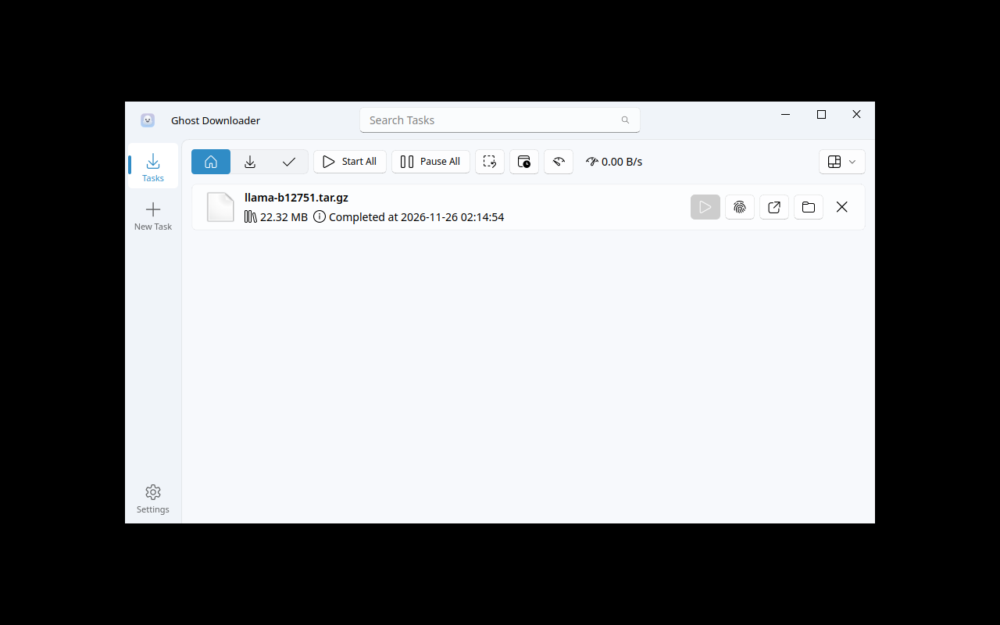
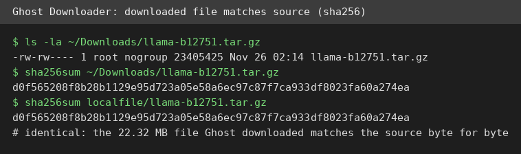
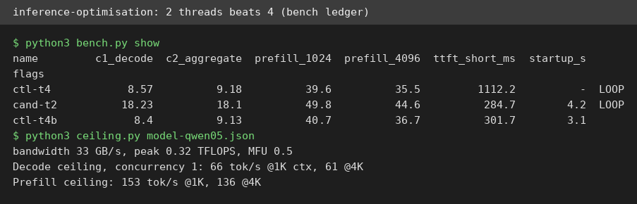

# AI Test Report — 2026-11-26

> Fewer threads ran twice as fast, a downloader proved itself on a local file, and one maintainer's 10-month diary of letting agents write his code

## At a glance

- **Ghost-Downloader-3** — one app that downloads files, torrents, and videos, tested on Linux with a real file.
- **Agentic coding on an open-source project** — a maintainer's 10-month diary: 70 billion tokens, 300 components moved, and the costs nobody quotes.
- **inference-optimisation-skill** — a method that finds your model's speed limit first, then tests one change at a time.
- **Archestack MCP** — ask your coding agent which open-source tool fits, and get a checked answer instead of a guess.

## 🆕 Open-source project tests

### Ghost-Downloader-3 — one app that grabs files, torrents, and videos ⭐4/5

- **In one sentence**: Ghost Downloader is a free desktop app (a program with windows and buttons) that downloads files over HTTP (plain web downloads), BitTorrent (peer-to-peer sharing), FTP (an old file-transfer method), and video sites, all in one place.
- **Why it caught my eye**: it gained 951 stars today and sat at #15 on GitHub Trending, the first entry I could actually run on this machine, and it promises to replace five download tools with one 62 MB download.
- **I tried it**: I downloaded the v4.6 Linux release (62 MB) and unpacked it. It refused to start until I installed three missing system libraries (`libxcb-cursor0`, `libxkbcommon-x11-0`, `libxcb-icccm4`, plus friends), then it opened under a virtual display. I skipped the setup wizard, clicked New Task, and pasted a test URL. The first URL, an external speed-test file, timed out: this sandbox blocks direct internet, and the app does not use the sandbox proxy. I served a 22.32 MB file from this machine itself (a local web server) and pasted that address instead. The app parsed it (22.32 MB), downloaded it with 8 threads, and marked it Completed at 02:14:54. What surprised me: the downloaded file matched the original byte for byte (same SHA-256 fingerprint, a long code that identifies a file's exact contents), and the app showed the failure honestly in its dialog instead of failing silently.
- **The catch**: on a bare Linux box, expect to install missing Qt libraries (the toolkit the app's windows are built with) before it starts. It ignores proxy settings, so it cannot download at all behind a proxy that requires one. I could not test video, torrent, or M3U8 downloads here, only plain HTTP.
- **Try it if**: you're a Windows, Mac, or Linux user who wants one download manager for files, torrents, and videos.
- **Skip it if**: you download behind a corporate proxy, or you only need plain browser downloads.
- **Score**: ⭐4/5 — the app launched, parsed, downloaded, and verified a real file, but the bare-Linux setup friction and the missing proxy support cost it a star.
- **Link**: https://github.com/XiaoYouChR/Ghost-Downloader-3

## ✍️ Tech article deep-dives

### Agentic coding on an open-source project — a maintainer let agents rebuild his app for 10 months, and kept the receipts

- **Read this if**: you let coding agents write your code and want to know what breaks after the demo wears off.
- **The argument in 3 bullets**:
  - Short prompts and many small rounds beat long specifications: the author never writes detailed specs, iterates instead, and moved a 300-component frontend (the part of the app you see and click) to a new style, added 6,500 tests, and cleared 50 old issues in days.
  - Scripts are contracts: for data moves, he makes the agent write a script (a small program that runs the same way every time) with a dry run (a trial that changes nothing) instead of letting it touch the database directly.
  - More output is not more progress: agents push endless improvements, reviews get noisy, and model quality shifts without warning, so he caps the work and reviews critical code himself.
- **Why it matters to you**: the numbers are unusually concrete (70 billion tokens, about $2,000 on a fixed subscription versus about $30,000 at per-use prices), so you can judge the trade for a small team, not a tech giant.
- **My take**: the most useful part is the honesty about what agents miss: his own security audits missed flaws that outside researchers later found, and his closing section on labour, resources, and dependence is bleaker than the cheerful middle. The cold water: this is one five-person team on a subscription, so the cost math does not transfer to per-use pricing, and the token counts say nothing about code quality.
- **Link**: https://blog.frankrousseau.fr/agentic-coding-on-an-open-source-project/

## 🛠️ Agent skill tests

### inference-optimisation-skill — a checklist that finds your model's speed limit before you start tuning ⭐4/5

- **In one sentence**: this skill is a written method (a step-by-step guide plus small scripts) that measures how fast a local AI model could ever run, then tests one change at a time against that limit.
- **Why it caught my eye**: its author reports about 588 stars on its first day, and its central claim, measure the ceiling first, is the opposite of how most tuning works.
- **I tried it**: I ran the ceiling script for a small model (Qwen2.5-0.5B, half a billion parameters, the numbers the model learned) on this 4-core VM: it put the decode ceiling at 66 tokens a second (a token is roughly a word piece) and the prefill ceiling at 153. I ran the bench script three times with the same model on llama.cpp (a program that runs AI models on your own machine): 4 threads, then 2 threads, then 4 threads again, 6 samples each. What surprised me: 2 threads ran at 18.23 tokens a second, more than double the 4-thread runs (8.57 and 8.4). On this box, which reports 4 cores but only has 1.5 CPUs to share, 4 threads fight each other. The skill's own rules saved the result: the first 4-thread control ran while I was installing software, so its first-answer time (1,112 ms) was polluted; the clean repeat (302 ms) matched the 2-thread run, and the method says to trust the repeat.
- **The catch**: the scripts assume a GPU machine in places (the memory probe and job queue need adapting for CPU-only boxes); the multi-stream ceiling math looks loose (it promises more than twice the single-stream rate); and the tiny model sometimes fell into repeating itself, which the bench correctly flagged.
- **Try it if**: you run a local model and want numbers, not vibes, for which setting is actually faster.
- **Skip it if**: you only use hosted APIs, where none of these knobs exist.
- **Score**: ⭐4/5 — the method found a real 2.1x win and caught my own polluted control, but the GPU-first assumptions and the loose multi-stream ceiling cost it a star.
- **Link**: https://github.com/sybil-solutions/inference-optimisation-skill

## 🔌 MCP tests

### Archestack MCP — ask your coding agent which open-source tool fits, and get a checked answer ⭐4/5

- **In one sentence**: Archestack MCP (MCP is the shared plug for connecting AI tools) is a small server (a helper your coding agent can question) that answers which open-source AI tool fits your limits, using a ranking that refreshes twice a day.
- **Why it caught my eye**: it appeared in the official MCP registry on Nov 22, needs no key and no account, and promises facts with dates instead of the model's stale memory.
- **I tried it**: I installed it with npx (a tool that runs Node programs without installing them first) and spoke to it directly over stdio (the plain text channel programs use to talk): it answered the handshake in 3.5 seconds and listed all 11 tools. I asked what rose this week: t3code gained 14,006 stars, and the data was dated Nov 25, yesterday, not the stale October date in the README example. I asked whether Qdrant, a database for similarity search (finding items by meaning), fits an 8 GB Raspberry Pi (a tiny single-board computer) with no GPU: it said "fits, but unknown", because the minimum RAM is not stated, and it gave the exact Docker command (Docker is a tool that runs apps in sealed boxes) plus the warning that the default setup has no password. What surprised me: checking one repo (ruvnet/ruflo) returned a real safety report, 15 of 18 checks passed, with the 3 failures named and linked.
- **The catch**: the project is brand new and tiny (0 stars, 41 commits), so the rankings are one team's lens, not raw GitHub; and the free hosted version can run out of requests late in the day.
- **Try it if**: you let an agent pick libraries and want it to check facts first.
- **Skip it if**: you already track the ecosystem yourself and trust your own shortlist.
- **Score**: ⭐4/5 — every tool answered fast with fresh, sourced facts, but the project is too new to lean on blindly.
- **Link**: https://github.com/archestack/mcp

## Notes

- OpenSRE, the next project on Trending (#13, 348 stars today), could not be tested: its installer failed a safety check in this environment, so I stopped there and took the next testable project instead. AFFiNE (#14) needs Docker, which this VM does not have.
- The trending page listed only 16 projects today, and the top 12 were all covered in earlier editions.
- Ghost's external downloads could not be tested here because this sandbox blocks direct internet and the app does not read proxy settings; the local download verified the engine end to end.
- The skill's multi-stream ceiling row looks optimistic; I reported only the single-stream ceiling (66 tokens a second).
